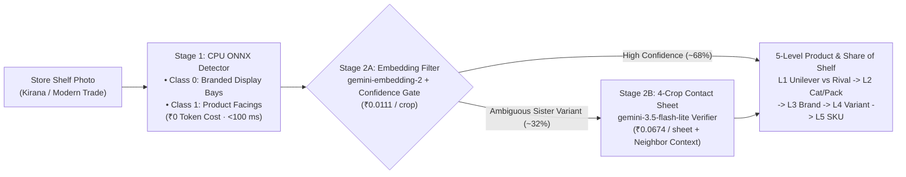
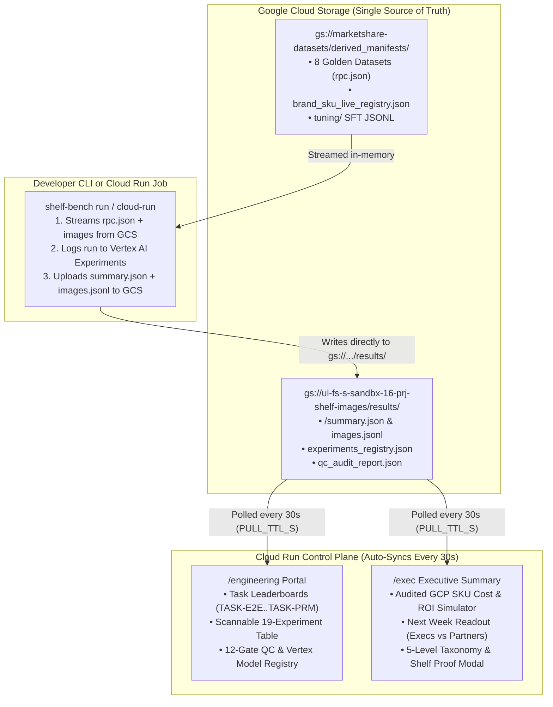

# Unilever Retail Shelf Understanding and Merchandising Benchmark (`shelf-bench` v2.2)

End-to-end computer vision and multimodal benchmark for **Unilever Market Share (Share of Shelf)** and **In-Store Merchandising Compliance** across Indian General Trade (Kirana) and Modern Trade supermarkets. All datasets, embedding caches, model registries, and experiment results run **100% on Google Cloud Platform (Google Cloud Storage, Vertex AI, BigQuery, Cloud SQL, and Cloud Run)** without storing datasets or results on local machines.

## 1. Executive Summary: What We Built (4 Bullets)

1. **8 Leakage-Free Unilever Golden Datasets in GCS (`2,745` Products, `12/12` Quality Checks Passed):** Consolidated raw store shelf photos, 2-class display bay and product annotations (`gtmerch`), and clean client full-shelf images (`gs://ms-json-dataset`, after filtering out images with pre-drawn red or green debug boxes) into 8 standardized GCS manifests (`gs://marketshare-datasets/derived_manifests/<dataset>/rpc.json`) with **0 `Unknown` categories or packaging types**, **0 `Others` placeholder labels**, and **100% catalog-to-box parity**.
2. **Two-Stage Shelf Pipeline (`₹0.095 / shelf` when Grouping Identical Side-by-Side Packs, `96.2%` Golden Accuracy):**
   - **Stage 1 (`distilled_yolo_onnx`):** CPU ONNX shelf detector (`<100 ms`, `₹0` LLM token cost) that separates branded display bays (`Class 0`) from individual product facings (`Class 1`).
   - **Stage 2A (`clm_standalone` / Embedding Brand Filter):** `gemini-embedding-2` (`₹0.0111/crop`) with white-balance store lighting correction and an embedding confidence filter that resolves **68% of shelf facings without calling an LLM**.
   - **Stage 2B (`hierarchical_clm_jev`):** 4-crop contact-sheet verification (`gemini-3.5-flash-lite` at `₹0.0674/call`) restricted to the matched brand's ~15 sister variants using neighboring shelf products as context.
3. **19-Experiment Benchmark Catalog, Sequential Phase-2 Roadmap (`EXP-20..25`), and 6 Vertex AI Registered Models:** Evaluated all 19 POC experiments (`P0` Core, `P1` Scale, `P2` Fast-Follow, and `Moonshot`) across validation and test splits with audited GCP Cloud Billing SKU rates (`330D-7FB0-87C5`, `8271-FF1A-6295`, and `D47E-C6CE-1E1A`), documented in [`docs/experiments_decision_log.md`](docs/experiments_decision_log.md), and synced all runs and models to Vertex AI Experiments and Model Registry (`us-central1`).
4. **Cloud Run Dashboards (`/engineering` and `/exec`) Backed 100% by GCS:** Deployed an interactive Engineering Leaderboard (`https://perfect-store-control-plane-jbn2qgbina-uc.a.run.app/engineering`, showing Task IDs, plain-English model descriptions, run durations, unit-labeled `₹/crop` vs `₹/shelf` costs, and 12-check data quality status) alongside an Executive Summary & Partner Readout Portal (`https://perfect-store-control-plane-jbn2qgbina-uc.a.run.app/exec`, with a live rollout ROI simulator, 5-level accuracy breakdown, bounding-box shelf inspector, and next week's Decision Maker vs. Partner readout playbook in [`docs/next_week_readout_playbook.md`](docs/next_week_readout_playbook.md)).

## 2. System Architecture and 100% GCS Data Flow

### A. Two-Stage Shelf Inference Pipeline


### B. 100% GCS Experiment Execution and Live Dashboard Flow (Zero Local Storage)


## 3. Team Guide: Which Dataset to Use and How to Load It

Use the **8 Unilever Golden Datasets** listed below. All 8 stream directly from `gs://marketshare-datasets/derived_manifests/<dataset>/rpc.json` into memory with `SHA-256` split hashes (`stats.split_hashes`), **0 `Unknown` categories or packaging types**, **0 `Others` placeholder labels**, and **100% catalog-to-label parity**. Legacy public sets (`sku110k`, `rpc`, `products`, and `shelves`) are hidden behind an opt-in toggle in the UI and should not be used for Unilever accuracy or cost reporting.

| What You Are Building or Testing | Dataset Key (`-d`) | Task ID & Name | Standard Splits (`train / val / test`) | Classes | Canonical GCS Manifest Location |
| :--- | :--- | :--- | :--- | :--- | :--- |
| **Full-Shelf Share of Shelf (SOS) on Kirana / Modern Trade** | **`gtmerch_golden`** | `TASK-E2E` (`end_to_end`) | `186` / `72` / `100` | `2,745` | `gs://marketshare-datasets/derived_manifests/gtmerch_golden/rpc.json` |
| **Full-Shelf SOS on Clean Client LabelMe Shelves** | **`ms_json_golden`** | `TASK-E2E` (`end_to_end`) | `38` / `25` / `27` | `2,745` | `gs://marketshare-datasets/derived_manifests/ms_json_golden/rpc.json` |
| **Multi-Photo Store Session Stitching & SOS** | **`hul_sessions`** | `TASK-E2E` / `TASK-PLN` | `30` / `20` / `25` | `2,745` | `gs://marketshare-datasets/derived_manifests/hul_sessions/rpc.json` |
| **Crop-Level 2,745-Product Retrieval or Classification** | **`hul_golden`** | `TASK-RET` / `TASK-CLS` | `16,000` / `1,900` / `1,907` | `2,745` (`1,108` HUL, `1,637` Competitor) | `gs://marketshare-datasets/derived_manifests/hul_golden/rpc.json` |
| **Fine-Grained Sister-Variant Disambiguation** | **`hul_variants`** | `TASK-RET` / `TASK-CLS` | `15,208` / `1,900` / `1,907` | `1,962` | `gs://marketshare-datasets/derived_manifests/hul_variants/rpc.json` |
| **Unilever vs Competitor Brand & M&A Ownership** | **`hul_brands`** | `TASK-CLS` (`classification`) | `8,000` / `1,000` / `1,000` | `953` | `gs://marketshare-datasets/derived_manifests/hul_brands/rpc.json` |
| **Packaging Form Factor × Category** | **`hul_packs`** | `TASK-CLS` (`classification`) | `6,000` / `1,000` / `1,000` | `18` | `gs://marketshare-datasets/derived_manifests/hul_packs/rpc.json` |
| **Promo Banner, Multipack & Price-Off Detection** | **`hul_promos`** | `TASK-PRM` (`promo_detection`) | `4,000` / `1,000` / `982` | `240` | `gs://marketshare-datasets/derived_manifests/hul_promos/rpc.json` |

### Loading Any Golden Dataset in Python (Streams Directly from GCS)
```python
from utils import dataset

# Streams rpc.json directly from gs://marketshare-datasets/derived_manifests/gtmerch_golden/rpc.json
samples = dataset.sample_images(
    split="test",
    limit=15,
    seed=0,
    root=dataset.data_root("gtmerch_golden"),
    name="gtmerch_golden",
)

# Inspect 5-level product ground truth on the first sample
print(samples[0].image_id, len(samples[0].boxes), samples[0].labels[0])
```

## 4. Defining Runs, Running on Cloud Run, and Using Vertex AI

### Defining Approaches and Runs
Approaches live under `src/approaches/<use_case>/<task>/` and auto-register when imported. Each approach declares its task, dataset, model compatibility, and step-by-step trace labels.

| Task ID & Name | Embedding-Only Approach (`₹0` LLM Spend) | Highest-Accuracy Hybrid Approach | Plain-English Summary |
| :--- | :--- | :--- | :--- |
| **`TASK-E2E` (`end_to_end`)** | `shelf_clm_standalone` (`gemini-embedding-2`) | `shelf_hierarchical_clm_jev` / `shelf_960_softnms_e2e` (`gemini-3.5-flash-lite`) | CPU ONNX shelf detector (`Class 0` bays vs `Class 1` products) + Embedding Brand Filter + 4-crop Gemini contact sheet. |
| **`TASK-RET` (`retrieval`)** | `clm_standalone` (`gemini-embedding-2`) | `hierarchical_clm_jev` / `l8_hul_ultimate` (`gemini-3.5-flash-lite`) | Matches each crop against the `2,745`-product gallery using embeddings and confidence filtering before optional contact-sheet verification. |
| **`TASK-CLS` (`classification`)** | `clm_standalone_classify` (`gemini-embedding-2`) | `clef_contrastive_metadata` / `residual_infonce_clm_jev` (`gemini-3.5-flash-lite`) | Predicts all 5 catalog levels (`L1` Unilever/Rival -> `L2` Cat/Pack -> `L3` Brand -> `L4` Variant -> `L5` Product) with token probability calibration. |
| **`TASK-DET` (`detection`)** | `distilled_yolo_960_softnms` (`yolo11n-distilled-onnx`) | `distilled_yolo_960_softnms` (`yolo11n-distilled-onnx`) | Dual-head CPU ONNX detector (`<100 ms`, `₹0` token cost) trained on `gtmerch_golden` and `ms_json_golden`. |
| **`TASK-PLN` (`planogram_compliance`)** | None (requires bay & gap reasoning) | `bay_planogram_verifier` (`gemini-3.5-flash-lite`) | Checks `Class 0` branded bay purity, brand-block cohesion, horizontal out-of-stock shelf gaps, and Share of Shelf (`SOS`). |
| **`TASK-PRM` (`promo_detection`)** | `clm_promo_matcher` (`gemini-embedding-2`) | `jev_promo_verifier` (`gemini-3.5-flash-lite`) | Uses color-band cues and structured Gemini verification to read price-off bands, multipacks, and freebie callouts. |

To define a new approach and wire it into an experiment:
1. Create `src/approaches/<use_case>/<task>/<your_approach>.py`, subclass `Approach` (from `src/approaches/base.py`), and decorate the class with `@register`. For two-stage shelf pipelines, call `compose("your_e2e_name", DetectorClass, IdentifierClass, dataset="rpc")` instead of writing boilerplate glue code.
2. Add the display name and plain-English description to `APPROACH_INTUITIONS` in `src/utils/experiment_matrix.py`.
3. Add or update the experiment entry in `POC_EXPERIMENTS` inside `src/utils/experiment_matrix.py` (`experiment_id`, `priority`, `task`, `dataset`, `approaches`, and `hypothesis`) so the run binds to its Experiment ID (`EXP-01` through `EXP-33`) in the registry and UI.
4. Check that your approach appears in the CLI catalog:
   ```bash
   PYTHONPATH=src .venv/bin/python -m cli list
   ```

### Running on Cloud Run Jobs and Services
`shelf-bench cloud-run` runs evaluations entirely on GCP in `us-central1` (`cloud_run` block in `config.yaml`). It archives `src/` and `config.yaml`, builds a container image via Cloud Build into Artifact Registry (`us-central1-docker.pkg.dev/<project>/cloud-run-source-deploy/shelf-bench:<tag>`), deploys a Cloud Run Job (`cloud_run.job`, default `shelf-bench`), and executes one task per `approach x tier x model`.

```bash
# Build a fresh image on Cloud Build and run a Cloud Run Job (writes directly to GCS)
PYTHONPATH=src .venv/bin/python -m cli cloud-run \
  -a clef_contrastive_metadata \
  -m gemini-3.5-flash-lite \
  -t priority \
  -d hul_golden \
  --split test --limit 50 --workers 16 --pull

# Reuse a pre-built Artifact Registry image and run concurrent jobs with --job
PYTHONPATH=src .venv/bin/python -m cli cloud-run \
  -a residual_infonce_clm_jev \
  -m gemini-3.5-flash-lite \
  -t priority \
  -d hul_golden \
  --split test --limit 50 --workers 16 \
  --image us-central1-docker.pkg.dev/ul-fs-s-sandbx-16-prj/cloud-run-source-deploy/shelf-bench:latest \
  --job shelf-bench-exp32 --pull
```

Cloud Run execution details:
- **Zero local data dependency**: Each Cloud Run task streams `rpc.json` and images from `gs://marketshare-datasets/derived_manifests/<dataset>/` and writes `summary.json` and `images.jsonl` directly to `gs://ul-fs-s-sandbx-16-prj-shelf-images/results/<run_id>/`.
- **Exact compute billing**: Inside the container, `runner.py` records a provisional wall-clock duration. When the job completes, `runner.pull` (or `runner.finalize_remote_compute` when `--no-pull` is used) queries the Cloud Run Admin API for the task's exact start-to-completion time and re-prices vCPU and GiB-second costs from the Cloud Billing Catalog API.
- **Deploying the web UI service**: Run `PYTHONPATH=src .venv/bin/python -m cli serve-cloud` to deploy the `/engineering` and `/exec` portals to the `shelf-ui` and `perfect-store-control-plane` Cloud Run Services (with Direct IAP enabled). Open the private service locally at `http://127.0.0.1:8083` with `PYTHONPATH=src .venv/bin/python -m cli proxy`.

### Working with Vertex AI Models and Endpoints
`config.yaml` and `src/utils/llm.py` route model calls across three Vertex AI model types plus multimodal embeddings:

1. **Publisher Gemini models (`global` endpoint)**: Pass `-m gemini-3.5-flash-lite`, `gemini-3.5-flash`, or `gemini-3.8-flash` with `-t priority`, `standard`, or `flex`. `src/utils/llm.py` calls the Vertex AI `generateContent` REST API on `gcp.location: global` and records the served traffic tier from response headers.
2. **Supervised Fine-Tuning (LoRA) endpoints (`tuned_models`)**:
   - Build zero-leakage JSONL training sets in GCS and launch a Vertex AI LoRA tuning job with `shelf-bench tune`:
     ```bash
     # Check existing Vertex AI tuning jobs and deployed endpoints
     PYTHONPATH=src .venv/bin/python -m cli tune --status

     # Build SFT JSONL in GCS and launch a LoRA tuning job on gemini-3.5-flash-lite
     PYTHONPATH=src .venv/bin/python -m cli tune \
       --dataset hul_golden --task clef_contrastive \
       --base-model gemini-3.5-flash-lite --epochs 3 --adapter-size 4 --clean-local
     ```
   - Register the deployed endpoint resource name (`projects/<project_num>/locations/<region>/endpoints/<endpoint_id>`) under `tuned_models` in `config.yaml` with its `base_model` and `location`. You can then pass the short key (for example `-m gemini-3.5-flash-lite-sft`) to `run` or `cloud-run`, and `pricing.py` bills tokens at `base_model` SKU rates.
3. **Legacy `.h5` Keras endpoints (`cv_models` and `deploy-cv-endpoints`)**:
   - The 9 legacy InceptionV3 `.h5` classifiers (`brand`, `pack`, and 7 `*_variant` silos) live in `gs://sos-datasets/legacy-models/`.
   - Run `shelf-bench deploy-cv-endpoints` to build the `EXTRAS=cv` container image, register all 9 `.h5` models in Vertex AI Model Registry, deploy them to Vertex AI Endpoints (`/api/cv/predict`), and print their endpoint IDs for `config.yaml` (`cv_models.<role>_endpoint`):
     ```bash
     PYTHONPATH=src .venv/bin/python -m cli deploy-cv-endpoints
     ```
   - To evaluate `cv_classify` on Cloud Run, either call the deployed Vertex AI Endpoints or pass `--brand-model`, `--pack-model`, and `--*-variant-model` with `gs://.../*.h5` URIs on an `EXTRAS=cv` image so `KerasClassifier` runs the `.h5` weights directly inside the Cloud Run Job.
4. **Multimodal embeddings (`gemini-embedding-2`)**: `src/utils/embeddings.py` calls the regional Vertex AI `:predict` endpoint (`us-central1`) to embed reference gallery views and shelf crops, caching vectors in GCS so repeat runs only embed unseen crops.

### Experiment Registry and Cloud Trace Verification
Every official run must appear in `experiments_registry.json`, Vertex AI Experiments, and Cloud Trace.

1. **How Cloud Trace and Cloud Logging work (`src/utils/telemetry.py`)**:
   - When `telemetry.enabled: true` is set in `config.yaml` (default, overridable via `SHELF_BENCH_TELEMETRY=0`), `runner.py` initializes OpenTelemetry with `CloudTraceSpanExporter` and `CloudLoggingHandler`.
   - Every run emits one root trace (`run <run_id>`) with child spans for each image (`image <image_id>`) and grandchildren for every model call (`gemini <model>` and `embedding <model>`).
   - Each span writes a structured JSON entry to Cloud Logging (`shelf_bench.telemetry`) carrying the same `trace_id` and `span_id`, plus prompts, responses, token counts by bucket, traffic tier served, retry errors, and USD/INR cost.
   - `summary.json` saves direct console links in `summary["telemetry"]["trace_url"]` and `summary["telemetry"]["logs_url"]`. The service account needs `roles/cloudtrace.agent` and `roles/logging.logWriter`.
2. **How Vertex AI Experiments and `experiments_registry.json` sync (`src/utils/vertex_experiments.py`)**:
   - Every Cloud Run task automatically logs a `system.ExperimentRun` context under `shelf-bench-l8-experiments` in Vertex AI Metadata Store (`us-central1`) and writes the console URL to `summary["vertex_experiment"]["console_url"]` (disable with `SHELF_BENCH_VERTEX_EXPERIMENTS=0`).
   - Run `cli experiments --sync-gcp` to rebuild `results/experiments_registry.json`, backfill any missing Vertex AI Experiment runs, and register the 6 model families in Vertex AI Model Registry:
     ```bash
     PYTHONPATH=src .venv/bin/python -m cli experiments --sync-gcp
     PYTHONPATH=src .venv/bin/python -m cli qc --verify-all
     PYTHONPATH=src .venv/bin/python -m cli push --overwrite
     ```
3. **One-command check for registry and trace completeness**:
   Run this check before opening a PR to confirm every official run in `results/` has a Cloud Run platform tag, a Cloud Trace URL, and a Vertex AI Experiment link:
   ```bash
   python3 -c '
   import glob, json
   for p in sorted(glob.glob("results/*/summary.json")):
       s = json.load(open(p))
       if not str(s.get("dataset", "")).startswith(("hul_", "gtmerch", "ms_json")):
           continue
       plat = (s.get("environment") or {}).get("platform")
       trace = (s.get("telemetry") or {}).get("trace_url")
       vexp = (s.get("vertex_experiment") or {}).get("console_url")
       if plat != "cloud-run" or not trace or not vexp:
           print("MISSING:", s.get("run_id"), "platform=", plat, "trace=", bool(trace), "vertex_exp=", bool(vexp))
   '
   ```

### How New Results Automatically Reflect in the Dashboards (`/engineering` and `/exec`)
1. **Automatic 30-second GCS polling (`PULL_TTL_S = 30.0`)**: The live Cloud Run service (`https://perfect-store-control-plane-jbn2qgbina-uc.a.run.app`) runs `shelf-bench serve --pull`, which polls `gs://ul-fs-s-sandbx-16-prj-shelf-images/results` every 30 seconds.
2. **Where your run appears**:
   - **Engineering Leaderboard (`/engineering#/board/market_share` or `#/board/merchandising`)**: Appears under its Task tab (`TASK-E2E`, `TASK-RET`, etc.) and Golden Dataset chip with its Task ID badge, plain-English model summary, UTC timestamp, run duration (`wall_time_s` + `setup_seconds`), and unit-labeled cost (`₹/crop` and `₹/shelf`).
   - **Experiments Matrix (`/engineering#/experiments`)**: Binds to its matching Experiment ID (`EXP-01` through `EXP-33`), updates the 5-level accuracy breakdown (`L1` through `L5`), and links the Vertex AI Experiment context and Cloud Trace URL.
   - **Executive Summary (`/exec`)**: Updates executive KPI cards, the Audited GCP Cloud Billing SKU cost simulator, 5-level accuracy bars, and the interactive Shelf Proof modal.
3. **Redeploying after UI or code changes**:
   ```bash
   PYTHONPATH=src .venv/bin/python -m cli serve-cloud
   ```

## 5. 12-Check Automated Data and Pipeline Quality Gate (`cli qc --verify-all`)

Before publishing manifests or promoting runs, verify all 12 quality checks (`src/utils/qc.py`):

```bash
PYTHONPATH=src .venv/bin/python -m cli qc --verify-all
```

1. **`G1 catalog_label_parity`**: Every box's `sample.labels[k]` matches `classes[str(sku_id)]` (`0` drift).
2. **`G2 canonical_taxonomy_domain`**: `0` `"Unknown"` categories, `0` `"Unknown"` packaging types, `0` `"Others"` placeholders, `0` brand typos (`tetely`, `twinnings`, `ppvwash`).
3. **`G3 zero_class_collision`**: Unique `(brand, base_variant)` pairs across all `2,745` classes; `0` brand-only classes in `hul_variants`.
4. **`G4 multi_box_shelf_diversity`**: `100%` of multi-box shelves in `gtmerch_golden`, `ms_json_golden`, and `hul_sessions` have `>1` distinct SKU (`0` single-product fallback stamping).
5. **`G5 pixel_overlay_deleakage`**: `100%` quarantine of burned-in OpenCV red rectangles and green variant text in `gs://ms-json-dataset`.
6. **`G6 non_product_box_quarantine`**: Rejects ceiling fans, printed model faces on display borders, and tiny `<3px` artifacts.
7. **`G7 bbox_geometry_and_dedup`**: Valid `[x1, y1, x2, y2]` bounds and nested-box deduplication.
8. **`G8 split_and_session_deleakage`**: `0` image URI overlap across `train`, `val`, and `test`.
9. **`G9 visual_embedding_concordance`**: Every catalog class has verified reference gallery images.
10. **`G10 detector_deoracle_integrity`**: `0` ground-truth bay proposal shortcuts or hardcoded `220px` grid division in detectors.
11. **`G11 stage2_per_box_completeness`**: Complete 5-level `field_accuracy` across all evaluated runs.
12. **`G12 ci_confidence_and_rival_parity`**: Cryptographic `SHA-256` split hashes and Unilever vs Competitor parity.

## 6. Modular Codebase Structure

```text
src/
├── approaches/
│   ├── market_share/
│   │   ├── detection/       # CPU ONNX YOLO detectors (onnx_yolo_detector.py) & Gemini dedup detectors
│   │   ├── retrieval/       # Embedding search, Brand Filter + Contact Sheet, and Cold-Start discovery
│   │   ├── classification/  # 5-level catalog classifiers (embedding-only & Gemini contact-sheet)
│   │   └── end_to_end/      # Composed Stage 1 ONNX/Gemini + Stage 2 Shelf Attribution pipelines
│   └── merchandising/       # Display Bay Planogram & Out-of-Stock Verifier, Promo Verifiers
├── utils/
│   ├── taxonomy/            # Modular catalog package (brands.py, categories.py, packaging.py, filenames.py)
│   ├── manifests/           # Modular manifest builders (ms_json_loader.py, crop_verifier.py, golden_builder.py)
│   ├── qc.py                # 12-Check Automated Data & Pipeline Quality Engine
│   ├── dataset.py           # Unified GCS-first streaming loader for all 8 Golden & 4 Public datasets
│   ├── experiment_matrix.py # 19-Experiment Catalog & Audited GCP Billing SKU Cost Estimator
│   ├── server.py            # Dual-mode HTTP server (:8080 /engineering, :8090 / /exec Executive Summary)
│   └── static/              # Frontend UI assets (index.html, app.js, styles.css, cio.html, cio.js, cio.css)
├── cli.py                   # CLI entrypoints (run, cloud-run, push, pull, qc, experiments, serve, serve-cloud)
└── runner.py                # Parallel evaluation harness, 5-level scorer & GCS/Vertex telemetry
```
