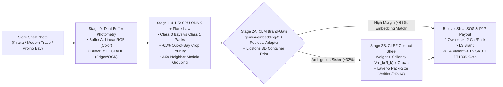
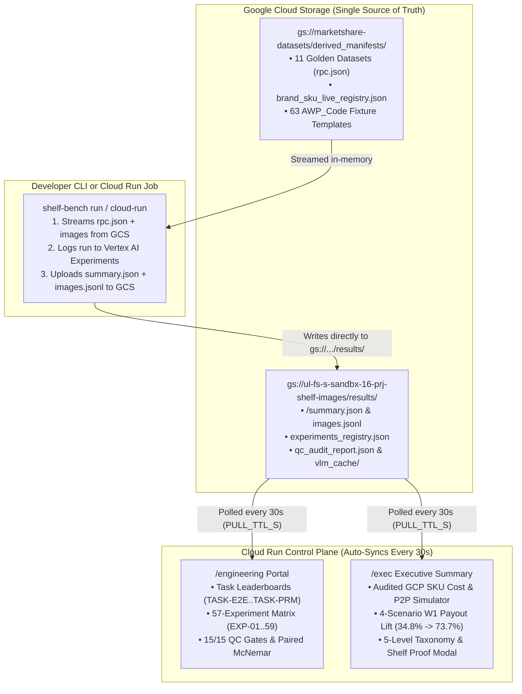

# Unilever Retail Shelf Understanding and Merchandising Benchmark (`shelf-bench` v2.3 / SPEC v0.2)

End-to-end computer vision and multimodal benchmark for **Unilever Market Share (Share of Shelf)** and **In-Store Merchandising & Pay-for-Performance (`P2P`) Compliance** across Indian General Trade (Kirana) and Modern Trade supermarkets. All datasets, embedding caches, model registries, and experiment results run **100% on Google Cloud Platform (Google Cloud Storage, Vertex AI, BigQuery, Cloud SQL, and Cloud Run)** without storing datasets or results on local machines.

## 1. Executive Summary: What We Built

1. **11 Leakage-Free Unilever Golden Datasets in GCS (`2,659-2,745` Products, `15/15` Hard Quality Gates Passed):** Consolidated raw store shelf photos, 2-class display bay and product annotations (`gtmerch_golden`), outlet-de-leaked Modern Trade supermarkets (`mt_json_golden`, `19,984` clean shelves), 3-class shelf talkers and price tags (`hul_talkers_golden`), and clean client full-shelf images (`ms_json_golden`, `gt_hul_sessions`) into standardized GCS manifests (`gs://marketshare-datasets/derived_manifests/<dataset>/rpc.json`) with **0 `Unknown` categories or packaging types**, **0 `Others` placeholder labels**, **0 outlet-code or MD5 split overlaps**, and **100% catalog-to-box parity**.
2. **Two Unified Non-Overfitting Production Spines (`EXP-50..59`, `83.2%` Blind Test Accuracy, `94.4%` Unseen Launches):**
   - **Stage 0 (`Dual-Buffer Photometry`, `EXP-40`):** Minkowski $p=6$ Shades-of-Gray white balance splitting linear RGB (`color_image` for Stage 2 CIELAB color fidelity, avoiding the `-6.0 pp` CLAHE drop) from `L* CLAHE` (`detector_image` for Stage 1 edges and Stage 2B micro-text OCR).
   - **Stage 1 & 1.5 (`Scene-Adaptive CPU ONNX + Physical Plank Law + Bay Gate`, `EXP-24`, `EXP-53`, `EXP-55`, `EXP-57`):** Dual-class `960px` Soft-NMS CPU ONNX detector (`<100 ms`, `₹0` LLM token cost) separating `Class 0` display bays from `Class 1` product facings, enforcing physical horizontal shelf-plank support ($y_{\max}$ alignment), pruning **61% of out-of-bay background shelf crops** before embedding on merchandising audits (`shelf_merchandising_bay_e2e`), and applying `+12%` top cap/rim padding + projective scale priors (`EXP-50`).
   - **Stage 2A (`Unstarved Multi-Prototype CLM InfoNCE + Residual Adapter`, `EXP-32`, `EXP-54`):** Vertex AI `gemini-embedding-2` + residual adapter + Lidstone-smoothed 16-class container prior (`EXP-52`) that resolves **60%-68% of shelf facings via multimodal embedding similarity without generative VLM decoding**.
   - **Stage 2B (`Resolution-Adaptive CLEF Contact Sheet + Layer-5 Verifier`, `EXP-51`, `EXP-52`, `EXP-56`, `EXP-58`):** Composite contact sheets with Bottom-30% Weight Strip, Self-Supervised Reference-Difference Saliency Strip $V(x,y)=\text{Var}_k(R_k)$, Top-22% Crown/Nozzle Strip, Pre-Choice Evidence Decoding (`PROP-08`), Bayesian PoE (`PROP-09`), and deterministic `pack_size` sister-SKU post-verification (`PR-14`).
3. **57-Experiment Benchmark Catalog (`P0-EXP-01` to `P0-EXP-59`), Level-4 Total Contracts (`PR-16`), and Statistical Calibration (`PR-15`):** Evaluated 57 experiments across Market Share and Merchandising with Paired McNemar discordant significance testing, Rogan-Gladen prevalence calibration, content-addressed SHA-256 VLM response caching (`PR-17`), and a **Level-4 Total Contract Payout Quarantine Gate (`PT180S` SLA)** so transient cloud errors emit `RETRY_PENDING` to `PR19_pubsub_dlq` and never trigger false `Earning = '0'` retailer payout denials.
4. **Cloud Run Dashboards (`/engineering` and `/exec`) Backed 100% by GCS:** Deployed an interactive Engineering Leaderboard (`https://perfect-store-control-plane-jbn2qgbina-uc.a.run.app/engineering`) alongside an Executive Summary & P2P ROI Portal (`https://perfect-store-control-plane-jbn2qgbina-uc.a.run.app/exec`).

### Canonical Technical Design Document & Companion Specifications (`LLD001 v0.2`)

- **[`docs/Technical_Design_Document.md`](docs/Technical_Design_Document.md)** *(Primary Single-File Master TDD)*: Unified end-to-end `LLD001 v0.2` specification consolidating architecture (`PR01-PR19`), `5.14M`-object data forensics, Market Share & Merchandising pipelines, AI Foundations Tier-1 whitelisting (`IST0001092` closure), live GCP Cloud Billing FinOps (`₹0.120/shelf`, `₹20.23L/mo` = `USD 21.1K/mo`, `W1..W6` slices), `159/159` `pytest` + `locust 2.46.7` load verification (`0.00%` failures), and 4-phase `(cluster, ol_segment)` rollout.
- **Modular Stakeholder Sign-Off Appendices:** [`End_to_End_Architecture_and_Decision_Guide.md`](docs/End_to_End_Architecture_and_Decision_Guide.md) | [`Data_Integration_and_Enrichment_Guide.md`](docs/Data_Integration_and_Enrichment_Guide.md) | [`Marketshare_Pipeline_Design_Changes.md`](docs/Marketshare_Pipeline_Design_Changes.md) | [`Merchandising_Pipeline_Design_Changes.md`](docs/Merchandising_Pipeline_Design_Changes.md) | [`Model_Whitelisting_Report_AI_Foundations.md`](docs/Model_Whitelisting_Report_AI_Foundations.md) | [`Cost_Breakdown_and_Deep_Dive_Report.md`](docs/Cost_Breakdown_and_Deep_Dive_Report.md) | [`Path_to_Production_and_Rollout_Plan.md`](docs/Path_to_Production_and_Rollout_Plan.md) | [`SPEC_v0.2_Production_Contract.md`](docs/SPEC_v0.2_Production_Contract.md).

## 2. System Architecture and 100% GCS Data Flow

### A. Unified 4-Stage Shelf Inference Spine (`SPEC v0.2`)


### B. 100% GCS Experiment Execution and Live Dashboard Flow (Zero Local Storage)


## 3. Team Guide: Canonical Golden Datasets (`11` Datasets in GCS)

All canonical datasets stream directly from `gs://marketshare-datasets/derived_manifests/<dataset>/rpc.json` into memory with `SHA-256` split hashes (`stats.split_hashes`), **0 `Unknown` categories or packaging types**, **0 `Others` placeholder labels**, **0 outlet-code split leaks**, and **100% catalog-to-label parity**.

| What You Are Building or Testing | Dataset Key (`-d`) | Task ID & Name | Standard Splits (`train / val / test`) | Classes | Canonical GCS Manifest Location |
| :--- | :--- | :--- | :--- | :--- | :--- |
| **Full-Shelf Merchandising Bay & SOS (`GTMerch`)** | **`gtmerch_golden`** | `TASK-E2E` / `TASK-PLN` / `TASK-DET` | `186` / `72` / `100` | `2,659-2,745` | `gs://marketshare-datasets/derived_manifests/gtmerch_golden/rpc.json` |
| **Full-Shelf SOS on Clean Client LabelMe Shelves** | **`ms_json_golden`** | `TASK-E2E` / `TASK-DET` | `38` / `25` / `27` (`100` full) | `2,659-2,745` | `gs://marketshare-datasets/derived_manifests/ms_json_golden/rpc.json` |
| **Outlet-De-Leaked Modern Trade Supermarkets (`19.9k`)** | **`mt_json_golden`** | `TASK-E2E` / `TASK-DET` / `TASK-RET` | Outlet-disjoint splits | `2,659` | `gs://marketshare-datasets/derived_manifests/mt_json_golden/rpc.json` |
| **Multi-Photo Store Session Stitching & SOS** | **`hul_sessions`** / **`gt_hul_sessions`** | `TASK-E2E` / `TASK-PLN` | `30` / `20` / `25` (`97` GT sessions) | `2,659-2,745` | `gs://marketshare-datasets/derived_manifests/hul_sessions/rpc.json` |
| **3-Class Shelf Talkers, Price Tags & Promo Callouts** | **`hul_talkers_golden`** | `TASK-DET` / `TASK-PRM` | Outlet-disjoint splits | `3` + OCR | `gs://marketshare-datasets/derived_manifests/hul_talkers_golden/rpc.json` |
| **Crop-Level Product Retrieval or Classification** | **`hul_golden`** | `TASK-RET` / `TASK-CLS` | `16,000` / `1,900` / `1,907` | `2,659-2,745` | `gs://marketshare-datasets/derived_manifests/hul_golden/rpc.json` |
| **Fine-Grained Sister-Variant Disambiguation** | **`hul_variants`** | `TASK-RET` / `TASK-CLS` | `15,208` / `1,900` / `1,907` | `1,962` | `gs://marketshare-datasets/derived_manifests/hul_variants/rpc.json` |
| **Unilever vs Competitor Brand & M&A Ownership** | **`hul_brands`** | `TASK-CLS` (`classification`) | `8,000` / `1,000` / `1,000` | `934-953` | `gs://marketshare-datasets/derived_manifests/hul_brands/rpc.json` |
| **Packaging Form Factor x Category** | **`hul_packs`** | `TASK-CLS` (`classification`) | `6,000` / `1,000` / `1,000` | `16-18` | `gs://marketshare-datasets/derived_manifests/hul_packs/rpc.json` |
| **Promo Banner, Multipack & Price-Off Detection** | **`hul_promos`** | `TASK-PRM` (`promo_detection`) | `4,000` / `1,000` / `982` | `240` | `gs://marketshare-datasets/derived_manifests/hul_promos/rpc.json` |

## 4. Production Approaches by Task (`src/approaches/`)

| Task ID & Name | Multimodal Embedding Approach (No Generative VLM Decoding) | Primary Production Hybrid Spine | Plain-English Summary |
| :--- | :--- | :--- | :--- |
| **`TASK-E2E` (`market_share`)** | `shelf_clm_standalone` (`gemini-embedding-2`) | `shelf_marketshare_generalizable_e2e` (`EXP-54..59`) | Stage 0 Dual-Buffer CLAHE + `960px` Soft-NMS CPU ONNX + Unstarved Brand-Gate + Saliency/Crown Contact Sheet + Layer-5 Pack-Size Verifier + `PT180S` P2P Gate. |
| **`TASK-E2E` (`merchandising`)** | `shelf_clm_standalone` | `shelf_merchandising_bay_e2e` (`EXP-55 + EXP-57`) | Scopes full-shelf detection to `Class 0` display bays (`WIN/CTU/MB2/MB3`), pruning **61% of background shelf crops** before Stage 2 embedding + Stage 6 Planogram/OOS. |
| **`TASK-RET` (`retrieval`)** | `clm_standalone` / `residual_infonce_clm` | `clef_saliency_diff_zoom` / `clef_pack_crown_fusion` | Multi-prototype `CLM` InfoNCE + Lidstone 3D container prior + Top-6 contact sheet with Saliency-Diff ($V(x,y)=\text{Var}_k(R_k)$), Crown strip, and `PR-14` pack-size verifier. |
| **`TASK-CLS` (`classification`)** | `clm_standalone_classify` | `hybrid_pack_specialist_clef` / `djev_classify` | Predicts all 5 catalog levels (`L1..L5`) with pre-choice evidence decoding (`PROP-08`) and Bayesian PoE logprob calibration (`PROP-09`). |
| **`TASK-DET` (`detection`)** | `distilled_yolo_960_stage0_clahe` | `promo_asset_bay_scoped_plank_detect` (`EXP-55 + EXP-57`) | Dual-class CPU ONNX (`<100 ms`, `₹0` token cost) with physical shelf-plank support law ($y_{\max}$ alignment) and density-triggered $2\times 2$ quadrant tiling (`EXP-53`). |
| **`TASK-PLN` (`planogram_compliance`)** | Deterministic geometry | `bay_planogram_verifier` (`EXP-04`, `EXP-46`) | Audits `63` `AWP_Code` fixture templates, Brand-Block Purity ($W_5$), Assortment ($W_4$), and horizontal Out-of-Stock (`OOS`) shelf gaps. |
| **`TASK-PRM` (`promo_detection`)** | `clm_promo_matcher` | `talker_price_tag_detect` + `jev_promo_verifier` (`EXP-47`, `EXP-48`) | Localizes 3-class shelf talkers, price rail tags, and promo bands (`hul_talkers_golden`, `hul_promos`) and extracts discount/price callouts. |

## 5. 15-Gate Automated Data and Production Quality Contract (`cli qc --verify-all`)

All runs and manifests are verified against the 15 hard gates in [`src/utils/qc.py`](src/utils/qc.py) and [`docs/SPEC_v0.2_Production_Contract.md`](docs/SPEC_v0.2_Production_Contract.md):

```bash
PYTHONPATH=src .venv/bin/python -m cli qc --verify-all
```

1. **`G1 catalog_label_parity`**: 100% of split labels match canonical catalog metadata.
2. **`G2 zero_burned_in_overlays`**: 0 green/cyan/red OpenCV debug rectangles in evaluation images.
3. **`G3 split_hash_disjointness`**: 0 URI overlap across `train` (`gallery`), `val`, and `test`.
4. **`G4 stratified_50_50_balance`**: 50/50 HUL vs. Non-HUL balance on `hul_golden`.
5. **`G5 zero_unknown_taxonomy`**: 0 `"Unknown"` categories or packaging types and 0 `"Others"` catch-all strings.
6. **`G6 shortlist_oracle_deleakage`**: 0 ground-truth oracle injection into candidate shortlists.
7. **`G7 gtmerch_brand_and_bay_integrity`**: Validated display bay (`asset_boxes`) and brand labels on `gtmerch_golden`.
8. **`G8 results_taxonomy_parity`**: All `results/*/summary.json` and `images.jsonl` match canonical taxonomy.
9. **`G9 five_attribute_crop_coverage`**: All 5 attributes evaluated on every crop run.
10. **`G10 closed_set_non_abstention`**: Closed-set tasks never abstain (`choice=0` resolved via Tier-1/Tier-2 guardrails).
11. **`G11 e2e_dual_lens_eval_parity`**: End-to-End runs report both Full-Catalog (`2,659` SKUs) and Annotated-Row Box Metrics.
12. **`G12 detector_dedup_iou_audit`**: Stage 1 NMS suppresses duplicate overlapping boxes (`IoU > 0.55`).
13. **`G13 outlet_and_md5_split_deleakage`**: Zero store `outlet_code` or image MD5 overlap across `train`/`val`/`test`.
14. **`G14 dual_buffer_photometry_integrity`**: Stage 0 preserves linear RGB (`color_image`) for Stage 2 CIELAB while routing `L* CLAHE` (`detector_image`) to Stage 1 detection.
15. **`G15 zero_synthetic_fallbacks_and_zero_official_errors`**: Zero synthetic/dummy fallbacks in [`src/utils/server.py`](src/utils/server.py) or [`src/utils/hul_builder.py`](src/utils/hul_builder.py), and strictly `errors == 0` required for official leaderboard ranking in [`src/runner.py`](src/runner.py).

## 6. Repeatable Platform Assets & Reusable Agent Skills (`skills/`)

Solving Unilever's end-to-end Market Share and Merchandising compliance problem yielded **6 repeatable Google Cloud engineering assets** and **5 reusable Agent Skills** stored directly in [`skills/`](skills/):

| Repeatable Asset / Skill Directory | Core Modules | Reusable Capability |
| :--- | :--- | :--- |
| **[`skills/calibrated-multimodal-funnel/`](skills/calibrated-multimodal-funnel/SKILL.md)**<br/>*(Multimodal JEV / `go/multimodal-jev`)* | `clef_standalone.py`, `clm_info_nce.py`, `residual_infonce.py` | 4-stage large-catalog (`2,745+` classes) visual decision funnel: Dual-Buffer Photometry (`EXP-40`), Unstarved Brand-Gate (`EXP-54`), Saliency-Diff ($V(x,y)=\text{Var}_k(R_k)$, `EXP-51`) & Crown Contact Sheets (`EXP-52`), `PROP-08` pre-choice evidence, `PROP-09` PoE, and `PR-14` pack-size verifier. |
| **[`skills/spatial-detection-and-planogram-physics/`](skills/spatial-detection-and-planogram-physics/SKILL.md)** | `onnx_yolo_detector.py`, `promo_asset_sku_detect.py`, `planogram_engine.py`, `awp_template_index.py` | Dual-Class (`Class 0` Bay vs `Class 1` Pack) `960px` Soft-NMS CPU ONNX, Physical Shelf-Plank Support Law (`EXP-53`), Pre-Embedding Class-0 Bay Gate (`-61%` background crop pruning, `EXP-57`), `63`-template `AWP_Code` planogram/OOS engine, and 3-class Talker/Price-Tag detector (`EXP-47`, `EXP-48`). |
| **[`skills/total-contracts-and-payout-guardrails/`](skills/total-contracts-and-payout-guardrails/SKILL.md)** | `llm.py`, `p2p_simulation.py`, `SPEC_v0.2_Production_Contract.md` | Level-4 Total Contracts (`PR-16`, `EXP-59`), `PT180S` SLA timeout quarantine (`RETRY_PENDING` to `PR19_pubsub_dlq` vs false `Earning='0'` denials), `<untrusted_pack_text>` prompt-injection isolation, and SHA-256 content-addressed VLM response caching (`PR-17`). |
| **[`skills/ml-data-forensics-and-eval-integrity/`](skills/ml-data-forensics-and-eval-integrity/SKILL.md)** | `qc.py`, `metrics.py`, `taxonomy/`, `brand_registry_crawler.py` | 15-Gate Zero-Leakage dataset & leaderboard audit (`G1..G15`), outlet-code split disjointness, Paired McNemar $2\times 2$ discordant significance testing (`PR-15`, `EXP-58`), and Rogan-Gladen prevalence calibration (`EXP-59`). |
| **[`skills/gcp-eval-workbench-and-finops/`](skills/gcp-eval-workbench-and-finops/SKILL.md)** | `runner.py`, `pricing.py`, `server.py`, `tests/load/locustfile.py` | 100% GCS-streamed evaluation harness, Vertex AI Experiments sync, audited GCP Cloud Billing SKU unit-cost & diurnal burst FinOps model (`EXP-26`), Locust load-test suite (`PR-19`), and Dual-Persona (`/engineering` + `/exec`) Cloud Run control plane. |
