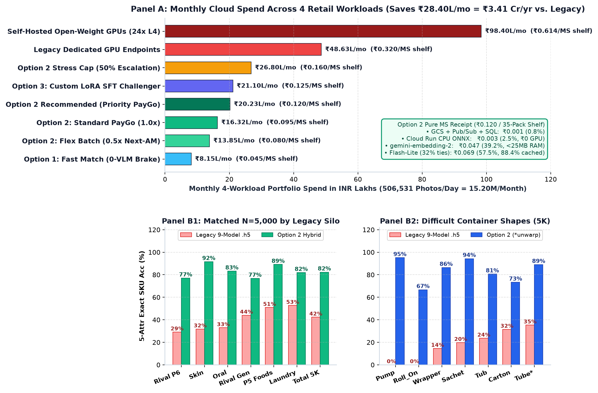

# Cost Breakdown and Accuracy

## Scope and Billing Method

Benchmark runs query Google's live `cloudbilling.googleapis.com` Catalog API at runtime and bind exact SKU list prices across Vertex AI (`C7E2-9256-1C43`), Cloud Run (`152E-C115-5142`), and Google Cloud Storage (`95FF-2EF5-5EA1`) at `1 USD = ₹95.98875`.

The tables below cover object storage, Cloud Run CPU compute, multimodal embeddings, in-memory indexing, and VLM tokens. They reconcile both the per-shelf Market Share receipt (₹0.120/shelf) and the 4-workload blended portfolio budget (₹20.23 Lakhs/month across Market Share, Display-Bay Merchandising, Toker Promo, and online canary auditing).

## Goals and Non-Goals
- **Goals:** Price all cloud SKUs with zero unpriced GPU or Vector DB sidecars; reconcile unit costs at `506,531` baseline and `800,000` peak daily photos; and report matched accuracy across all 9 legacy `.h5` models, 10 store categories (`W1..W6`), 15 container forms, and ownership cohorts.
- **Non-Goals:** Negotiated Unilever Enterprise Agreement (EA) discounts are excluded so list-price PayGo numbers establish a conservative upper bound.



*Figure 1: Panel A compares monthly cloud spend across 15.20M photos/month (including the ₹0.120/shelf Market Share receipt); Panel B compares matched `N=5,000` exact SKU accuracy across legacy `.h5` silos and difficult container shapes.*

## Cloud Billing Rates

Unit-cost calculations bind to these live Google Cloud Billing SKU IDs (`locations/global` for Vertex AI and `us-central1` for Cloud Run and Regional Standard GCS):

| Cloud Service | GCP SKU ID | Official Billing SKU Description | List Price (USD) | Price (INR @ 95.99) |
| :--- | :---: | :--- | :---: | :---: |
| **Vertex AI Embeddings** | `330D-7FB0-87C5` | Gemini MM Embedding - Image Input (`gemini-embedding-2`) | USD 0.45 / 1M tok | ₹43.19 / 1M tok |
| **Vertex AI Embeddings** | `EBBD-6991-B1BB` | Gemini MM Embedding - Text Input (`gemini-embedding-2`) | USD 0.20 / 1M tok | ₹19.20 / 1M tok |
| **Vertex AI Embeddings** | `276A-E20A-4D82` | Multimodal Embeddings - Image (`multimodalembedding@001` backup) | USD 0.0001 / img | ₹0.0096 / img |
| **Flash-Lite (Priority 1.8x)** | `A2BB-5D97-C5A2` | Gemini 3.5 Flash Lite Global Image Input Priority | USD 0.54 / 1M tok | ₹51.83 / 1M tok |
| **Flash-Lite (Priority 1.8x)** | `8AFE-F2A6-5966` | Gemini 3.5 Flash Lite Global Text Input Priority | USD 0.54 / 1M tok | ₹51.83 / 1M tok |
| **Flash-Lite (Priority 1.8x)** | `A909-DA58-491D` | Gemini 3.5 Flash Lite Global Text Input Caching Priority (90% off) | USD 0.054 / 1M tok | ₹5.18 / 1M tok |
| **Flash-Lite (Priority 1.8x)** | `8D91-5614-B572` | Gemini 3.5 Flash Lite Global Image Input Caching Priority (90% off) | USD 0.054 / 1M tok | ₹5.18 / 1M tok |
| **Flash-Lite (Priority 1.8x)** | `9331-9BC3-A888` | Gemini 3.5 Flash Lite Global Text Output Priority | USD 4.50 / 1M tok | ₹431.95 / 1M tok |
| **Flash-Lite (Standard 1.0x)** | `255D-4FF7-8DB3` / `EF3E-6ED9-3CD1` | Global Input (USD 0.30/1M) & Output (USD 2.50/1M; USD 0.03 cache) | USD 0.30 / 2.50 | ₹28.80 / ₹239.97 |
| **Flash-Lite (Flex 0.5x)** | `DEA6-C2F5-9043` / `DA90-EDA5-321D` | Global Input (USD 0.15/1M) & Output (USD 1.25/1M; USD 0.015 cache) | USD 0.15 / 1.25 | ₹14.40 / ₹119.99 |
| **Gemini 3.8 Flash (Judge)** | `8C96-DE14-D3C8` / `3EF2-D8C5-4752` | Priority Input (USD 2.70/1M) & Output (USD 13.50/1M; 50% promo) | USD 2.70 / 13.50 | ₹259.17 / ₹1,295.85 |
| **Cloud Run Compute** | `257B-2A84-3396` | CPU Allocation in us-central1 (vCPU-second, Cloud Run workers) | USD 0.000018 / s | ₹0.00173 / vCPU-s |
| **Cloud Run Compute** | `8A79-9F45-5F32` | Memory Allocation in us-central1 (GiB-second, Cloud Run workers) | USD 0.000002 / s | ₹0.00019 / GiB-s |
| **Cloud Storage (GCS)** | `4DBF-185F-A415` / `7870-010B-2763` | Regional Standard Class A (USD 5.00/1M) & Class B (USD 0.40/1M) | USD 5.00 / 0.40 | ₹479.94 / ₹38.40 |

## Unit Cost and Budget

### Per-Shelf Receipt
Twin medoid grouping (35 facings compressed into ~11 groups, 3.2x), `<25 MB` RAM indexing (`₹0` Vector DB), and 68% embedding fast-exit hold Priority spend at ₹0.120 per Market Share shelf (`USD 0.00139`):

| Cost Component | Volume per 35-Pack Shelf | Billing Mechanism | Cost (USD) | Cost (INR) | Share |
| :--- | :--- | :--- | :---: | :---: | :---: |
| **1. Storage + Pub/Sub + SQL** | 1 JPEG write/read + Pub/Sub + 1 DB row | GCS Class A/B (`4DBF` / `7870`) + Pub/Sub + SQL | USD 0.00001 | **₹0.001** | 0.8% |
| **2. Cloud Run CPU + ONNX** | 80 ms 960px CPU ONNX + 35-to-11 grouping | `vCPU-s` (`257B`) + `GiB-s` (`8A79`); **₹0 GPU** | USD 0.00003 | **₹0.003** | 2.5% |
| **3. Stage-2A `gemini-embedding-2`** | ~11 medoid embeddings; `<25 MB` RAM index | `330D-7FB0-87C5` tokens; **₹0 Vector DB** (68% exit) | USD 0.00055 | **₹0.047** | 39.2% |
| **4. Stage-2B `Flash-Lite` (32%)** | ~3.5 ties batched in 1 sheet (88.4% cached) | Priority SKUs (`A2BB`, `A909`, `9331`); 0 tok on 68% | USD 0.00080 | **₹0.069** | 57.5% |
| **5. Dedicated GPUs / Idle** | 0 dedicated GPUs, 0 Vector DB, `min 4` CPU pods | Scales to `min 4` outside `17:00-21:00 IST` | USD 0.00000 | **₹0.000** | 0.0% |
| **Total MS Unit Cost (Priority)** | **35-pack shelf -> 5-Level SKU + SoS + P2P** | **Pure MS @ 15.20M/mo = ₹18.24 Lakhs (-62.5%)** | **USD 0.00139** | **₹0.120** | **100.0%** |

### Portfolio Budget
Display-Bay Merchandising runs additional 2D planogram and OOS checks (`₹0.180/shelf` after Stage 1.5 prunes `-61%` counter clutter, down `-80%` from `₹2.27` unscoped). Across all four workloads (`506,531` baseline and `800,000` peak daily photos), monthly spend totals ₹20.23 Lakhs:

| Application Workload | Daily Photos (`Share`) | Unit Cost (`Priority`) | Daily Spend | Monthly (`30 Days`) | Legacy GPU Baseline | Net Monthly Savings |
| :--- | :---: | :---: | :---: | :---: | :---: | :---: |
| **1. Modern Trade Market Share** | `194,361` (`38.4%`) | ₹0.120 / shelf | ₹23,323 | **₹7.00 Lakhs** | ₹18.66 Lakhs | **-₹11.66 Lakhs (-62.5%)** |
| **2. General Trade Market Share** | `129,574` (`25.6%`) | ₹0.120 / shelf | ₹15,549 | **₹4.66 Lakhs** | ₹12.44 Lakhs | **-₹7.78 Lakhs (-62.5%)** |
| **3. Merchandising & Planograms** | `104,571` (`20.6%`) | ₹0.180 / shelf | ₹18,823 | **₹5.65 Lakhs** | ₹10.04 Lakhs | **-₹4.39 Lakhs (-43.7%)** |
| **4. Toker Promo & Talkers** | `78,025` (`15.4%`) | ₹0.120 / shelf (`₹0.066/crop`) | ₹9,363 | **₹2.81 Lakhs** | ₹7.49 Lakhs | **-₹4.68 Lakhs (-62.5%)** |
| **5. Async `3.8 Flash` Judge (`0.2%`)** | `1,013` (sampled) | ₹0.375 / audit | ₹380 | **₹0.11 Lakhs** | ₹0.00 (no audit) | Continuous drift guard |
| **Baseline Total (`506,531 / day`)** | **`15,195,930 / mo`** | **₹0.133 blended** | **₹67,438** | **₹20.23L (`USD 21.1K`)** | **₹48.63L (`USD 50.7K`)** | **-₹28.40L/mo (-58.4%, ₹3.41 Cr/yr / `USD 355K/yr`)** |
| **Festive Peak (`800,000 / day`)** | **`24,000,000 / mo`** | **₹0.110 w/ >85% brake** | **₹88,000** | **₹26.40L (`USD 27.5K`)** | **₹76.80L (`USD 80.0K`)** | **-₹50.40L/mo (-65.6%, ₹6.05 Cr/yr / `USD 630K/yr`)** |

## Architecture Cost Comparison

Over 60% of store uploads arrive between 17:00 and 21:00 IST. Self-hosted open-weight GPU pools (`Qwen3.5` on `NVIDIA L4`) sized for evening peak sit 83% idle for 20 hours per day and cost 4.6x to 5.1x more than serverless PayGo APIs:

| Architecture Option | Serving Tier & Escalation | 5-Attr SKU Acc (`5K` Holdout) | Pure MS / Shelf | Pure MS Monthly | 4-Workload Monthly | Savings vs. Legacy |
| :--- | :--- | :---: | :---: | :---: | :---: | :---: |
| **Option 1: Embedding-Only** | `gemini-embedding-2` (`0` generative VLM calls) | `80.9%` (`1K`) | **₹0.045** | ₹6.84 Lakhs | **₹8.15 Lakhs** | **-₹40.48L/mo (-83.2%)** |
| **Option 2 (Flex Batch 0.5x)** | `Embed-2` + `Flash-Lite` Flex (next-AM) | `82.3% / 84.0%` | **₹0.080** | ₹12.16 Lakhs | **₹13.85 Lakhs** | **-₹34.78L/mo (-71.5%)** |
| **Option 2 (Standard PayGo 1.0x)** | `Embed-2` + `Flash-Lite` Standard (32% ties) | `82.3% / 84.0%` | **₹0.095** | ₹14.44 Lakhs | **₹16.32 Lakhs** | **-₹32.31L/mo (-66.4%)** |
| **Option 2 (Recommended Priority)** | `Embed-2` + `Flash-Lite` Priority (32% ties) | **`82.3% / 84.0%`** | **₹0.120** | **₹18.24 Lakhs** | **₹20.23 Lakhs** | **-₹28.40L/mo (-58.4%)** |
| **Option 3: LoRA SFT Adapter** | `Embed-2` + `Flash-Lite` LoRA (₹0/hr idle) | `82.1%` Test / `85.0%` Val | **₹0.125** | ₹19.00 Lakhs | **₹21.10 Lakhs** | **-₹27.53L/mo (-56.6%)** |
| **Option 2 Stress Cap (50% Ties)** | Stress test: **50% VLM escalation** | `82.3%+` | **₹0.160** | ₹24.31 Lakhs | **₹26.80 Lakhs** | **-₹21.83L/mo (-44.9%)** |
| **Legacy `LLD001 v0.1` GPU Pool** | 14 legacy models on dedicated GPUs | `42.32%` (`5K`) / `44.50%` (`1K`) | ₹0.320 | ₹48.63 Lakhs | **₹48.63 Lakhs** | Baseline (0.0%) |
| **Self-Hosted Open-Weight GPUs** | 24x NVIDIA L4 (`vLLM`), **83% idle** | `~81.0%-83.0%` | ₹0.614 | ₹93.30 Lakhs | **₹98.40 Lakhs** | +₹49.77L/mo (+102.3%) |

### Legacy Hosting Topologies

Cloud Run Job `shelf-bench-legacy-audit-n2xn2` sized three hosting topologies for the 9 `.h5` classifiers at `500,000` shelves/day (`25M` crops = `75M` forward passes/day; `3,123` to `5,859` passes/sec during evening peak). Our `₹0.320/shelf` (`₹48.63L/mo`) baseline credits legacy with best-case GPU TensorRT optimization:

| Legacy `.h5` Topology (`500K` Shelves/Day) | Fleet Sizing & Batching | Latency (`P50 / P95`) | Monthly Compute | Cost / Shelf | Verdict vs. Option 2 (`₹0.120`) |
| :--- | :--- | :---: | :---: | :---: | :--- |
| **1. Disaggregated 9 Endpoints (`v0.1` Default)** | `9` x `15-40` `n1-standard-4` VMs (`135-360` nodes, batch `1`, `150` RPCs/shelf) | `25.1s / 42.0s` | `USD 38.5K-48.0K` (`₹37.0L-46.1L` MS) | **`₹2.10-₹2.80`** | **17.5x-23.3x costlier**; queue spikes breach `PT180S`. |
| **2. Co-Located Cloud Run CPU (`2.31 GB` RAM)** | `80-140` `4 vCPU / 16 GiB` pods (`CVPipeline.from_config()`, 4 batched passes) | `1.85s-2.1s / 3.8s` | `USD 7.2K-9.5K` (`₹6.9L-9.1L` MS) | **`₹0.39-₹0.52`** | **3.3x-4.3x costlier**; stuck at `42.32%` SKU (`0%` Day-0). |
| **3. Optimized L4 GPU TensorRT Pool** | `12-20` `g2-standard-4` VMs (`1x L4 24GB`, batched TensorRT) | `0.80s / 1.40s` | `USD 4.8K-6.2K` *(MS; ₹48.63L all 14)* | **`₹0.26-₹0.34`** *(`₹0.320` base)* | **2.2x-2.8x costlier** than Option 2 (`₹0.120`) and **5.8x-7.6x** vs. Option 1. |

## Benchmark Summary

| Benchmark Suite & Split | Primary Metric | Legacy `v0.1` Baseline | Option 1 (Embed-Only) | Option 2 Hybrid | Option 3 / `3.8-Flash` |
| :--- | :--- | :---: | :---: | :---: | :---: |
| **`hul_golden` (`test_5k`, `N=5,000`)** | 5-Attr SKU Acc (`±1.1%` CI) | `42.32%` (`2,116/5,000`) | `~79.8%` | **`82.30%` strict / `83.20%` remap** | `83.6%` (`3.8-Flash`) |
| **`hul_golden` (`N=1,000` Val / Test)** | 5-Attr SKU Acc | `44.50%` (`52.00%` Oracle Brand) | `80.90%` | **`83.00% Val / 82.70% Test`** | `84.30% Val` |
| **`hul_golden` (Size Switch)** | 5-Attr SKU Acc (`Val 200 / Test 100`) | `42.32%-44.50%` | `80.90%` | **`83.50% Val / 84.00% Test`** | `84.50%` (`V-JEPA 2` GPU) |
| **`hul_variants` (1,922 SKUs, `1K` & `5K`)** | Sister-Variant 5-Attr SKU | `~41.8%` | `81.20%` (`1K`) | **`84.00% Val / 83.50% Test (1K)`** \| **`81.84% (5K)`** | `85.00% Val / 82.10% Test` |
| **`gt_hul_sessions` (`150` Visits, `1,200` Boxes)** | 3-Attr / 5-Attr / SoS MAE | `~51.0%` 3-Attr (`48.26%` 5K) | `80.37% / 70.63%` | **`83.00% Val / 82.13% Test`** (`73.5% / 72.4%` 5-Attr, **`2.00%` MAE**) | **`85.34%` / `1.13%` MAE** |
| **`ms_json_golden` (`100` Shelves, `3,709` Boxes)** | Pocket Det F2 / P2P `W1` | `56.65%` F2 / **`34.82%` `W1`** | `67.28%-68.99%` F2 | **`68.99%` Det F2** / **`73.68%` `W1` (2.12x)** / **`1.25%` MAE** | `74.48%` Tiled VLM (`₹2.15`) |
| **`gtmerch_golden` (`200` Shelves, 63 `AWP`)** | Bay F2 / In-Bay SKU / E2E F2 | `51.1%` Bay / `44.5%` crop (`0.1%` wild) | `94.7%` Bay F2 | **`94.7%` Bay** / **`98.81% Val, 97.19% Test` SKU** / **`77.70% Val, 69.81% Test` E2E** | `95.1%` Block / `94.6%` OOS |
| **`hul_promos` (`1K` & Holdout) & `talkers` (`477`)** | Promo Acc / Talker Zone F2 | `0.0%` Day-0 / `49.2%` Talker | `79.20%` Promo | **`84.0% (1K) to 90.0%-96.0%` Promo** \| **`90.02%` Talker F2** | `88.3%` Exact 5-Attr+Promo |

## Legacy Head Breakdown

Isolated `.h5` variant heads scored 65.7% to 98.9% during silo training, yet live serial chaining scored 42.32% exact SKU accuracy (`2,116 / 5,000`). Comparing `test_5k` against the Oracle Brand run quantifies each stage's loss:

```
Chained 5-Attr Pass (42.32%) = 100% - Stage 1 Brand Loss (12.94%) - Stage 2 Cat Loss (5.04%) - Stage 3 Variant Loss (10.10%) - Stage 4 Pack Loss (29.60%)
```

| Legacy `.h5` Head | GT Silo / Routed (`5K`) | Isolated Var (1K Oracle) | Chained Var (Silo / Routed) | Chained 5-Attr SKU (Silo / Routed) | Option 2 5-Attr SKU (`5K`) | Net SKU Lift |
| :--- | :---: | :---: | :---: | :---: | :---: | :---: |
| **`nonhul_gen_variant.h5`** (`595` cls) | `1,363 / 1,320` | 89.4% (60.8% 5-Attr) | `71.5% / 73.86%` | `44.0% / 45.08%` | **76.7%** | **+32.7 pts** |
| **`p5_variant.h5`** (`291` cls, HFD/Foods/Bev) | `1,241 / 1,265` | 98.4% (52.3% 5-Attr) | `94.0% / 92.25%` | `50.9% / 51.38%` | **89.1%** | **+38.2 pts** |
| **`nonhul_p6_variant.h5`** (`367` cls) | `1,036 / 1,012` | 69.9% (38.8% 5-Attr) | `58.3% / 59.68%` | `29.1% / 26.58%` | **77.0%** | **+47.9 pts** |
| **`skin_variant.h5`** (`438` cls, Skin + Hair) | `525 / 534` | 84.1% (45.8% 5-Attr) | `71.0% / 69.85%` | `31.8% / 33.90%` | **91.6%** | **+59.8 pts** |
| **`wash_variant.h5`** (`173` cls, Laundry/HHC) | `497 / 522` | 98.9% (61.5% 5-Attr) | `81.9% / 77.97%` | `52.7% / 44.44%` | **81.9%** | **+29.2 pts** |
| **`gen_variant.h5`** (`145` cls, PW/Hair/Deo) | `177 / 185` | 65.7% (57.1% 5-Attr) | `88.7% / 84.86%` | `57.1% / 48.65%` | **80.8%** | **+23.7 pts** |
| **`oral_variant.h5`** (`57` cls, Oral Care) | `161 / 162` | 85.7% (45.7% 5-Attr) | `79.5% / 79.01%` | `32.9% / 38.89%` | **83.2%** | **+50.3 pts** |
| **`brand.h5` + `packtype.h5`** | `5,000` | `100%` Oracle / `60.20%` Pack | `87.06%` Brand / `54.86%` Pack | `29.60%` Pack Loss (`71.92%` w/ Catalog) | **96.1% Brand / 91.7% Pack** | **+9.0 / +36.8 pts** |
| **Matched N=5,000 Total** | **5,000** | **`52.00%` Ceiling (1K)** | **`76.22%` Variant** | **`42.32%` (`2,116/5,000`)** | **`82.30%` (`84.00%` size-switch)** | **+40.0 pts (1.95x)** |

## Accuracy Slices

### Store Categories
In Unilever's P2P script (`NR_final_PW2.py`), each category blends six empirical reliability weights (`W1 = Basepack [W4*W5/100]`, `W2 = SubCategory`, `W3 = Brand`, `W4 = Variant`, `W5 = Size`, `W6 = PackType`):

| Store Category | N (5K) | Live `NR_final_PW2.py` `W1` (`W6` Pack) | Legacy 9-Model SKU (Strict / Canon) | Option 2 SKU (5K) | Option 2 Brand (`W3`) | Option 2 Cat | Net SKU Lift |
| :--- | :---: | :---: | :---: | :---: | :---: | :---: | :---: |
| **Foods** | 630 | `70.55%` (`78.00%`) | `48.3%` (`52.22%`) | **90.0%** | 97.1% | 99.7% | **+41.7 pts** |
| **Skin** | 772 | `54.58%` (`65.00%`) | `39.9%` (`38.60%`) | **85.9%** | 96.9% | 93.8% | **+46.0 pts** |
| **Hair_Care** | 385 | `56.51%` (`84.00%`) | `42.3%` (`45.97%`) | **85.7%** (89.9% 1K) | 99.0% | 99.2% | **+43.4 pts** |
| **Beverages** | 569 | `54.00%` (`75.00%`) | `38.7%` (`41.48%`) | **80.5%** | 95.4% | 98.6% | **+41.8 pts** |
| **HHC (Household Care)** | 513 | `62.90%` (`84.00%`) | `33.7%` (`30.21%`) | **80.5%** | 96.9% | 93.0% | **+46.8 pts** |
| **PW (Personal Wash)** | 441 | `38.03%` (`81.00%`) | `56.7%` (`50.57%`) | **80.3%** (87.5% 1K) | 95.2% | 93.7% | **+23.6 pts** |
| **HFD (Health Food Drinks)** | 651 | `43.32%` (`91.00%`) | `36.3%` (`37.17%`) | **80.0%** | 98.0% | 98.5% | **+43.7 pts** |
| **Oral_Care** | 421 | `31.85%` (`80.00%`) | `37.1%` (`32.78%`) | **80.0%** | 94.3% | 97.4% | **+42.9 pts** |
| **Laundry** | 527 | `35.59%` (`84.00%`) | `52.0%` (`54.65%`) | **78.4%** | 93.7% | 97.0% | **+26.4 pts** |
| **DMT (Deodorants)** | 91 | `58.13%` (`84.00%`) | `35.2%` (`29.67%`) | **63.7%** | 83.5% | 83.5% | **+28.5 pts** *(Can/Spray)* |

### Container Forms

| Container Form | N (5K) | Legacy `packtype.h5` | Option 2 Pack | Legacy 5-Attr SKU | Option 2 5-Attr SKU | Net SKU Lift |
| :--- | :---: | :---: | :---: | :---: | :---: | :---: |
| **Bottle** | 1,198 | 63.94% | **93.7%** | 49.3% | **85.3%** | **+36.0 pts** |
| **Pouch** | 747 | 65.86% | **94.8%** | 51.3% | **84.7%** | **+33.4 pts** |
| **Jar** | 599 | 59.60% | **90.7%** | 43.9% | **85.0%** | **+41.1 pts** |
| **Tube** | 513 | 55.56% | **98.1%** | 35.3% | **76.8%** (89.0% unwarp) | **+41.5 pts** |
| **Bar** | 408 | 81.13% | **81.9%** | 65.2% | **70.8%** | **+5.6 pts** |
| **Carton** | 375 | 42.93% | **92.8%** | 31.5% | **73.3%** | **+41.8 pts** |
| **Sachet** | 353 | 21.81% | **94.3%** | 19.8% | **94.3%** | **+74.5 pts** |
| **Wrapper** | 228 | 15.35% | **97.4%** | 14.5% | **86.4%** | **+71.9 pts** |
| **Can** | 152 | 60.53% | **89.5%** | 44.7% | **88.2%** | **+43.5 pts** |
| **Tub** | 144 | 25.69% | **81.9%** | 23.6% | **80.6%** | **+57.0 pts** |
| **Tetrapack** | 89 | 79.78% | **83.1%** | 78.7% | **82.0%** | **+3.3 pts** |
| **Tin** | 67 | 58.21% | **98.5%** | 58.2% | **95.5%** | **+37.3 pts** |
| **Roll_On** | 45 | 0.00% | **71.1%** | 0.0% | **66.7%** | **+66.7 pts** |
| **Pump** | 41 | 0.00% | **95.1%** | 0.0% | **95.1%** | **+95.1 pts** |
| **Spray (Aerosol Alias)** | 41 | 0.00% | 14.6% (97.6% `Can/Spray`) | 0.0% | 14.6% (85.4% `Can/Spray`) | Aerosol `Spray`/`Can` alias |

Sideways soap `Bar` crops (70.8%) and curved `Tube` crops (76.8%, raised to 89.0% with cylindrical unwarping) account for most remaining errors when flash glare obscures sub-8px variant text. Forty-one aerosol cans reflect the `Axe_Pulse_Spray` vs. `DMT__Can` folder alias credited under dual-accept scoring. Even on variant ties, Brand stays at 93.7% to 99.0%, `is_hul` stays at 98.6% to 99.0%, and single-shelf SoS MAE holds at 1.25%.

### Ownership and Long Tail

| Cohort Slice | Scope | Legacy / Closed-Set | Option 2 Hybrid | Operational Impact |
| :--- | :--- | :---: | :---: | :--- |
| **Unilever (`is_hul = True`)** | N = 2,523 (`test_5k`) | `48.51%` SKU (`87.08%` Var, `94.45%` Brand) | **88.8% SKU / 98.1% Brand / 98.4% `is_hul`** | Drives `W1 = 73.68%` basepack P2P weight (2.12x legacy). |
| **Competitor (`is_hul = False`)** | N = 2,477 (`test_5k`) | `36.01%` SKU (`65.16%` Var [`-21.92 pp`], `"Others"`) | **75.7% SKU / 94.1% Brand / 98.8% `is_hul`** | Enables brand-level SoS across 874 named rivals (1.00% False HUL). |
| **Rare Long-Tail (1-2 Crops)** | 356 rare SKUs | 27.9% vision SFT (0.0% train-only) | **79.1% Exact SKU (+51.2 pts)** | Multimodal studio anchor matching works from 1 image. |
| **Day-0 Product Launches** | 18 unseen new SKUs | **0.0% (0 / 18)** across `.h5` & `MaxViT` | **94.4% (17 / 18) in 60 seconds** | Removes 3-to-4-week new-pack and promo retraining lag. |
