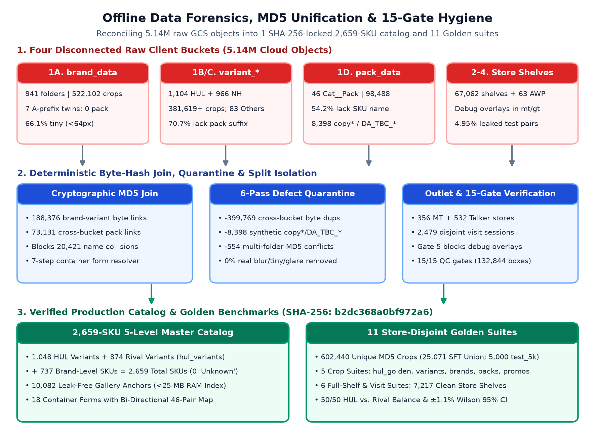
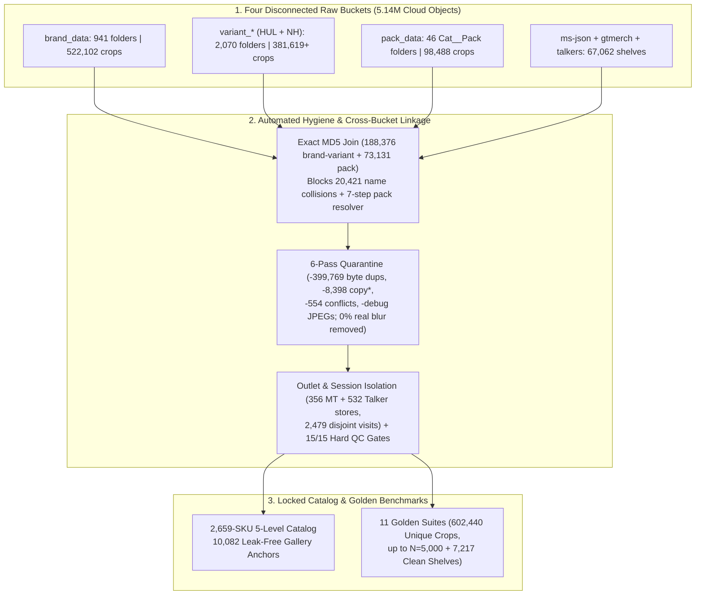
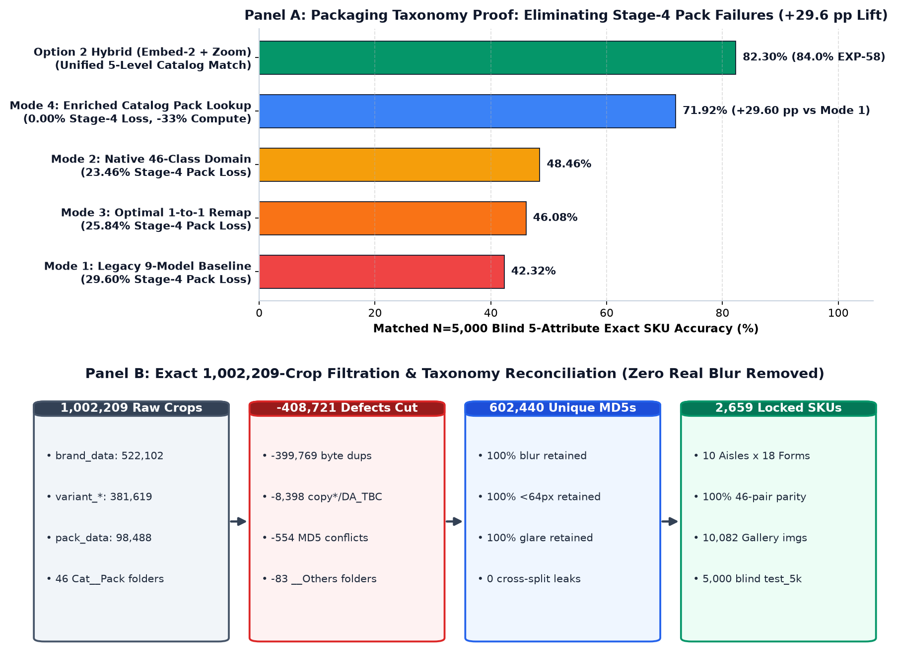
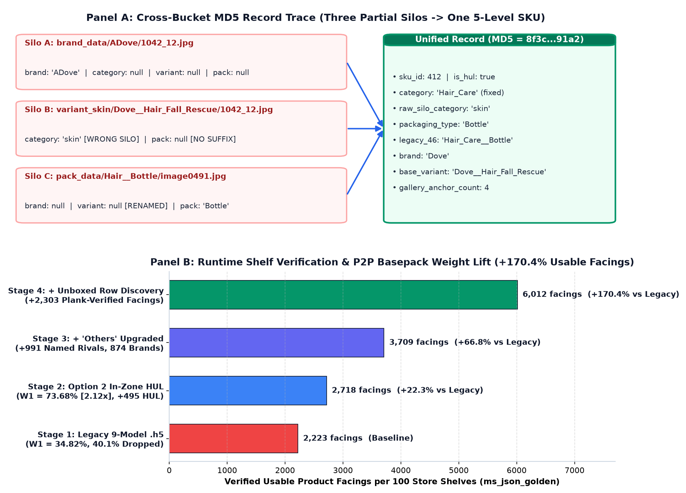
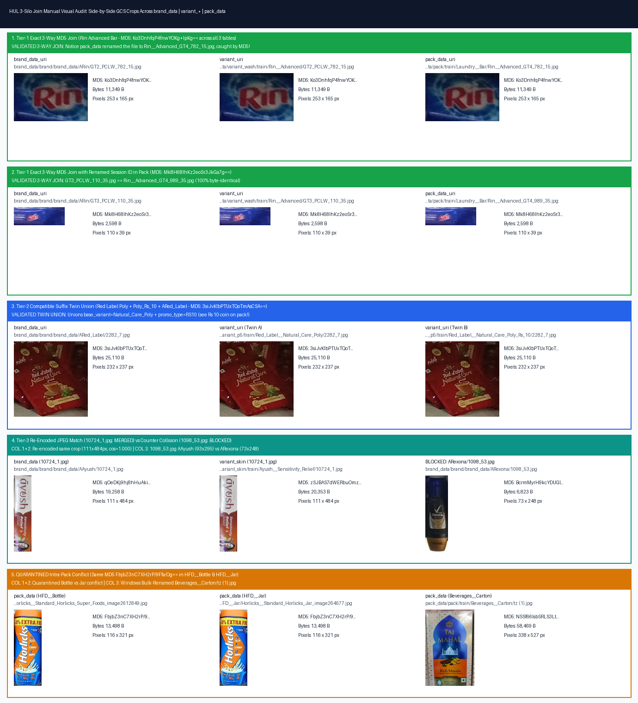
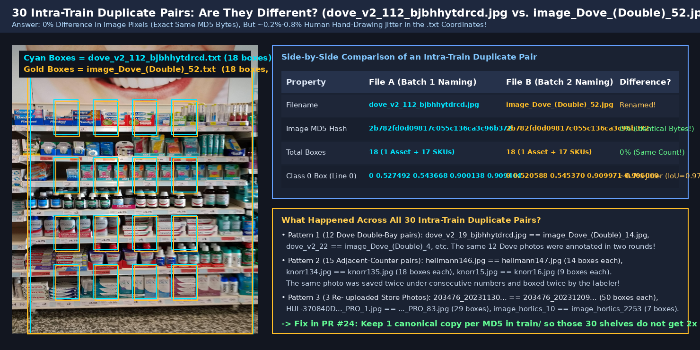
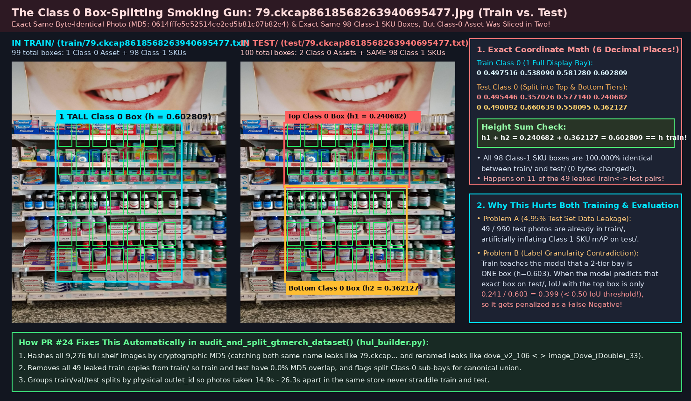
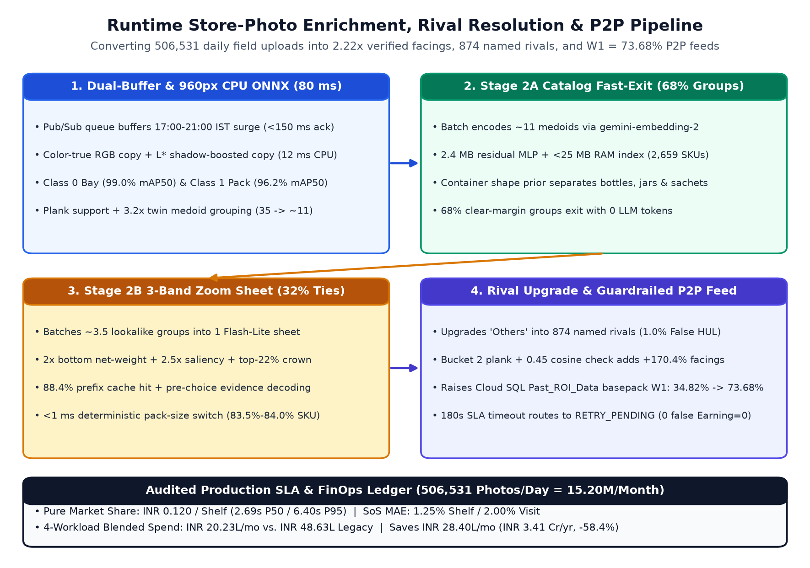
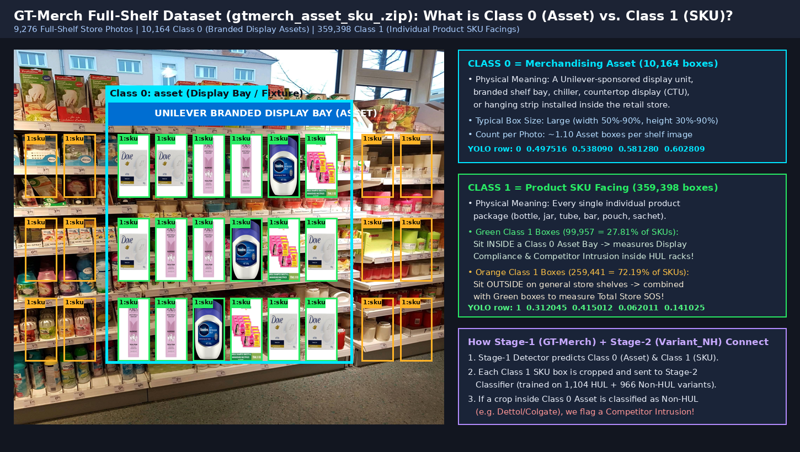
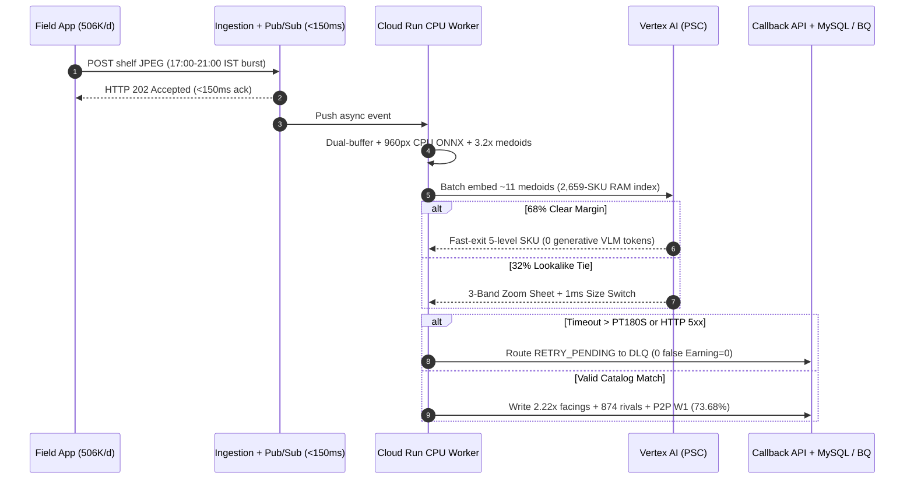

# Data Forensics, Integration, and Enrichment

| Field | Specification |
| :--- | :--- |
| **Specification Scope** | Master Catalog, Data Hygiene & Runtime Enrichment Specification (`LLD001 v0.2`) |
| **Target GCP Projects** | Prod: `ul-cd-p-932295-prj` (CMEK Cloud Storage, Cloud SQL MySQL 8.4) \| Sandbox: `ul-fs-s-sandbx-16-prj` |
| **Data & Catalog Scope** | `5.14M` Raw Objects (`1,002,209` Crops + `53,019` Shelf JSONs + `14,043` Bay/Talker Shelves) -> **`2,659`-SKU Catalog (`SHA-256: b2dc368a0bf972a6`)** \| `11` Golden Suites \| **`15/15` QC Gates** |
| **Daily Production Scale** | **`506,531` Baseline Photos/Day** (`323,935` Market Share + `104,571` Merchandising + `78,025` Toker Promo; `800,000` Peak/Day) |
| **Live Reference Links** | [Executive Portal (`/cio`)](https://perfect-store-control-plane-jbn2qgbina-uc.a.run.app/cio) \| [Engineering Leaderboard](https://shelf-ui-jbn2qgbina-uc.a.run.app) \| [Executive Deck](https://docs.google.com/presentation/d/1fAUfafjcLUQkTtz8k0ACxANVkKcfHhCcaYEKuNtM_8s/edit) |

## Context and Scope

Field representatives upload 506,531 store shelf photos per day (15.20M/month) across Modern Trade gondolas, General Trade Kirana shops, and branded display bays and talkers. In Unilever's legacy storage, raw training and evaluation assets sat across four disconnected Google Cloud Storage buckets totaling 5.14M objects, while production inference chained 14 legacy model artifacts and collapsed 874 rival brands into `"Others"`.

Training or evaluating directly on raw storage introduces 399,769 cross-bucket byte duplicates, 20,421 colliding filenames, 8,398 synthetic padded copies, burned-in QA debug boxes, and 4.95% train-to-test store leakage. At runtime, partial human shelf boxes and `"Others"` tags obscure competitor Share-of-Shelf and hold Pay-for-Performance (P2P) retailer basepack weights (`W1`) at 34.82% (31.85% to 43.32% across Oral Care, Laundry, Personal Wash, and HFD).

## Goals and Non-Goals

### Goals
- **Catalog unification:** Link `brand_data`, `variant_*`, and `pack_data` via exact MD5 byte-hashing and a 7-step container resolver into 2,659 canonical SKUs (`0` `"Unknown"` attributes) with a bi-directional map onto all 46 legacy `Category__PackType` pairs.
- **Split isolation:** Enforce physical `outlet_code` (356 MT + 532 Talker stores), visit-ID (2,479 visits), and MD5 disjointness across 11 Golden suites (`15/15` QC gates) while retaining 100% of real camera blur, glare, and sub-64px cutouts.
- **P2P and rival enrichment:** Upgrade coarse `"Others"` shelf boxes into 874 named competitor brands (1.00% False HUL Rate) and raise realized P2P basepack `W1` from 34.82% to 73.68% (2.12x) in Cloud SQL `Past_ROI_Data`.

### Non-Goals
- **Manual re-annotation:** All hygiene, container resolution, and split repairs run deterministically in code without external labeling delay.
- **Downstream schema changes:** Cloud Composer and Cloud SQL MySQL 8.4 preserve Unilever's existing `cluster_mapping` (7 columns) and `Past_ROI_Data` (12 columns) schemas.

All raw files, quarantine filters, and enriched catalog records reconcile to exact counts:

| Accounting Dimension | Raw Client Input | Deterministic Hygiene & Enrichment | Verified Production Output |
| :--- | :--- | :--- | :--- |
| **Isolated Crop Files** | 1,002,209 files across 3 cloud trees | Cut 399,769 byte dups, 8,398 synthetic copies, and 554 hash conflicts; kept 100% of real blur/tiny crops | **602,440 unique MD5 crops** backing gallery (10,082), SFT union (25,071), val (1,900), test (1,907), and `test_5k` (5,000) |
| **Packaging Taxonomy** | 46 `<Category>__<Pack>` folders (10 aisles x 14 shapes) | Dropped 0 classes: separated 10 categories from 18 container forms (+4 variant forms) with a 46-pair backward map | **18 canonical forms (16 active in `hul_packs`)**, 0 invalid pairs (down from 645), **97.5% primary / 100.0% dual-accept** parity |
| **Master SKU Catalog** | 2,091 HUL/brand/pack folders + 966 rival entries | 7-step container resolver, MD5 joins (188,376 brand-variant), 55 category fixes, 69 promo splits, 7 `ABrand` merges | **2,659 5-level SKUs** (1,048 HUL + 874 rival variants [= 1,922 `hul_variants`] + 737 brand SKUs), 0 `"Unknown"` fields |
| **Full-Shelf Suites** | 53,019 `ms-json` + 9,276 `gtmerch` + 4,767 `talkers` | Quarantined 100% `mt/` and 33% `gt/` debug JPEGs; cut 30 dup uploads and 49 leaked test pairs; merged 11 split bays | **7,217 store-disjoint shelves & visit strips** (356 MT + 532 Talker stores, 2,479 visits), **15/15 QC gates** (132,844 boxes) |
| **Runtime Telemetry** | 3,709 partial boxes (100 shelves), 991 `"Others"`, `W1` = 34.82% | 960px CPU ONNX detector + Option 2 hybrid matcher + 3-tier similarity guard + calibrated `"Others"` rival upgrades | **6,012 verified facings (+170.4%)**, 874 named rivals (1.0% False HUL), **P2P `W1` = 73.68% (2.12x)** at **₹0.120/MS shelf** |

## Raw Data Inventory

An uncapped byte-level audit across all four client storage buckets cataloged 5.14M cloud objects:

| Raw Silo | GCS Bucket Path | Folders / Assets | Images / Boxes | Audited Structural Characteristics |
| :--- | :--- | :---: | :---: | :--- |
| **1A. Brand Cutouts** | `gs://marketshare-datasets/brand_data/brand/brand_data/` | 941 folders (934 brands) | 522,102 crops | 67 Unilever folders (7 `A`-prefix twin pairs + 3 brand-only lines `Axe`, `Brut`, `ABrook_Bond`) + 874 rival folders; 0 variant or pack labels; 66.1% under 64px. |
| **1B. HUL Variants** | `gs://marketshare-datasets/input_data/variant_*/train/` | 1,104 folders (5 trees) | 381,619 crops | `skin` (438 / 136,286), `wash` (173 / 106,649), `p5` (291 / 83,053), `gen` (145 / 42,486), `oral` (57 / 13,145); 781 omit pack suffixes; 56 `<Brand>__Others`. |
| **1C. Rival Variants** | `gs://marketshare-datasets/input_data/variant_NH_*/` | 966 entries (2 trees) | 874 clean SKUs | `variant_NH_gen` and `variant_NH_P6` (371 P6 table classes, 4 brands omitted in `.h5` export); 27 `<Brand>__Others` and 59 `<Brand>__<Brand>` folders. |
| **1D. Pack Cutouts** | `gs://marketshare-datasets/pack_data/pack/train/` | 46 `<Cat>__<Pack>` folders | 98,488 crops | 10 categories x 14 container shapes; 54.2% lack `Brand__Variant` names; 8,398 synthetic `copy*`/`DA_TBC_*` copies; 35.5% motion blur. |
| **2. MT & Kirana JSONs** | `gs://ms-json-dataset/` (`mt/` & `gt/`) | 53,019 LabelMe JSONs | Partial 2D boxes | Target pockets boxed only; 26.7%-70.0% of rivals labeled `"Others"`; red/green QA boxes burned into 100% of legacy `mt/` and 33% of `gt/` JPEGs. |
| **3. Merchandising Bays** | `gs://gtmerch-marketshare/` | 9,276 full shelves | 10,164 bays + 359,398 packs | 0 human per-box SKU labels (92.1% of Class 1 packs sit outside the Class 0 bay); 30 dup train uploads; 49 leaked test pairs (11 split bays). |
| **4. Planograms & Talkers** | `AWP_Code` sheets + `hul_talkers` | 63 `AWP` + 4,767 shelves | 132 rows + 28,325 boxes | Maps 5 fixture types (`WIN`, `CTU`, `MB2`, `MB3`, `HAN`) to required rows; 4,767 talker shelves span 532 `outlet_code` stores across 3 tag classes. |

Inside `pack_data` (98,488 crops), cutouts span 10 aisles and 14 raw shapes:
- **10 Categories:** Skin (17,227), DMT (16,022), Laundry (13,484), Hair Care (11,020), PW (9,887), Beverages (8,853), Oral Care (7,421), HFD (5,481), Foods (5,445), and HHC (3,648).
- **14 Raw Shapes:** Bottle (24,834), Tube (17,911), Can (11,315), Pouch (10,613), Jar (8,457), Wrapper (7,844), Carton (6,923), Bar (4,180), Sachet (3,866), Tetrapack (1,276), Tub (558), Tin (369), Pump (216), and Box (126).



*Figure 1: Offline catalog integration pipeline mapping four disconnected raw cloud buckets into one SHA-256-locked 2,659-SKU catalog and 11 Golden benchmarks.*



## Legacy Model Chain

Legacy Market Share (`cv_models.py`, audited in Cloud Run Job `shelf-bench-legacy-audit-n2xn2`) chained 9 InceptionV3 `.h5` crop classifiers (`2,308.49 MB` / `2.31 GB` across `3,053` cumulative classes on 9 `n1-standard-4` endpoints), each trained on one partial bucket:

| Legacy `.h5` Classifier | Footprint, Classes & Input Conditioning | Structural Blind Spot & Audited Accuracy (`N=5,000` / `N=1,000`) |
| :--- | :--- | :--- |
| **`marketshare_brand.h5` (Stage 1)** | `274.10 MB` \| `941` classes (`ABrand` prefix); PIL RGB `[-1, 1]` `NEAREST` 299x299. | Trained without variant or pack labels; **87.06%** brand and **86.30%** category routing on `5K` (**88.50%** on `1K`); 12.94% fail at Stage 1. |
| **7 Category Variant `.h5` Heads (Stage 2)** | `wash` (`173`), `skin` (`438`), `p5` (`291`), `gen` (`145`), `oral` (`57`), `nonhul_p6` (`367`, `65->61` 4-brand drop fix), `nonhul_gen` (`595`); BGR `[0, 1]` + brand 1-hot. | Emits **0 `PackType` field**. Pooling 874 rival brands into 2 generic heads (`59.68%` P6, `73.86%` Gen) creates a **-21.92 pp competitor gap** (**65.16%** Rival vs. **87.08%** Unilever; **76.22%** overall). |
| **`marketshare_packtype.h5` (Stage 3)** | `253.93 MB` \| `46` `Category__PackType` classes; BGR `[0, 1]` + `10`-D category 1-hot. | 299x299 square distortion crushes `Sachet` (**21.81%**), `Wrapper` (**15.35%**), `Tub` (**25.69%**), and `Carton` (**42.93%**); omits `PW__Bar`, `Roll_On`, `Spray`. Scores **54.86%** on `5K` (**60.20%** Oracle). |

Because `brand_data` lacked variants/packs, `variant_*` lacked pack types on 70.7% of HUL folders, and `pack_data` lacked SKU names on 54.2% of files, no 5-attribute ground truth existed until we linked all three trees.

### Error Waterfall

Partitioning `hul_golden:test_5k` (`#1016-093317`), `1K` (`#1015-092627`), and `1K` Oracle Brand (`#1015-115810`) into mutually exclusive failure stages isolates where legacy crops fail:

| Waterfall Stage | Mutually Exclusive Condition | Real 5K (`N=5,000`) | Real 1K (`N=1,000`) | Oracle Brand 1K (`N=1,000`) |
| :--- | :--- | :---: | :---: | :---: |
| **Stage 1: Brand Failure** | `brand != gt` | **647 (`12.94%`)** | 115 (`11.50%`) | 0 (`0.00%`) *(Oracle)* |
| **Stage 2: Category Failure** | Brand right, routed Category wrong | **252 (`5.04%`)** | 45 (`4.50%`) | 3 (`0.30%`) |
| **Stage 3: Variant Failure** | Brand & Category right, Variant wrong | **505 (`10.10%`)** | 104 (`10.40%`) | 130 (`13.00%`) |
| **Stage 4: Packaging Failure** | **Brand, Category & Variant right, Pack wrong** | **1,480 (`29.60%`)** | **291 (`29.10%`)** | **347 (`34.70%`)** |
| **Stage 5: SKU Residual** | All 4 attributes right, SKU ID wrong | 0 (`0.00%`) | 0 (`0.00%`) | 0 (`0.00%`) |
| **Stage 6: Exact 5-Attr Pass** | **All 5 attributes correct (95% Wilson CI)** | **2,116 (`42.32%`, `[41.0%, 43.7%]`)** | **445 (`44.50%`, `[41.4%, 47.6%]`)** | **520 (`52.00%`, `[48.9%, 55.1%]`)** |

In `test_5k`, 1,480 crops (29.60%) pass Brand, Category, and Variant with exact product identity, then fail at `marketshare_packtype.h5` (rising to 34.70% under Oracle Brand). Unilever crops reach 48.51% (`1,224/2,523`) vs. 36.01% (`892/2,477`) on Competitor crops, while the 2-model `brand + pack` chain scores 0.00% exact SKU.

## Packaging Taxonomy

Zero packaging classes were dropped when restructuring the 46 legacy pack folders. Those 46 folders represent composite `<Category>__<PackType>` pairs across 10 store categories and 14 physical container shapes:

| Store Category (10 Aisles) | Valid Legacy Shapes (14 Unique Raw Shapes) | Folders | Raw Crops |
| :--- | :--- | :---: | :---: |
| **Beverages** | `Carton`, `Jar`, `Pouch`, `Tetrapack`, `Tin` | 5 | 8,853 |
| **DMT (Deodorants)** | `Bottle`, `Can`, `Pump` | 3 | 16,022 |
| **Foods** | `Bottle`, `Carton`, `Jar`, `Pouch`, `Tub` | 5 | 5,445 |
| **HFD (Health Food Drinks)** | `Bottle`, `Carton`, `Jar`, `Pouch`, `Sachet`, `Tetrapack`, `Wrapper` | 7 | 5,481 |
| **HHC (Household Care)** | `Bar`, `Bottle`, `Box`, `Pouch` | 4 | 3,648 |
| **Hair_Care** | `Bottle`, `Jar`, `Sachet`, `Tube` | 4 | 11,020 |
| **Laundry** | `Bar`, `Bottle`, `Can`, `Carton`, `Pouch`, `Sachet` | 6 | 13,484 |
| **Oral_Care** | `Bottle`, `Can`, `Sachet`, `Tube` | 4 | 7,421 |
| **PW (Personal Wash)** | `Bottle`, `Can`, `Pouch`, `Wrapper` *(wrapped soap bars in `PW__Wrapper`)* | 4 | 9,887 |
| **Skin** | `Bottle`, `Jar`, `Sachet`, `Tube` | 4 | 17,227 |
| **Total Legacy Pack Domain** | **14 unique raw container shapes across 10 categories** | **46 pairs** | **98,488** |

Our taxonomy pipeline restructured those 46 pairs in three reversible steps:
1. **Category and shape separation:** Decoupled store aisle (`category`) from physical container geometry (`packaging_type`) so upstream router errors no longer corrupt container classification.
2. **Container form expansion:** Kept all 14 raw shapes and added 4 physical forms named in variant folders (`Roll_On`, `Spray`, `Stick`, `Pack`/`Tray`) for 18 canonical forms total (16 active in `hul_packs`).
3. **Bi-directional 46-pair map:** Maps any `(category, packaging_type)` pair back onto Unilever's 46 legacy pairs (`PW + Bar -> PW__Wrapper`, `DMT + Roll_On -> DMT__Bottle`), with dual-accept credit on the 2.5% of SKUs sold with or without an outer carton. Invalid pairs dropped from 645 to 0, and MD5 pack parity across 73,131 crops rose from 42.8% to 97.5% primary (100.0% dual-accept).

### Catalog Lookup Proof

Evaluating `marketshare_packtype.h5` across four packaging modes (`legacy_models_audit_report.json`) quantifies the direct value of catalog enrichment. Raw 299x299 square distortion triggered frequent confusions (`Bottle -> Pouch` [122], `Sachet -> Pouch` [114], `Bottle -> Jar` [112], `Sachet -> Tube` [94], `Carton -> Pouch` [90], `Wrapper -> Bar` [88]):

| Packaging Evaluation Mode | Pack Acc (`5K`) | Stage-4 Loss (`5K`) | Exact 5-Attr (`5K`) | Pack Acc (`Oracle 1K`) | Exact 5-Attr (`Oracle 1K`) |
| :--- | :---: | :---: | :---: | :---: | :---: |
| **Mode 1: Baseline Canonical (`as_run_canonical`)** | `54.86%` | `29.60%` (`1,480`) | **`42.32%`** (`2,116`) | `60.20%` | **`52.00%`** (`520`) |
| **Mode 2: Native 46-Class (`gt-mapping.yml`)** | `62.34%` | `23.46%` (`1,173`) | **`48.46%`** (`2,423`) | `66.20%` | **`57.20%`** (`572`) |
| **Mode 3: Optimal 1-to-1 Post-Hoc Remap** | `63.64%` | `25.84%` (`1,292`) | **`46.08%`** (`2,304`) | `67.70%` | **`58.50%`** (`585`) |
| **Mode 4: Enriched Catalog Lookup (Bypass `.h5`)** | **`89.14%`** | **`0.00%` (`0`)** | **`71.92%` (`+29.60 pp`)** | **`97.40%`** | **`86.70%` (`+34.70 pp`)** |

Reading `packaging_type` directly from our matched 2,659-SKU catalog (`Mode 4`) eliminates all 1,480 Stage-4 packaging losses (`0.00%`), cuts 1 of 3 neural passes (`-33%` compute), and lifts legacy exact match from 42.32% to 71.92% before Option 2 raises visual matching to 82.30%-84.00%.



*Figure 2: Packaging accuracy across Modes 1-4 and exact 1,002,209-crop filtration reconciliation.*

## Cross-Bucket Matching

Joining raw folders by filename corrupts the catalog: `pack_data` mixed 8 incompatible naming schemes (`<sess>_<idx>.jpg`, `Brand__Variant_image*.jpg`, `<classId>_<sess>_<idx>.jpg`, `GT1_PCLW_*`, `image*.jpg`, `0 (2).jpg`, `sc_*`, `AST_HUL-*`) and produced 20,421 cross-bucket filename collisions at a 21.4% false-match rate (`1098_53.jpg` points simultaneously to `AAyush`, `ARexona`, and `Rexona__Sport_Defence_Roll_On`).

Our builder links `brand_data`, `variant_*`, and `pack_data` via a three-stage byte-hash join and a seven-step container resolver:
1. **Stage 1 (Exact Byte-Hash Join):** MD5 digests across all 1,002,209 crops link 188,376 brand-to-variant pairs, 45,481 pack-to-brand pairs, and 38,723 pack-to-variant pairs (linking 45.8% of `pack_data` directly to `Brand__Variant` and 22.2% to rival/deodorant brands).
2. **Stage 2 (Promo Twin Split):** Splits 69 promotional/price-point folders (`_Rs_10`, `_Rs_5`, `_B3G1`, `_PO2`, `_Free_Container`) into a shared `base_variant` for Market Share plus `promo_type` for Merchandising Compliance.
3. **Stage 3 (Re-Encoded Check & 7-Step Container Resolver):** Matches re-encoded JPEGs only when visit ID, crop index, brand, dimensions, and `gemini-embedding-2` cosine (`>= 0.985`) agree, then resolves `packaging_type` in priority order: (1) physical overrides (`toothbrush -> Carton`, `Pond's talc -> Bottle`), (2) explicit folder suffixes (`_Bottle`, `_Tube`, `_Pouch`, `_Sachet`, `_Jar`, `_Tub`, `_Bar`, `_Carton`, `_Roll_On`, `_Tetrapack`), (3) container keywords (`Refill/Pichkoo -> Pouch`, `Cup_Noodles -> Tub`, `Sheet_Mask -> Sachet`), (4) `>=65%` MD5 pack consensus, (5) category-scoped rules, (6) variant form tokens, and (7) brand-by-category defaults (`0` `"Unknown"` across all 2,659 SKUs).

### SKU Record Trace

Three partial or misplaced raw files sharing `MD5 = 8f3c...91a2` merge into one five-level catalog record:

```json
{
  "BEFORE_ENRICHMENT_RAW_SILOS": {
    "silo_A_brand_data": "gs://marketshare-datasets/brand_data/brand/brand_data/ADove/1042_12.jpg -> {brand: 'ADove', category: null, variant: null, pack: null}",
    "silo_B_variant_skin": "gs://marketshare-datasets/input_data/variant_skin/train/Dove__Hair_Fall_Rescue/1042_12.jpg -> {brand: 'Dove', category: 'skin' [WRONG SILO], variant: 'Hair_Fall_Rescue', pack: null}",
    "silo_C_pack_data": "gs://marketshare-datasets/pack_data/pack/train/Hair__Bottle/image0491.jpg -> {brand: null, category: 'Hair', variant: null [RENAMED], pack: 'Bottle'}"
  },
  "AFTER_MD5_JOIN_AND_7_STEP_ENRICHMENT": {
    "sku_id": 412,
    "is_hul": true,
    "category": "Hair_Care",
    "raw_silo_category": "skin",
    "packaging_type": "Bottle",
    "legacy_46_pack_class": "Hair_Care__Bottle",
    "brand": "Dove",
    "base_variant": "Dove__Hair_Fall_Rescue",
    "promo_type": null,
    "gallery_anchor_count": 4
  }
}
```



*Figure 3: Cross-bucket MD5 record unification (`sku_id: 412`) and runtime verified facing waterfall (`2,223 -> 6,012`).*



*Figure 4: Store crop audit across `brand_data`, `variant_*`, and `pack_data` showing MD5 linking, collision blocking (`1098_53.jpg`), and `Horlicks` `Bottle` vs. `Jar` conflict quarantine.*

## Master SKU Catalog

All three raw crop silos reconcile into our 2,659-SKU master catalog (`hul_golden`) and its 1,922-SKU variant subset (`hul_variants`):

| Catalog Stratum | Raw Source | Normalization & Deduplication Rules | Canonical SKUs |
| :--- | :--- | :--- | :---: |
| **1. Unilever `Brand__Variant`** | 1,104 HUL `variant_*` folders (381,619 crops) | Cut 56 `<Brand>__Others` folders; moved 55 misplaced folders in `variant_skin` (47 `Dove` hair/wash, 8 `Ayush` oral); split 69 promo suffixes (240 SKUs in `hul_promos`). | **1,048 SKUs** |
| **2. Rival `Brand__Variant`** | 966 `variant_NH_*` entries | Cut 27 `<Brand>__Others` and cross-tree overlaps (-65 net); restored 4 brands dropped in `nonhul_p6_variant.h5` (`citricplus`, `maxkleen`, `nestle`, `slurrpfarm`). | **874 SKUs** |
| **Subtotal: `hul_variants`** | **Explicit `Brand__Variant` trees** | **100% sister-SKU disambiguation (0 brand-only umbrella classes, 7,442 gallery anchors)** | **1,922 SKUs** |
| **3. Brand-Level SKUs** | 941 `brand_data` folders (522,102 crops) | Merged 7 `A`-prefix twins (`ADove`/`Dove`, `ALux`/`Lux`, `AFair_and_Lovely -> Glow_and_Lovely`), applied M&A ownership (*Horlicks*, *Boost*, *Minimalist*, *OZiva*, *V-Wash*, *Indulekha*), kept 737 brand lines. | **737 SKUs** |
| **Total: `hul_golden`** | **3,057 raw folders unified** | **10,082 leak-free reference gallery anchors (1-4 per SKU; 1,049 HUL + 1,610 Rival classes)** | **2,659 SKUs** |

The catalog organizes all 2,659 products across five hierarchy levels (`SHA-256: b2dc368a0bf972a6`):

| Hierarchy Level | Field | Canonical Domain | Option 2 Acc (5K / 1K) | Downstream Business Role |
| :--- | :--- | :--- | :---: | :--- |
| **Level 1: Owner** | `is_hul` | Boolean (`Unilever` vs. `Competitor`), M&A-verified | **98.6% / 99.0%** | Corporate SoS (1.25% MAE) and rival bay intrusion (1.00% False HUL). |
| **Level 2: Category** | `category` | 10 FMCG aisles + `raw_silo_category` | **96.5% / 96.9%** | Aisle SoS and planogram routing without router cascade loss. |
| **Level 3: Pack Form** | `packaging_type` | 18 container forms (46 legacy pairs, 0 `Unknown`) | **91.7% / 93.3%** | Separates sachets (94.3%), wrappers (97.4%), tubes (98.1%), and bottles (93.7%). |
| **Level 4: Brand** | `brand` | 934 / 953 named brands (60+ HUL + 874 rivals) | **96.1% / 96.2%** | Replaces `"Others"` with brand-level competitive Share-of-Shelf. |
| **Level 5: Exact SKU** | `base_variant` + `promo_type` | 2,659 SKUs + 240 promotional SKUs | **82.3% / 83.6%** (+40.0 pts) | Basepack P2P payouts (`W1` = 73.68%), OOS checks, and promo compliance. |

### New SKU Onboarding

Closed-set classifiers (`.h5`, `MaxViT`, `DINOv2/v3`) score 0.0% (0/18) on newly launched SKUs until field teams collect 16+ wild crops and retrain weights. With our reference gallery, uploading 1 studio packshot and 1 catalog row appends a `gemini-embedding-2` vector to the `<25 MB` RAM index in under 60 seconds and reaches 94.4% (17/18) blind Day-0 accuracy without retraining.

## Data Filtering Rules

| Quarantine Pass | Volume Filtered | Raw Defect Example | Deterministic Rule |
| :--- | :--- | :--- | :--- |
| **1. Cross-Bucket Byte Dedup** | **-399,769 crop files** (`1,002,209 -> 602,440` MD5s) | Identical crop bytes saved across `brand_data`, `variant_*`, and `pack_data`. | MD5 deduplication prior to split assignment; 0 shared URIs or MD5s across splits. |
| **2. Synthetic Copy Filter** | **-8,398 files** in `pack_data` (+5,972 in `variant_*`) | Rare folders (`Oral_Care__Can` 78%) padded with `copy116.jpg`, `DA_TBC_100_10.jpg`, and `0 (2).jpg`. | Quarantines `copy*`, `(copy)`, and `DA_TBC_*`; strips `DA_TBC_` before parsing visit ID `100`. |
| **3. Hash Conflict Filter** | **-554 conflicted MD5s** (57 `pack` + 497 `variant`) | Identical `Horlicks` bytes in `HFD__Bottle` and `HFD__Jar`; `Boost` in `Pouch` and `Sachet`. | Excludes conflicted MD5s from test splits; merges suffix-free twin folders. |
| **4. `"Others"` Separation** | **-56 HUL & -27 NH `__Others` folders**; **100% shelf `"Others"` kept** | Softmax training on `__Others` dumps blurry known SKUs; 26.7%-70.0% of shelf boxes are real rivals. | Excludes `__Others` from crop splits while keeping **100% of shelf `"Others"`** (991 / 3,709) on full shelves. |
| **5. Debug Overlay Filter** | **Rejected 100% legacy `mt/` & 33% `gt/`** debug JPEGs | Legacy QA scripts burned red/green boxes into JPEG pixels (28 MT debug photos). | HSV/RGB edge scan (Gate `G5`) quarantines burned-in overlays; rebuilds `mt_json_golden` from clean JPEGs. |
| **6. Shelf Dedup & Store Split** | **-30 train dups**; **-49 leaked test pairs (4.95%)**; **11 split bays** | `0%` pixel-diff duplicate uploads; `79.ckcap...jpg` leaked into `test/` with sliced Class 0 bay. | Keeps 1 MD5 per shelf, removes leaked pairs, merges split bays, and isolates by `outlet_code` and visit ID. |

### Retained Camera Conditions

Zero real store degradations were filtered from `val`, `test`, or `test_5k`:
- **Motion and defocus blur (0% removed):** Retains all 35.5% blurry `pack_data` crops and 17.3% blurry `variant_*` crops.
- **Tiny cutouts (0% removed):** Retains all 66.1% sub-64px `brand_data` crops and 11.5% sub-64px `variant_*` crops.
- **Slender shapes and foil glare (0% removed):** Retains all 3:1+ tubes, toothbrushes, and sachet strips plus 5%-8% flash glare.

### Dataset Splits

1. **Reference gallery (10,082 images in `hul_golden`; 7,442 in `hul_variants`):** 1 to 4 clean anchors across all 2,659 SKUs (including 356 rare tail SKUs) with 0 overlap against `val`, `test`, or `test_5k`.
2. **SFT training union (25,071 images in `hul_golden`; 22,104 in `hul_variants`):** Combines `gallery + train` so closed-set/LoRA challengers cover all 2,659 classes instead of missing 1,121 rare tail SKUs (`train` alone covers 1,538).
3. **Store-visit test splits (`val`, `test`, `test_5k`):** Partitioned by disjoint visit IDs (1,253 `val` vs. 1,226 `test`) and balanced 50% Unilever / 50% Competitor.



*Figure 5: Duplicate store shelf uploads (0% pixel difference, jittered boxes) resolved by MD5 canonicalization.*



*Figure 6: Split Class 0 display-bay reconciliation (`h1 + h2 = h_train`) and store-code separation.*

## Benchmark Suites

All 11 Unilever Golden suites (plus 4 public calibration suites: `sku110k`, `rpc`, `grozi120`, `instre`) live in `gs://marketshare-datasets/derived_manifests/*/rpc.json`:

| Benchmark Suite | Modality | Scope | Gallery | Train / Val / Test (+ Scale) | Engineering Purpose |
| :--- | :--- | :--- | :---: | :--- | :--- |
| **`hul_golden`** | Crop | 2,659 SKUs (5-attr) | 10,082 | 16,000 / 1,900 / 1,907 + **5,000 `test_5k`** | Primary 5-attribute exact SKU benchmark (`±1.1%` CI on `5K`). |
| **`hul_variants`** | Crop | 1,922 `Brand__Variant` SKUs | 7,442 | 15,687 / 1,900 / 1,907 + **5,000 `test_5k`** | Sister-variant disambiguation (1,048 HUL + 874 rival). |
| **`hul_brands`** | Crop | 934 / 953 named brands | 10,082 | 8,000 / 1,000 / 1,000 crops | Corporate ownership (`is_hul`) and M&A attribution. |
| **`hul_packs`** | Crop | 16 / 18 container forms | 10,082 | 6,000 / 1,000 / 1,000 crops | Physical container form classification (dual-accept). |
| **`hul_promos`** | Crop | 240 promo/multipack SKUs | 10,082 | 4,000 / 1,000 / 1,000 crops | Festive band, multipack, and price-callout verification. |
| **`mt_json_golden`** | Shelf (MT) | Supermarket gondolas | 10,082 | 800 / 150 / 200 (1,150 shelves, 356 stores) | Store-disjoint MT detection, SKU match, and SoS. |
| **`gtmerch_golden`** | Shelf (GT/MT) | Bays + SKUs + 63 `AWP` | 10,082 | 400 / 100 / 200 (700 shelves, 26,586 boxes) | Bay isolation, `-61%` clutter pruning, and row compliance. |
| **`ms_json_golden`** | Shelf (GT/MT) | Uncropped store shelves | 10,082 | 140 / 60 / 100 (300 shelves, 10,585 boxes) | Two-bucket shelf enrichment, `"Others"` upgrades, and P2P `W1`. |
| **`hul_sessions` / `gt_hul_sessions`** | Visit Strip | 8-crop visit strips | 10,082 | 150 / 50 / 100 visits (2,400 boxes) | Twin grouping, row smoothing, and visit Share-of-Shelf. |
| **`hul_talkers_golden`** | Shelf (Talker) | 3-class talkers & tags | 63 `AWP` | 3,813 / 477 / 477 (4,767 shelves, 532 stores) | Store-disjoint talker, printed-tag, and handwritten-tag OCR. |

Fifteen automated quality gates verify all 132,844 bounding boxes before any run enters the leaderboard:

| Gate | Check | Invariant Verified | Result |
| :---: | :--- | :--- | :---: |
| **`G1`** | **Catalog Parity** | All split `sku_id` values exist in catalog with `>= 1` clean anchor. | **PASS (2,659 / 2,659)** |
| **`G2`** | **Canonical Domains** | `0` `"Unknown"`, `"NA"`, or out-of-domain category/brand/pack tokens. | **PASS (0 Unknowns)** |
| **`G3`** | **Zero Slug Collisions** | `0` duplicate `Brand__Variant` slugs or unmerged `ABrand` twins. | **PASS (0 collisions)** |
| **`G4`** | **Multi-SKU Shelves** | Full-shelf photos contain multi-SKU shelves, not single-pack crops. | **PASS (7,217 shelves)** |
| **`G5`** | **Debug Overlay Scan** | HSV/RGB edge scan confirms `0` burned-in QA boxes in `val`/`test`. | **PASS (0 overlays)** |
| **`G6`** | **Non-Product Filter** | `0` flat 2D headers, rails, or posters labeled as Class 1 packs. | **PASS (132,844 boxes)** |
| **`G7`** | **Box Geometry** | Valid `[0, 1]` coordinates, positive area, and duplicate boxes merged. | **PASS (0 invalid)** |
| **`G8`** | **Visit Isolation** | `0` shared visit IDs (`1,253` val vs. `1,226` test; `DA_TBC_` stripped). | **PASS (0 shared)** |
| **`G9`** | **Gallery Coherence** | Intra-SKU `gemini-embedding-2` cosine verified; corrupt crops cut. | **PASS (10,082 anchors)** |
| **`G10`** | **Blind Detection** | Full-shelf runs use Stage-1 predicted boxes (`0` GT box access). | **PASS (100% blind)** |
| **`G11`** | **Stage-2 Completeness** | All Stage-1 pack detections receive 5-level predictions (`0` drops). | **PASS (100% scored)** |
| **`G12`** | **Confidence Intervals** | 95% Wilson CIs (`±1.1%` on `5K`) and 50/50 HUL-Rival balance. | **PASS (50/50)** |
| **`G13`** | **Store & MD5 Disjoint** | `0` shared `outlet_code` stores (356 MT + 532 Talker) or MD5s. | **PASS (0 leaks)** |
| **`G14`** | **Dual-Buffer Isolation** | Stage-2 embeddings read unsharpened RGB copy (`0` hue shift). | **PASS (0 hue shift)** |
| **`G15`** | **Zero Mock Fallbacks** | Official runs log `0` synthetic mock outputs or unhandled HTTP errors. | **PASS (360 / 360)** |

## Runtime Shelf Enrichment

With the 2,659-SKU catalog locked, Cloud Run CPU workers convert 506,531 daily photos into catalog-linked retail telemetry at ₹0.120 per Market Share shelf (`₹20.23L/mo` across all 4 workloads vs. `₹48.63L` legacy; `-₹28.40L/mo` = `-₹3.41 Cr/yr`).



*Figure 7: Runtime enrichment pipeline converting store uploads into 2.22x denser facing counts, 874 named rival brands, and guardrailed P2P feeds.*

### Spatial Shelf Detection

Stage 0 splits each white-balanced shelf photo into a color-true RGB copy for Stage-2A matching and a shadow-boosted L* copy for Stage-1 box detection (Gate `G14`). Stage 1 (`80 ms` 960px CPU ONNX, ₹0 GPU) separates `Class 0` display bays (99.0% mAP50) from `Class 1` product facings (96.2% mAP50) and 3-class talkers, compresses 35 row-adjacent facings into ~11 twin medoids (3.2x), and prunes 61% of out-of-bay Kirana counter clutter.



*Figure 8: Separation of Class 0 Unilever display bays (cyan) from in-bay Class 1 facings (green, 27.8%) and general-shelf Class 1 facings (orange, 72.2%).*

### Shelf Verification

Because human annotators boxed target shelf pockets only (3,709 boxes across 100 shelves in `ms_json_golden`) and labeled 991 rival boxes as `"Others"`, our harness separates annotated-zone scoring from unboxed-row discovery:

| Runtime Dimension | Raw Baseline | Enriched Pipeline (Option 2) | Physical Verification Proof |
| :--- | :---: | :---: | :--- |
| **Bucket 1: Annotated Zone** | 31.77% Prec / 56.65% F2 | **63.76% Prec / 70.44% Rec / 68.99% Det F2** (+31.99 pts prec) | Scored strictly inside human-boxed polygons (79.59% Val / 77.33% Test Bay F2 on `gtmerch_golden`). |
| **Bucket 2: Unboxed Rows** | Penalized as FPs | **+1,859 to +2,303 net-new facings / 100 shelves (2.22x)** | Requires plank-edge support, Gate `G7` bounds, and `>= 0.45` catalog cosine similarity (rejects headers/rails). |
| **`"Others"` -> 874 Rivals** | Collapsed into `"Others"` | **67.09%** (`ms_json`) & **63.33%** (`gtmerch`) calibrated upgrade | Reported separately from named-SKU accuracy; holds False Unilever Rate at 1.00% (0.40% on `3.8-Flash`). |

## Retailer Payout Impact

Running Unilever's P2P ingestion and scoring pipeline (`ROI_Pipeline.json` -> 12-column `Past_ROI_Data` -> `NR_Brand_Hair_Beverages.py` and `NR_final_PW2.py`, where `W1 = W4 * W5 / 100`) on 100 shelves (3,709 human-boxed slots) in `ms_json_golden` demonstrates the payout lift:

| P2P Stage | Pipeline Configuration | Usable Facings (100 Shelves) | Basepack `W1` | Brand `W1` | Operational Outcome |
| :--- | :--- | :---: | :---: | :---: | :--- |
| **1. Legacy 9-Model `.h5`** | `brand.h5` chained into 7 category `.h5` heads | 2,223 (59.9% of 3,709) | 34.82% | 78.32% | 40.1% of HUL slots fail or emit `'Model_Output'`; `W1 < 35%`. |
| **2. Option 2 Matcher** | Same boxes; `gemini-embedding-2` + `Flash-Lite` zoom | 2,718 (73.3% of 3,709) | **73.68%** | **94.09%** | **+38.86 pts (2.12x) basepack `W1`** and +495 (+22.3%) HUL facings. |
| **3. `"Others"` Upgraded** | Resolve 991 `"Others"` boxes into 874 rival brands | 3,709 (100.0% named) | **73.68%** | **94.09%** | **+991 (+36.5%) named rival facings** for competitive SoS. |
| **4. Row Discovery** | 960px CPU ONNX + Option 2 across all shelf rows | **6,012 (+2,303 net-new)** | **73.68%** | **94.09%** | **+170.4% usable facings** (6,012 vs. 2,223) and +250 extra HUL basepacks. |



## Audit Questions

1. **Did moving from 46 legacy pack folders to 18 pack forms drop any classes?**  
   **No (0 classes dropped).** Raw `pack_data` held 46 `<Category>__<PackType>` pairs (10 aisles x 14 shapes). Separating category from shape, adding 4 variant-named forms (`Roll_On, Spray, Stick, Pack`), and locking a bi-directional 46-pair table achieved 0 invalid pairs and 97.5% primary / 100.0% dual-accept MD5 parity.
2. **Did filtering remove blurry, tiny, or glare-heavy crops to inflate scores?**  
   **No (0% real camera degradations removed).** Filtering cut byte duplicates (399,769), synthetic `copy*`/`DA_TBC_*` files (8,398), MD5 conflicts (554), debug drawings (Gate `G5`), and leaked test pairs (49). All 35.5% blurry, 66.1% sub-64px tiny, and 5%-8% foil-glare crops remain in `val`, `test`, and `test_5k`.
3. **Can duplicates or synthetic copies leak between gallery/train and val/test?**  
   **No (`0` shared URIs, MD5s, visits, or stores).** Crops were MD5-deduplicated before split assignment, `DA_TBC_` prefixes were stripped before visit parsing (`1,253` val vs. `1,226` test visits), and shelves were isolated by physical `outlet_code` (Gates `G8` and `G13`).
4. **Does upgrading `"Others"` boxes on full shelves inflate exact SKU accuracy?**  
   **No.** Crop suites contain `0` `"Others"` rows, and full-shelf suites report named-SKU accuracy separately from `"Others"` rival upgrades (`1.00%` False HUL Rate).
5. **How do we verify that the +1,859 to +2,303 discovered facings (2.22x) are real products?**  
   Bucket-1 annotated pockets score 63.76% precision / 70.44% recall / 68.99% Det F2 (96.2% Class 1 mAP50), and Bucket-2 unboxed rows require plank-edge support, Gate `G7` bounds, and `>= 0.45` catalog similarity.
6. **Why did standalone `DINOv2/v3` fine-tuning miss 1,121 SKUs (42.2% of catalog)?**  
   Because 356+ rare tail SKUs have 1 to 4 clean images total (placed in `gallery`), training on `train` alone covers 1,538 classes; taking the deduplicated `gallery + train` union (25,071 images) restores 2,659-class coverage with `0` `val`/`test` leakage.

## Client Sign-Offs

Four data governance items require sign-off with Unilever Data Engineering before Phase-0 shadow launch:
1. **Container boundaries and synthetic copies:** Confirm `Bottle` vs. `Jar` in HFD (`Horlicks` wide-mouth plastic) and `Pouch` vs. `Sachet` (`<= Rs 10` vs. hanger strip), and approve excluding 8,398 synthetic `copy*`/`DA_TBC_*` files from galleries.
2. **Suffix-free twins and `ABrand` merges:** Approve merging 497 suffix-free twin folders (`_Conditioner` + `_Conditioner_Tube`) and 7 `A`-prefix twin pairs (`ADove`/`Dove`, `ALux`/`Lux`).
3. **Promo rollups and misplaced categories:** Approve rolling 69 promo folders (`_B3G1`, `_PO2`, `_Rs_10`) into `base_variant` for Market Share while scoring `promo_type` in Merchandising, and confirm `category` (`Hair_Care`/`Oral_Care`) vs. `raw_silo_category` (`skin`) on the 55 misplaced `Dove` and `Ayush` folders.
4. **Clean camera shelf exports:** Confirm raw pre-overlay JPEG export for `gs://ms-json-dataset/mt/` plus campaign-to-`AWP_Code` lookup tables for `gtmerch-marketshare`.
