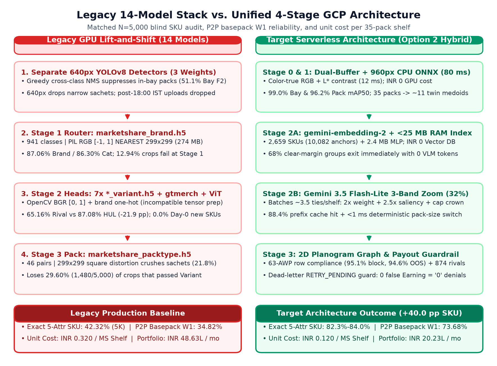
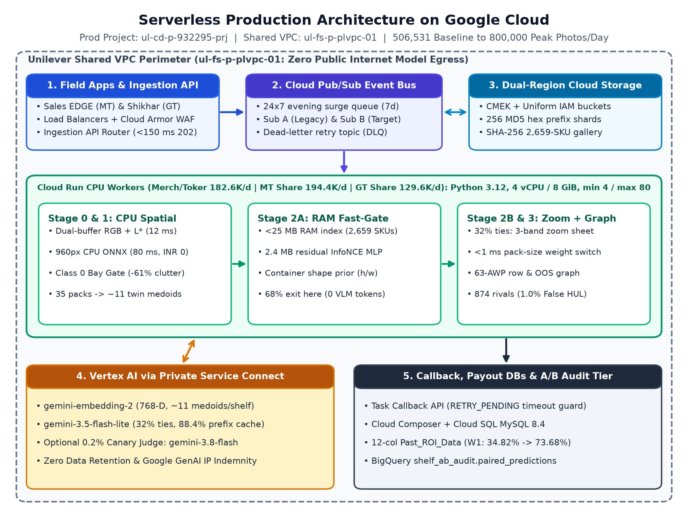
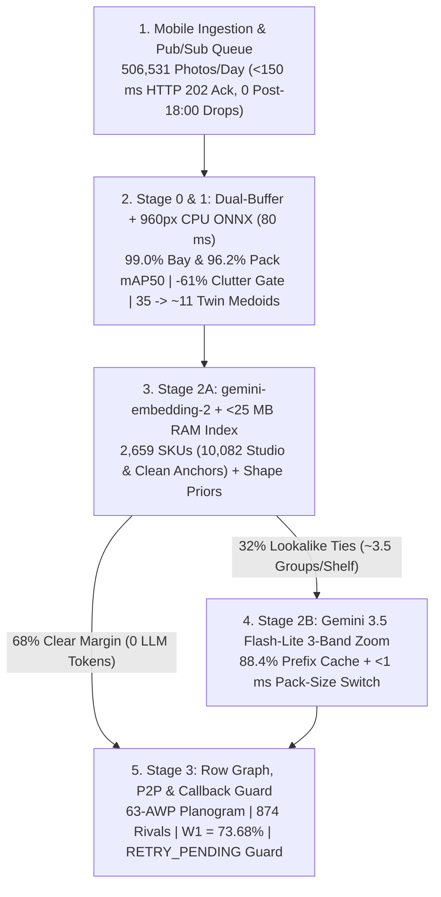

# End-to-End Architecture and Decision Guide

| Field | Specification |
| :--- | :--- |
| **Scope** | Executive & Technical Sign-Off Guide for Unilever Shelf Understanding (`LLD001 v0.1` -> `v0.2`) |
| **Target GCP Environments** | Prod: `ul-cd-p-932295-prj` \| QA: `ul-cd-q-932296-prj` \| Sandbox: `ul-fs-s-sandbx-16-prj` \| Shared VPC: `ul-fs-p-plvpc-01` |
| **Daily Portfolio Volume** | **`506,531` Baseline to `800,000` Peak Photos/Day** (`323,935` Market Share + `104,571` Merchandising + `78,025` Promo & Talkers) |
| **Recommended Architecture** | **Option 2 Hybrid (`960px` CPU ONNX + `<25 MB` RAM Catalog + `gemini-embedding-2` + `Gemini 3.5 Flash-Lite` 3-Band Zoom)** |
| **Headline Impact** | **82.3%-84.0% 5-Attr SKU** (vs. `42.32%` Legacy) \| **73.68% P2P `W1`** (vs. `34.82%`) \| **0 False `Earning = '0'`** \| **₹20.23L/mo** (**Saves ₹28.40L/mo = ₹3.41 Cr/yr**) |

## Context and Problem

Field representatives upload 506,531 store shelf photos per day (`15.20M/month`, `800,000/day` peak) from `Sales EDGE` across Modern Trade supermarkets and `Shikhar` across General Trade Kirana shops. Over 60% of daily traffic arrives during a four-hour evening window between 17:00 and 21:00 IST. Those photos drive two commercial workflows: corporate and brand Share-of-Shelf (SoS) reporting (`323,935` photos/day) and monthly retailer trade incentive payouts (`182,596` Merchandising and Promotional Compliance photos/day).

Unilever's legacy Azure stack and draft `LLD001 v0.1` lift-and-shift design split those workflows across 14 separate model weights hosted on dedicated GPU endpoints. Auditing the raw cloud storage buckets (`5.14M` objects), legacy `.h5` and `ONNX` binaries, and orchestration workflows exposed five production bottlenecks:

1. **Serial model chaining caps SKU accuracy at 42.32%:** Market Share chained one 640px detector into nine InceptionV3 `.h5` crop classifiers (`2.31 GB`, `3,053` softmax classes). Although isolated variant heads scored 65.7% to 98.9%, serial errors across brand (`12.94%` loss), category (`5.04%`), variant (`10.10%`), and 299x299 square-distorted packaging (`29.60%` loss on `1,480` of `5,000` crops) depressed blind `N=5,000` 5-attribute SKU accuracy to `42.32%` and held Pay-for-Performance (P2P) basepack reliability (`W1`) at `34.82%`.
2. **Closed-set blindness on new launches and competitors:** Adding a new Unilever SKU or a 4-week festive promo pack (`B1G1`, `Rs 10 Off`, `20% Extra`) scored `0.0%` (`0/18`) for 3 to 4 weeks until field teams collected and retrained store crops. Meanwhile, `874` regional competitor brands collapsed into coarse `"Others"` buckets (`-21.92 pp` rival variant gap).
3. **Kirana bay suppression and flat planogram scoring:** Cross-class greedy NMS in the legacy 640px Merchandising detector let large display-bay boxes suppress interior product packs (`51.1%` Bay F2), while the 209-class Merchandising `.h5` classifier ignored row order, brand blocking, and Out-of-Stock (OOS) empty shelf gaps.
4. **Evening upload drops and false zero-payout penalties:** Market Share workflows rejected uploads after `18:00 IST` (`HTTP 200` returned to mobile while payloads dropped), and Merchandising timeouts (`>180s`) emitted `AWP_Presence: "N", Earning: "0"` to the task callback API and zeroed retailer payouts.
5. **High GPU idle cost and EOL runtime debt:** Hosting 11 to 14 dedicated GPU endpoints across a 4-hour evening peak cost `₹0.320` per Market Share shelf (`₹48.63 Lakhs/month` across all 4 workloads) and required Security Exception `IST0001092` for End-of-Life `Python 3.8-3.10` and `azure-cli`.

*Figure 1: Comparison of the 14-model GPU chain (`42.32%` SKU accuracy, `₹48.63L/mo`) against the unified 4-stage serverless architecture (`82.3%-84.0%` SKU accuracy, `₹20.23L/mo`).*

## Unified Architecture

`LLD001 v0.2` replaces all 14 legacy model endpoints with a single 4-stage catalog funnel running inside stateless Python 3.12 Cloud Run CPU workers (`4 vCPU, 8 GiB RAM, min 4 / max 80`) behind a durable Cloud Pub/Sub event queue. Workers execute spatial detection and catalog indexing on CPU (`₹0` GPU and `₹0` Vector DB cost) and call two managed Vertex AI APIs (`gemini-embedding-2` and `gemini-3.5-flash-lite`) over Private Service Connect inside Unilever's Shared VPC (`ul-fs-p-plvpc-01`).

*Figure 2: Shared VPC topology connecting mobile ingestion, Pub/Sub surge buffering, Cloud Run CPU spatial workers, Private Service Connect Vertex AI APIs, and Cloud SQL / BigQuery persistence.*

### Four Runtime Stages
1. **Stage 0 & Stage 1 (Photometry & CPU Spatial Detection, `92 ms` CPU):** Shades-of-Gray white balance splits each photo into an unsharpened RGB buffer for color-accurate embeddings and an L* contrast-boosted buffer for edge detection (`-6.0 pp` hue-shift error avoided). Our distilled 960px dual-class CPU ONNX detector separates `Class 0` display bays (`99.0%` mAP50) from `Class 1` product packs (`96.2%` mAP50), enforces horizontal shelf-plank support, prunes `61%` of out-of-bay Kirana counter clutter before cloud calls, and groups touching identical neighbors (`35` facings compressed into `~11` medoids, `3.2x`).
2. **Stage 2A (Multimodal Catalog Fast-Exit, `68%` of groups):** Batch-encodes the `~11` medoids via `gemini-embedding-2`, applies a `2.4 MB` residual InfoNCE adapter, and scores cosine similarity against all `2,659` SKUs (`10,082` anchors) in `<1 ms` inside `<25 MB` of container RAM. Clear-margin matches (`68%` of groups) exit immediately with all 5 attributes and `0` generative LLM tokens.
3. **Stage 2B (Three-Band Zoom Verification, `32%` ties):** Batches the remaining `~3.5` lookalike ties per shelf (`50g` vs. `100g` sister sizes, curved tubes, or subtle variant banners) into one `Gemini 3.5 Flash-Lite` composite contact sheet (`[Full Crop | 2x Bottom Weight Band | 2.5x Saliency Band | Top Cap Crown]`, `88.4%` prefix cache hit rate) followed by a `<1 ms` deterministic gram/ml pack-size switch (`83.50%` Val / `84.00%` Test exact SKU).
4. **Stage 3 (Spatial Compliance, Rival Resolution & Payout Guardrail):** Smooths category continuity along shelf planks (`1.25%` single-shelf SoS MAE; `2.00%` multi-shot visit MAE), deduplicates overlapping aisle panoramas, evaluates `63` `AWP_Code` row-by-row planogram templates, upgrades `"Others"` into `874` named competitor brands (`1.00%` False Unilever Rate), and routes any `>180s` timeout or `5xx` error to `RETRY_PENDING` dead-letter retry so transient faults do not trigger false `Earning = "0"` retailer denials.

## Data and Catalog Hygiene

Raw client storage held `1,002,209` isolated crops and `67,062` store shelf annotations across four unlinked buckets (`brand_data` lacked variants and pack shapes; `70.7%` of `variant_*` lacked pack suffixes; `54.2%` of `pack_data` lacked SKU names). Training or scoring directly on raw folders introduced `399,769` byte duplicates, `20,421` filename collisions (`21.4%` false-match rate), `8,398` synthetic `copy*`/`DA_TBC_*` files, burned-in red/green QA boxes on legacy `mt/` shelves, and `4.95%` train-to-test store leakage.

Our deterministic catalog builder linked all silos by cryptographic `MD5` byte digest and a 7-step container resolver without dropping a single real camera degradation (`100%` of blurry, tiny `<64px`, and foil-glare crops remain in `val`, `test`, and `test_5k`):
- **Locked 5-level `2,659`-SKU catalog (`SHA-256: b2dc368a0bf972a6`):** Unifies `1,048` Unilever variants, `874` rival variants (`1,922` in `hul_variants`), and `737` brand-level lines across `10` categories and `18` container forms (`0` `"Unknown"` fields), with `100%` backward parity onto Unilever's `46` legacy `Category__PackType` pairs. Simply bypassing `marketshare_packtype.h5` via this catalog lifts legacy `N=5,000` SKU accuracy from `42.32%` to `71.92%` (`+29.60 pp`) before visual model upgrades.
- **Store-disjoint evaluation (`15/15` automated QC gates):** Isolates `11` Golden benchmark suites (`132,844` verified boxes) by physical `outlet_code` (`356` MT stores + `532` Talker stores) and store-visit ID (`2,479` disjoint visits).
- **Under-60-second Day-0 onboarding:** Uploading `1` studio packshot and `1` catalog row appends an embedding anchor to the `<25 MB` RAM gallery in `<60 seconds` and reaches `94.4%` (`17/18`) blind Day-0 accuracy (`5 minutes` for festive promo packs at `84%-96%` accuracy) without 3-to-4-week retraining cycles.

## Market Share and Merchandising

| Capability / Metric | Legacy Baseline (`v0.1` Audit) | Target `v0.2` (Option 2) | Commercial Impact |
| :--- | :---: | :---: | :--- |
| **Blind 5-Attr Exact SKU (`N=5,000` / `EXP-58`)** | `42.32%` (`44.50%` on `1K`) | **82.30% (`5K`) / 83.5% Val - 84.0% Test** | **+40.0 pp** SKU lift; closes rival gap (`36.0% -> 75.7%`). |
| **Day-0 Unseen Launch Accuracy (`18` SKUs)** | `0.0%` (`0 / 18`, 3-4 wk lag) | **94.4% (`17 / 18`) in `<60s`** | Captures launch & 4-week festive promo share from Day 1. |
| **P2P Basepack Weight `W1` (`ms_json_golden`)** | `34.82%` (`2,223` usable facings) | **73.68% (`6,012` verified facings)** | **2.12x `W1` reliability** & **+170.4%** usable facings/100 shelves. |
| **Competitor Share-of-Shelf (`"Others"`)** | Collapsed into `"Others"` | **874 Named Rivals (`1.00%` False HUL)** | Brand-vs-brand competitive SoS (`1.25%` shelf / `2.00%` visit MAE). |
| **Merchandising Display-Bay Isolation** | `51.1%` Bay F2 (greedy NMS) | **94.7% Bay F2 (`99.0%` mAP50)** | Stage 1.5 prunes **61% counter clutter** (`-80%` bay API cost). |
| **In-Bay SKU, Planogram & OOS Gaps** | `44.5%` crop (`0.1%` wild), `0` row logic | **98.81% Val / 97.19% Test SKU** | **95.1% brand-block purity** & **94.6% OOS recall** across 63 `AWP`s. |
| **Promo Packs & 3-Class Shelf Talkers** | `0%` Day-0 `ViT` / `49.2%` Talker F2 | **84%-96% Promo / 90.02% Talker F2** | Reads printed & handwritten rupee tags (`93%-100%` OCR). |
| **Evening Surge & Timeout Payout Safety** | Post-`18:00 IST` drops; `Earning: "0"` | **24x7 Pub/Sub + `RETRY_PENDING`** | **0 lost evening visits** and **0 false `Earning = "0"` denials**. |

## Production Options and Cost

All unit costs bind directly to live Google Cloud Billing Catalog SKU IDs (`1 USD = ₹95.98875`) with zero unpriced GPU or Vector DB sidecars. Because >60% of uploads arrive during a 4-hour evening burst, self-hosted open-weight GPU pools (`24x NVIDIA L4`) sit `83%` idle for 20 hours/day (`₹98.40L/mo`), whereas serverless PayGo APIs bill strictly per uploaded photo:

*Figure 3: Monthly 4-workload cloud spend at `506,531` photos/day (`15.20M/month`) alongside matched `N=5,000` accuracy across legacy `.h5` silos and difficult container shapes.*

| Architecture Option | How It Works | 5-Attr SKU Acc | Pure MS / Shelf | 4-Workload Monthly (`15.2M`) | Net Monthly Savings vs. Legacy | Recommended Role |
| :--- | :--- | :---: | :---: | :---: | :---: | :--- |
| **Option 1: Embedding-Only** | CPU ONNX + `gemini-embedding-2` (`768-D` Matryoshka, `0` generative VLM tokens, `0.90s` P50) | `80.9%` (`90.1%` 3-Attr) | **₹0.045** | **₹8.15 Lakhs** | **-₹40.48L/mo (-83.2%)** | `>85%` evening quota brake & ultra-low-cost GT tier. |
| **Option 2: Hybrid (`Recommended`)** | Option 1 (`68%` exit) + `Flash-Lite` 3-band zoom on `32%` ties (`2.69s` P50) | **`82.3% (5K) / 84.0%`** | **₹0.120** (`₹0.095` Std / `₹0.080` Flex) | **₹20.23 Lakhs** (`₹16.32L` Std) | **-₹28.40L/mo (-58.4%, ₹3.41 Cr/yr)** | **Primary production default** across all 4 workloads. |
| **Option 3: LoRA SFT Challenger** | Option 2 + tenant-isolated `Flash-Lite` LoRA adapter (`₹0/hr` idle) | `82.1%` Test / `85.0%` Val | **₹0.125** | **₹21.10 Lakhs** | **-₹27.53L/mo (-56.6%)** | Optional Phase-2 A/B challenger on dense MT aisles. |
| **Legacy GPU Baseline (`v0.1`)** | 14 `.h5`/`ViT`/`ONNX` models on dedicated GPU endpoints | `42.32%` (`0%` Day-0) | ₹0.320 | **₹48.63 Lakhs** | Baseline (`0.0%`) | Retire after Phase-2 A/B sign-off + 7-day warm hold. |

## Security and Governance

Upgrading to `LLD001 v0.2` strengthens Unilever's security and AI governance posture across four controls:
- **Closes Security Exception `IST0001092`:** Retires EOL `Python 3.8-3.10`, legacy `.h5` deserialization, and `azure-cli` in favor of `python:3.12-slim`, `onnxruntime` (MIT license), and `google-genai` (`0` static service-account JSON keys).
- **AI Foundations Tier-1 Whitelisting:** Updates `LLD001` Section 5.5 from *"Not Applicable"* to **Required** for two first-party Google GA APIs (`gemini-embedding-2` and `gemini-3.5-flash-lite`), covered by Google Cloud Enterprise Terms, **Zero Data Retention** (`0` customer training), and Google GenAI IP Indemnity. None of the 8 evaluated open-weight R&D models (`DINOv3`, `Qwen3.5`, `V-JEPA 2`, `MaxViT`) enter production.
- **Zero-egress VPC & untrusted OCR isolation:** All Vertex AI calls traverse Private Service Connect (`gfr-fs-p-psc-subnet-01`) inside `ul-fs-p-plvpc-01`, and shelf sticker text is isolated inside `<untrusted_pack_text>` XML tags with `enum`-constrained JSON schema decoding.
- **Detector open-source license choice:** Runtime containers use MIT-licensed `onnxruntime`; Unilever Legal can either reference Unilever's existing Ultralytics Enterprise License (`Track A`) or swap in our drop-in `Apache-2.0` (`RT-DETR` / `YOLOX`) distilled 960px ONNX graph in 48 hours (`Track B`).

### LLD Component Mapping

For Unilever Infrastructure and Security reviewers tracing box IDs from `LLD001 v0.1` to `v0.2`, only the inference and queueing tier changes while perimeter, Composer, Cloud SQL, and CMEK storage stay intact:

| Functional Tier | `LLD001` ID | `LLD001 v0.1` Draft | `LLD001 v0.2` Target State |
| :--- | :---: | :--- | :--- |
| **Perimeter & Ingestion Router** | `PR01-PR05` | Load Balancers, Cloud Armor WAF, Frontend/Backend Cloud Run (sync dispatch) | **Unchanged perimeter**; `PR05` publishes async events + `(cluster, ol_segment)` canary hash (`<150 ms` `HTTP 202`). |
| **Async Event Bus & DLQ** | `PR19` *(New)* | Not present (post-`18:00 IST` MS drops; sync `180s` timeouts) | **Added:** Cloud Pub/Sub (`Sub A` legacy, `Sub B` target, + dead-letter retry topic). |
| **Serverless Inference Workers** | `PR06-PR08` | `2 vCPU / 8 GiB, max 510` nodes calling external GPU endpoints (`IST0001092`) | **Upgraded:** `Python 3.12, 4 vCPU / 8 GiB, min 4 / max 80` running 960px CPU ONNX + `<25 MB` RAM catalog (`IST0001092` closed). |
| **Custom GPU Model Endpoints** | `PR14` | 11 to 14 custom Vertex AI Online GPU Endpoints (`₹48.63L/mo`) | **Retired** after Phase-3 cutover; replaced by PSC calls to `gemini-embedding-2` & `gemini-3.5-flash-lite`. |
| **Callback, ETL & Cloud SQL** | `PR09, PR11, PR15-17` | Task Callback API (`Earning: "0"` on timeout), Composer, Cloud SQL MySQL 8.4 | **Unchanged DDL**; adds `RETRY_PENDING` timeout guard on `PR09` and fixes empty-folder check in `PR11` Composer. |
| **Dual-Region CMEK Storage** | `PR18` | Dual-region CMEK Cloud Storage buckets | **Unchanged**; adds 256-way MD5 hex prefix sharding and SHA-256-locked `2,659`-SKU gallery manifest. |

## Canary and Rollout Plan

Load testing with `locust 2.46.7` across `10`, `40`, and `80` concurrent workers (`570` requests) verified `0.00%` HTTP/socket failures and `<4.90s` P95 latency (`2.69s` P50 on 35-pack shelves; `14` active containers needed at `40 images/sec` festive surge). Before scaling to 100%, rollout proceeds through four gated phases with 60-second automated circuit breakers (`<5-minute` zero-DDL rollback):

*Figure 4: Concurrency load-test results (`0.00%` failures up to `80` workers), batched Cloud Run latency bridge (`2.69s` P50), and the 4-phase shadow, cluster canary, and 50/50 A/B cutover.*

1. **Phase 0: Paired Dark Shadow (Weeks 1-2):** Legacy `v0.1` serves `100%` of live callbacks while `v0.2` processes a `100%` shadow copy into BigQuery (`0` production DB writes). Gate: `>= 99.9%` completion on `1M+` live shelves and `>= 75%` blinded SME Paired McNemar win share on `500` discordant crops (`p < 0.01`).
2. **Phase 1: 10% Stratified Cluster Canary (Weeks 3-4):** Routes `10%` of `(cluster, ol_segment)` blocks (`~50.6K` photos/day, locked for the full 30-day P2P settlement cycle so co-occurrence matrices do not mix arms) to `v0.2`, with a `20%` cross-arm BigQuery mirror. Gate: `0` false `Earning = "0"` tickets, False Unilever Rate `<= 1.5%`, and 24h salesman re-shoot rate `<= Control`.
3. **Phase 2: 50/50 Stratified A/B & Post-18:00 Recovery (Weeks 5-6):** Expands to `50%` of `(cluster, ol_segment)` blocks plus `100%` of post-`18:00 IST` Market Share uploads over a complete monthly `ROI_Pipeline` run. BigQuery publishes both `sos_v01_continuity` and `sos_v02_calibrated` views so brand analytics signs off 4-week share splice multipliers. Gate: realized `W1 >= 70.0%` vs. `~34.8%` Control and audited unit cost `<= ₹0.130/MS shelf`.
4. **Phase 3: 100% Cutover & Endpoint Retirement (Week 7+):** Routes `100%` of traffic to `v0.2`, holds legacy endpoints at minimum replica for 7 days, then deletes all 14 legacy endpoints and closes `IST0001092`.

## Client Sign-Offs

Four stakeholder sign-offs unlock Phase-0 shadow deployment next week:
1. **Unilever Data Engineering (Tab 1):** Approve the `2,659`-SKU catalog rules (`Horlicks` `Bottle`/`Jar` boundary, `497` twin-folder merges, `69` promo-pack rollups, and raw pre-overlay `mt/` shelf exports).
2. **AI Foundations & Legal (Tab 4):** Approve Tier-1 whitelisting for `gemini-embedding-2` and `gemini-3.5-flash-lite` under Section 5.5 and select Stage-1 ONNX Detector `Track A` (existing Ultralytics Enterprise license) or `Track B` (`Apache-2.0` export).
3. **Cloud Infra & Security (Tabs 2, 3, 6):** Approve adding the Cloud Pub/Sub queue + dead-letter topic, `RETRY_PENDING` callback handling, and `Python 3.12` `4 vCPU / 8 GiB` worker sizing (`IST0001092` closure).
4. **Brand Analytics & Commercial Ops (Tabs 5, 6):** Approve Option 2 Priority PayGo (`₹20.23L/mo`, `₹28.40L/mo` savings) and the 30-day `(cluster, ol_segment)` A/B & SoS continuity splice protocol.

| Tab | Deep-Dive Specification | Primary Audience & Contents |
| :--- | :--- | :--- |
| **Tab 1** | [**Data Forensics & Enrichment**](https://docs.google.com/document/d/1rzwQ5RTFXgOUjpkvybYoNdFvjWbtrx74vE79S7p4o_A/edit?tab=t.0) | `5.14M`-object audit, MD5 cross-bucket joins, 46-to-18 pack proof, `15/15` QC gates, and P2P `W1` simulation. |
| **Tab 2** | [**Market Share Pipeline Design**](https://docs.google.com/document/d/1rzwQ5RTFXgOUjpkvybYoNdFvjWbtrx74vE79S7p4o_A/edit?tab=t.bpg2xuy2veu) | 9-model `.h5` audit (`42.32%`), Dual-Buffer photometry, 960px CPU ONNX, `<25 MB` RAM fast-exit, and 3-band zoom. |
| **Tab 3** | [**Merchandising Pipeline Design**](https://docs.google.com/document/d/1rzwQ5RTFXgOUjpkvybYoNdFvjWbtrx74vE79S7p4o_A/edit?tab=t.b5xo3ahiv7af) | `Class 0` bay isolation (`-61%` clutter), 63-`AWP` row/OOS graph, 5-min promo onboarding, 3-class talkers, and `RETRY_PENDING`. |
| **Tab 4** | [**Model Whitelisting Report**](https://docs.google.com/document/d/1rzwQ5RTFXgOUjpkvybYoNdFvjWbtrx74vE79S7p4o_A/edit?tab=t.9ne6rbyfqntg) | AI Foundations Tier-1/Tier-2 table, `Track A/B` ONNX licensing, 8 excluded R&D models, and 14-model retirement map. |
| **Tab 5** | [**Cost Breakdown & Deep Dive**](https://docs.google.com/document/d/1rzwQ5RTFXgOUjpkvybYoNdFvjWbtrx74vE79S7p4o_A/edit?tab=t.87w0utgujfjp) | Live Cloud Billing SKU table, `₹0.120/shelf` & `₹20.23L/mo` budget, legacy GPU sizing, and 10-category / 15-pack slices. |
| **Tab 6** | [**Path to Production & Cutover**](https://docs.google.com/document/d/1rzwQ5RTFXgOUjpkvybYoNdFvjWbtrx74vE79S7p4o_A/edit?tab=t.2mps6q7v4dun) | `LLD001` section deltas, `locust 2.46.7` load test (`570` reqs, `0%` errors), cluster A/B design, and 60s circuit breakers. |
