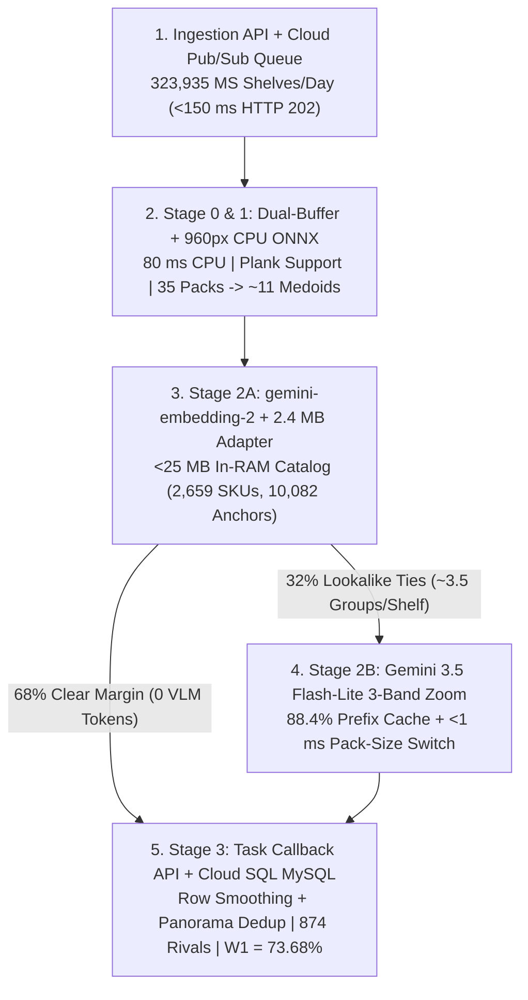
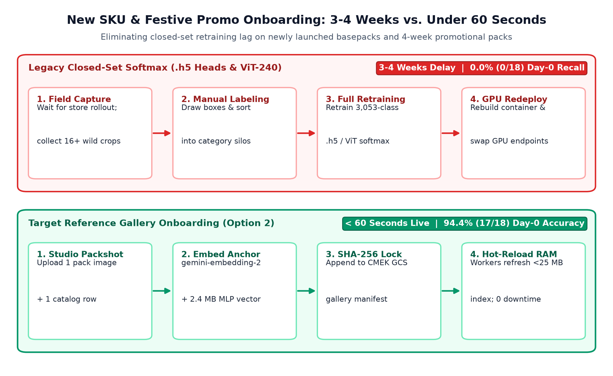
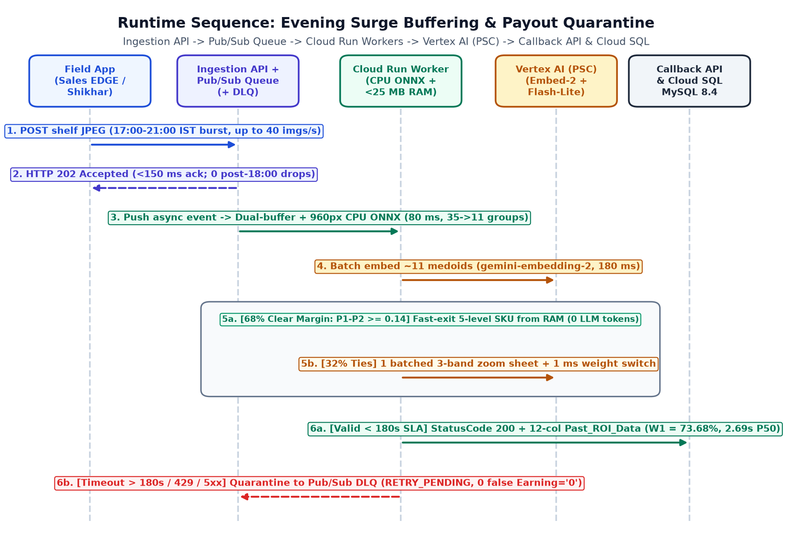

# Market Share Pipeline Design

| Field | Specification |
| :--- | :--- |
| **Specification Scope** | `LLD001 v0.1` -> `v0.2` Sections 3, 4.1, 4.1.1.2, 4.2, 6.1, and 9.3 |
| **Target GCP Projects** | Prod: `ul-cd-p-932295-prj` \| QA: `ul-cd-q-932296-prj` \| Sandbox: `ul-fs-s-sandbx-16-prj` |
| **Workload Scope** | Modern Trade (`194,361/day`, `Sales EDGE`) + General Trade (`129,574/day`, `Shikhar`) = **`323,935` Shelves/Day** (`64.0%` of `506,531` daily photos) |
| **Recommended Design** | **Option 2 Hybrid (`DistilledYolo960SoftNms` CPU ONNX + `gemini-embedding-2` + `Gemini 3.5 Flash-Lite` 3-Band Zoom)** |
| **Headline Outcome** | **82.3% (`N=5,000`) / 83.5% Val to 84.0% Test 5-Attr SKU Acc** (+40.0 pts vs. 42.32% Legacy) \| **2.69s P50** \| **₹0.120 / Shelf** (-62.5% Cost) |

## Context and Problem

Market Share audits calculate Unilever's corporate, category, brand, container, and basepack Share-of-Shelf (SoS) across Modern Trade supermarket gondolas and General Trade Kirana counters. Field representatives upload 323,935 Market Share photos per day inside a 506,531-photo portfolio (`800,000` peak), with over 60% arriving between 17:00 and 21:00 IST.

Unilever's legacy Azure Kubernetes Service (AKS) stack and draft `LLD001 v0.1` lift-and-shift design chained one 640px single-class detector into nine Keras InceptionV3 crop classifiers on dedicated GPU endpoints. Auditing the customer code and running those nine weights on matched blind splits exposed four bottlenecks:

1. **Compound chaining loss:** Individual variant heads scored 65.7% to 98.9% in isolated training, yet serial chaining across brand (87.06%), category variants (76.22%), and packaging (54.86%) cut end-to-end 5-attribute SKU accuracy to 42.32% on `N=5,000` (44.50% on `1K`) and held P2P basepack weight (`W1`) at 34.82%.
2. **Incompatible tensor prep and zero Day-0 recall:** The brand classifier expected PIL RGB `[-1, 1]` `NEAREST` 299x299 inputs, whereas the variant and pack heads expected OpenCV BGR `[0, 1]` `BILINEAR` inputs plus one-hot conditioning vectors. Closed-set softmax weights scored 0.0% (0/18) on newly launched SKUs for 3 to 4 weeks and collapsed 874 competitor brands into `"Others"`.
3. **Evening upload drops and scheduler bugs:** An upfront time check (`07:30 <= IST <= 18:00`) in the Azure Logic App returned `HTTP 200` to the mobile app and dropped uploads after 18:00 IST when AKS GPU clusters powered down. Meanwhile, the start-cluster workflow checked `dayOfWeek(...) == 10` (outside the valid `0..6` range) and booted both GPU clusters on Sundays.
4. **Timeout losses and endpoint cost:** Synchronous `PT180S` calls with `retryPolicy: none` returned `StatusCode: 500, Recognised_Packs: ""` during evening spikes. `LLD001 v0.1` sized the inference worker pool up to 510 Cloud Run nodes alongside 11 to 14 dedicated GPU endpoints at ₹0.320 per shelf (`₹48.63 Lakhs/month` portfolio baseline).


*Figure 1: Legacy 14-model chain (42.32% SKU accuracy, ₹0.320/shelf) vs. unified 4-stage `LLD001 v0.2` spine (82.3% to 84.0% SKU accuracy, ₹0.120/shelf).*

## Goals and Non-Goals

### Goals
- **SKU and Share-of-Shelf accuracy:** Exceed 80% 5-attribute SKU accuracy on `N=5,000` blind crops (achieved 82.30% on `test_5k`, 83.50% Val / 84.00% Test), hold visit SoS MAE at or below 2.0% (achieved 1.25% to 2.00%), and raise P2P basepack `W1` from 34.82% to 73.68% (2.12x).
- **Day-0 launch onboarding:** Index new basepacks in under 60 seconds from 1 studio packshot and 1 catalog row at 94.4% (17/18) Day-0 accuracy.
- **Evening surge resilience:** Replace the `07:30-18:00 IST` drop window with asynchronous Cloud Pub/Sub buffering (`<150 ms` ack) and sustain `40 images/sec` peaks at 2.69s P50 / 6.40s P95 latency.
- **Unit economics:** Cut Market Share unit cost from ₹0.320 to ₹0.120 per 35-pack shelf (`USD 0.00139` Priority PayGo; ₹0.045/shelf on Option 1 Embedding-Only with `0` generative VLM calls) and retire dedicated GPU endpoints.

### Non-Goals
- **Mobile app payload changes:** `Sales EDGE` and `Shikhar` send their existing JSON request schemas to the ingestion API without mobile client updates.
- **Network perimeter or DDL changes:** Shared VPC `ul-fs-p-plvpc-01`, Cloud Armor WAF, Cloud SQL MySQL 8.4 table schemas, and downstream P2P scoring scripts remain unchanged.

## Customer LLD Baseline

Each Azure legacy artifact and `LLD001 v0.1` component maps directly to its `LLD001 v0.2` replacement:

| Azure Legacy Asset | `LLD001 v0.1` Draft | Audited `v0.1` / Legacy Defect | `LLD001 v0.2` Production Design |
| :--- | :--- | :--- | :--- |
| **`marketshare-endpoint-mt-prod-aks2.json`** | `PR05` sync HTTP to `PR07/PR08` | Drops post-`18:00 IST` uploads after `HTTP 200`; static token; `retryPolicy: none` on `PT180S`. | `PR05` publishes to **`PR19` Pub/Sub** (`24x7` queue, `<150 ms` ack); Secret Manager + Workload Identity. |
| **`marketsharestartcluster` & `stopcluster.json`** | Scheduled `PR14` GPU scaling | `dayOfWeek == 10` bug starts clusters Sundays; `18:00 IST` stop kills evening uploads. | **Retired.** Serverless `PR07/PR08` (`min 4, max 80`) + Vertex PayGo scale 24x7 (`₹0` overnight idle). |
| **`marketshare_yolo.onnx` + 9 `.h5` Heads** | `PR14` Custom Endpoints (`IST0001092`) | 42.32% SKU accuracy; 3 conflicting RGB/BGR resizers; EOL Python 3.8-3.10 + `azure-cli`. | **Retired (`IST0001092` closed).** Python 3.12 runs 960px CPU ONNX (`80 ms`) + `gemini-embedding-2` + `Flash-Lite` via PSC. |
| **`Outlet_Cluster_Segment` & `ROI_Pipeline.json`** | `PR11` Composer + `PR16/17` MySQL | `Set variable2` outside `ifTrueActivities` logs `"Moved"` on empty runs; `'Model_Output'` dropped. | `PR11` DAG fixes empty-folder check and loads 7-col `cluster_mapping` (`10K` batch) + 12-col `Past_ROI_Data` (`2K` batch). |

### Legacy Model Audit

Cloud Run Job `shelf-bench-legacy-audit-n2xn2` evaluated all 9 Market Share `.h5` weights (`2,308.49 MB` / `2.31 GB`, `3,053` cumulative classes across 9 `n1-standard-4` endpoints) on matched `N=5,000` (`#1016-093317`), `N=1,000` (`#1015-092627`), and Oracle Brand (`#1015-115810`) splits:

| Legacy `.h5` Model (`gs://sos-datasets/legacy-models/`) | Input Prep & Binary Size | Classes | Isolated Var (Oracle 1K) | Chained Var (5K Silo / Routed) | Chained 5-Attr SKU (5K Silo / Routed) | Option 2 5-Attr SKU (5K) |
| :--- | :--- | :---: | :---: | :---: | :---: | :---: |
| **`marketshare_brand.h5` (Stage 1)** | RGB `[-1, 1]` `NEAREST` (`274.10 MB`) | 941 | 100.0% (`88.50%` 1K) | `87.06%` Brand (`86.30%` Cat) | `12.94%` Stage-1 loss (`647` crops) | **96.1% Brand** (+9.0 pts) |
| **`p5_variant.h5` (HFD/Foods/Bev)** | BGR `[0, 1]` + 1-hot (`254.30 MB`; `1,241 / 1,265`) | 291 | 98.4% | `94.0%` (`92.25%`) | `50.9%` (`51.38%`) | **89.1%** (+38.2 pts) |
| **`nonhul_gen_variant.h5` (Rival Gen)** | BGR `[0, 1]` + 1-hot (`254.83 MB`; `1,363 / 1,320`) | 595 | 89.4% | `71.5%` (`73.86%`) | `44.0%` (`45.08%`) | **76.7%** (+32.7 pts) |
| **`nonhul_p6_variant.h5` (Rival P6)** | BGR `[0, 1]` + `61`-D 1-hot (`254.45 MB`; `1,036 / 1,012`) | 367 | 69.9% | `58.3%` (`59.68%`) | `29.1%` (`26.58%`) | **77.0%** (+47.9 pts) |
| **`skin_variant.h5` (Skin + Hair)** | BGR `[0, 1]` + 1-hot (`254.52 MB`; `525 / 534`) | 438 | 84.1% | `71.0%` (`69.85%`) | `31.8%` (`33.90%`) | **91.6%** (+59.8 pts) |
| **`wash_variant.h5` (Laundry/HHC)** | BGR `[0, 1]` + `21`-D 1-hot (`254.13 MB`; `497 / 522`) | 173 | 98.9% | `81.9%` (`77.97%`) | `52.7%` (`44.44%`) | **81.9%** (+29.2 pts) |
| **`gen_variant.h5` (PW/Hair/Deo)** | BGR `[0, 1]` + 1-hot (`254.08 MB`; `177 / 185`) | 145 | 65.7% | `88.7%` (`84.86%`) | `57.1%` (`48.65%`) | **80.8%** (+23.7 pts) |
| **`oral_variant.h5` (Oral Care)** | BGR `[0, 1]` + 1-hot (`254.15 MB`; `161 / 162`) | 57 | 85.7% | `79.5%` (`79.01%`) | `32.9%` (`38.89%`) | **83.2%** (+50.3 pts) |
| **`marketshare_packtype.h5` (Stage 3)** | BGR `[0, 1]` + `10`-D Cat (`253.93 MB`) | 46 | `60.20%` Pack (1K) | `54.86%` Pack | **`29.60%` Stage-4 loss (`1,480`)** | **91.7% Pack** (+36.8 pts) |
| **9-Model Compound Total** | **Serial 3-step chain (`2.31 GB` total)** | **3,053 -> 2,659** | **`52.00%` Ceiling (1K)** | **`76.22%` Variant** | **`42.32%` (`2,116/5,000`; `44.50%` 1K)** | **`82.30%` (`83.20%` remap / `84.00%` EXP-58)** |

Even with 100% Oracle Brand labels, the `.h5` chain hits a 52.00% ceiling because 1,480 of 5,000 crops (29.60%) pass Variant only to fail at `marketshare_packtype.h5` (21.81% on sachets, 15.35% on wrappers, and 0% on `PW__Bar`, `Roll_On`, and `Spray`). Bypassing that pack classifier via our 2,659-SKU catalog lookup lifts legacy `test_5k` accuracy from 42.32% to 71.92%; Option 2 then closes the -21.92 pp competitor variant gap (`65.16%` Rival vs. `87.08%` Unilever) and raises `W1` from 34.82% to 73.68%.

## Target Architecture

`LLD001 v0.2` replaces all nine `.h5` classifiers and the 640px detector with a 4-stage catalog funnel inside the Modern Trade and General Trade Cloud Run CPU workers (`4 vCPU, 8 GiB RAM, min 4 / max 80`). Workers call two managed Vertex AI APIs over Private Service Connect (`gfr-fs-p-psc-subnet-01`).


*Figure 2: Event-driven GCP architecture connecting CMEK Cloud Storage, Cloud Pub/Sub, Cloud Run CPU spatial detection, `<25 MB` RAM catalog fast-gating, and 32% fine-print zoom verification.*



### Stage 0 Photometry

Kirana photos mix tungsten bulbs, back-shelf shadows, and foil glare. Applying contrast sharpening globally helps edge detection (+0.8 pts on micro-text) yet shifts pack hue and drops color-sensitive embedding accuracy by 6.0 percentage points (`Pond's` blue vs. violet tubs). Stage 0 isolates the two paths in 12 ms on CPU (Gate `G14`):
- **Minkowski Shades-of-Gray white balance (`p = 6`):** Neutralizes warm tungsten and fluorescent color casts once per shelf photo.
- **Buffer A (color-true linear RGB):** Feeds Stage-2A embeddings so brand hues remain untouched.
- **Buffer B (luminance L* CLAHE contrast):** Feeds Stage-1 box edge detection and Stage-2B bottom gram-weight zoom crops.

### Stage 1 Pack Detection

Stage 1 executes inside the Cloud Run worker container on CPU with ₹0 GPU spend:
1. **Distilled 960px dual-class CPU ONNX (`yolo11n-distilled-onnx`):** Runs in 80 ms on 4 vCPUs and reaches 96.2% mAP50 on `Class 1` packs and 99.0% mAP50 on `Class 0` display bays (100.0% recall on `gt_hul_sessions`).
2. **Aspect-aware Gaussian Soft-NMS (`sigma = 0.55`):** Smoothly decays overlapping scores instead of deleting touching soap bars and hanging sachet strips.
3. **Sub-window refinement and 2x2 tiling:** Splits merged multi-pack boxes (68.99% Det F2 inside annotated pockets on `ms_json_golden`) and tiles gondolas exceeding 65 detections (up to 189 packs per photo).
4. **Shelf-plank support:** Fits horizontal plank lines across bottom box edges (`y_max`) to reject floating 2D header signs, posters, and price rails.

### Stage 2A Catalog Matching

Row-adjacent twin grouping clusters touching boxes on the same plank when aspect ratio and color histogram (`>= 0.94`) match: 35 shelf facings compress into ~11 medoid groups (3.2x), and cloud API calls drop by 68% to 75%. Each medoid then runs through Stage 2A:
1. **Multimodal embedding and residual adapter:** Encodes Buffer A via Vertex AI `gemini-embedding-2` (`outputDimensionality=768` Matryoshka slice from `3,072-D` native) and applies a 2.4 MB residual InfoNCE MLP (`norm(q + 0.35 * W2 * GELU(W1 * q))`) trained strictly on gallery anchors.
2. **In-memory 2,659-SKU gallery (`<25 MB` RAM, ₹0 Vector DB):** Scores CSLS hubness-reduced cosine similarity against 10,082 anchors in `<1 ms` inside container RAM.
3. **Container-shape priors (`epsilon = 0.01`):** Weights visual similarity by aspect ratio (`h/w`), neck taper, and plank-relative height to separate bottles, jars, and sachets.
4. **Margin fast-exit (68% of groups):** When top-2 probability margin (`P1 - P2 >= 0.14`) and Z-score (`Z >= 1.65`) clear threshold, Stage 2A emits all 5 attributes with 0 generative VLM tokens. Standalone Stage 2A (Option 1 Embedding-Only) reaches 80.9% exact SKU / 90.1% 3-attribute accuracy in 0.90s P50 at ₹0.045/shelf.



*Figure 3: Adding 1 studio packshot and 1 catalog row updates the `<25 MB` RAM index in under 60 seconds at 94.4% (17/18) blind Day-0 accuracy.*

### Stage 2B Zoom Verification

The remaining 32% (~3.5 groups per shelf) are lookalike ties (`50g` vs. `100g` sister sizes, `Lemon` vs. `Jasmine` sub-banners, or curved tubes). Stage 2B batches up to 8 uncertain groups per shelf into one `Gemini 3.5 Flash-Lite` call (`2.69s` P50 / `6.40s` P95 total shelf latency):
1. **Three-band zoom sheet and tube unwarping:** Builds `[Full Crop | 2x Bottom-30% Weight Band | 2.5x Reference-Variance Band | Top-22% Cap Crown]`. Squeeze tubes (`h/w >= 1.75`) receive 1.15x horizontal foreshortening correction, which raises tube SKU accuracy from 77.0% to 89.0%.
2. **Prefix context caching (88.4% hit rate):** Places invariant catalog rubrics first so repeated prefixes bill at 90% off (`USD 0.054` vs. `USD 0.54 / 1M` Priority tokens).
3. **Pre-choice evidence decoding and logprob fusion:** Decodes `pack_size_read`, `distinctive_cue`, and `brand_read` before `choice` (+8.9 pts over choice-first) and fuses VLM logprobs (0.62) with Stage-2A similarity (0.38) when top-2 token margin falls below `0.35`.
4. **Deterministic pack-size switch (`<1 ms`):** Matches parsed `g`/`ml` stamps against shortlist sister SKUs (83.50% Val / 84.00% Test on `EXP-58`, Paired McNemar `p = 0.006`, 0 cross-brand errors), guarded by a `0.045` cosine veto and open-set competitor floor (1.00% False HUL Rate).

### Stage 3 Shelf Aggregation

Stage 3 converts verified medoids into visit-level Share-of-Shelf and downstream database rows:
- **Plank-row neighbor smoothing (+2.5 pts):** Enforces spatial continuity along shelf planks (98.2% category accuracy; 1.25% single-shelf SoS MAE; 2.00% multi-shot visit SoS MAE).
- **Panorama overlap deduplication:** Detects overlapping left-to-right aisle shots (`NCC >= 0.86`) in multi-image `Image_Names` uploads so boundary facings count once (`<0.5%` visit error).
- **12-column `Past_ROI_Data` export:** Writes exact basepack codes (`0` `'Model_Output'` drops) into Cloud SQL MySQL, raises usable shelf facings by +170.4% (`2,223` to `6,012`), and lifts P2P `W1` from 34.82% to 73.68%.

## Interface Contracts

The Modern Trade and General Trade Cloud Run workers accept Unilever's inbound request schema (`Image_Names`, `Outlet_Code`, `RSCode`, `Request_ID`, `Salesman_Code`, plus optional `psa_category`) and emit the `DYNAMIC_TASK_API` callback with `v0.2` timeout quarantine fields:

```json
{
  "Request_ID": "REQ-MT-20261025-88412",
  "Outlet_Code": "HUL-MT-40912",
  "RSCode": "RS-WEST-104",
  "Salesman_Code": "SM-7721",
  "StatusCode": 200,
  "contract_version": "v0.2",
  "contract_status": "OK",
  "catalog_sha256": "b2dc368a0bf972a6",
  "Recognised_Packs": [
    {
      "image_name": "gondola_left_01.jpg",
      "sku_id": 412,
      "is_hul": true,
      "category": "Hair_Care",
      "packaging_type": "Bottle",
      "legacy_46_pack_class": "Hair_Care__Bottle",
      "brand": "Dove",
      "base_variant": "Dove__Hair_Fall_Rescue",
      "facing_count": 4,
      "panorama_deduped": true
    }
  ]
}
```

## Trade-Offs Considered

| Alternative Evaluated | Sandbox Result | Reason Rejected as Primary Default |
| :--- | :--- | :--- |
| **Option 1: Pure `gemini-embedding-2` (Embedding-Only)** | **80.9%** 5-Attr (`1K`), `0.90s` P50, `₹0.045/shelf` | Trails by `-2.7 pp` on identical-artwork `50g` vs. `100g` stamps; retained as `>85%` quota spillover brake (`0` generative VLM calls). |
| **Option 3: LoRA SFT (`EXP-29/33`)** | **85.0% Val / 82.1% Test** (`hul_variants`), `₹0.125/shelf` | Wider `2.9 pp` val-to-test gap vs. `0.5 pp` on Option 2 and needs periodic SFT refreshes; kept as Tier-2 challenger. |
| **Closed-Set `MaxViT-Tiny` / `V-JEPA 2`** | `86.77%` (`hul_variants`) / `84.50%` (`hul_golden` 1K) | Misses 737 catalog SKUs on `MaxViT`, scores **0.0% on Day-0 launches**, and leaves GPUs 83% idle off-peak. |
| **Full-Shelf Single-Call VLM** | `45.6%-46.3%` E2E on `ms_json_golden`, `₹1.41-₹2.15/shelf` | Attention dilution across 35 to 120 small packs cuts accuracy below 47% at **11.7x** higher shelf cost. |

## Runtime Guardrails



*Figure 4: End-to-end ingestion, Cloud Pub/Sub, Cloud Run worker, and callback sequence buffering 17:00 to 21:00 IST bursts (`<150 ms` ack) and routing timeouts into `RETRY_PENDING`.*

| Failure Mode | Legacy `v0.1` Behavior | `LLD001 v0.2` Deterministic Guardrail |
| :--- | :--- | :--- |
| **Post-18:00 IST Upload Burst** | Returns `HTTP 200` and drops payload | Cloud Pub/Sub buffers uploads (7-day retention) into Cloud Run workers (`min 4 / max 80` containers). |
| **Timeout (`> PT180S`) or `429/5xx`** | Emits `StatusCode: 500, Recognised_Packs: ""` (`retryPolicy: none`) | Routes message to `shelf-inference-dlq` with `contract_status = "RETRY_PENDING"` (`0` lost visits). |
| **Evening Vertex Quota > 85%** | Unhandled queueing / HTTP `429` drops | Auto-sheds Stage-2B ties to Option 1 (`gemini-embedding-2` fast-match, `0` generative VLM calls, 80.9% SKU, 0.90s) until quota drops below 75%. |
| **Adversarial Shelf Sticker Text** | Unstructured string concatenation | Isolates OCR inside `<untrusted_pack_text>` XML tags with `enum`-constrained JSON schema decoding (`1..K` or `0`). |
