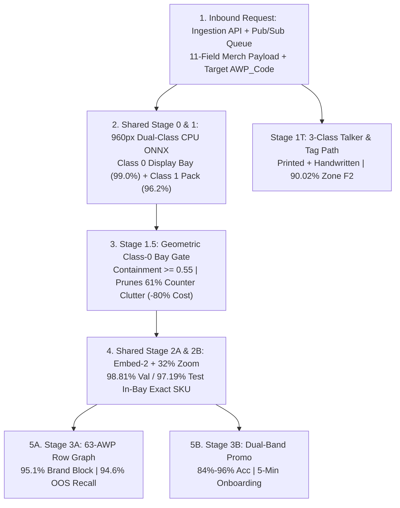

# Merchandising Pipeline Design

| Field | Specification |
| :--- | :--- |
| **Specification Scope** | `LLD001 v0.1` -> `v0.2` Sections 3, 4.1, 4.1.1.2, 4.2, 6.1, and 9.3 |
| **Target GCP Projects** | Prod: `ul-cd-p-932295-prj` \| QA: `ul-cd-q-932296-prj` \| Sandbox: `ul-fs-s-sandbx-16-prj` |
| **Workload Scope** | Display-Bay Merchandising (`104,571` imgs/day, `20.6%`) + Toker Promo (`78,025` Promo & Talker imgs/day, `15.4%`) = **`182,596` Shelves/Day** (Cloud SQL MySQL 8.4) |
| **Recommended Design** | **Shared 4-Stage Spine + Stage 1.5 Class-0 Bay Gate (`-61%` Clutter) + 63-`AWP` Row Graph + Promo/Talker Verifiers** |
| **Headline Outcome** | **98.81% Val / 97.19% Test In-Bay SKU** \| **97.2%-100% Purity** \| **95.1% Brand Block & 94.6% OOS Recall** \| **90.02% Talker F2** \| **0 False `Earning = '0'`** |

## Context and Problem

Merchandising and Promotional Compliance audits govern monthly retailer trade incentives (`Earning`) across 182,596 daily store photos (`104,571` Display-Bay/Planogram photos plus `78,025` Toker promotional pack and talker photos). Each audit checks four spatial and campaign criteria:

1. **Display bay isolation:** Verify that the retailer kept Unilever's paid fixture (`WIN` window bay, `CTU` countertop unit, `MB2`/`MB3` multi-bay gondola, or `HAN` hanging sachet strip) stocked with Unilever products free of competitor intrusion.
2. **Row-level planogram compliance:** Match physical shelves inside that bay against the assigned `AWP_Code` row sequence, brand blocking, and facing quotas across 63 templates (132 required rows), and locate horizontal Out-of-Stock (OOS) empty gaps.
3. **Promotional pack verification:** Confirm that packs carry active campaign callouts (`B1G1`, `B3G1`, `PO2`, `PO3`, `Rs 10 Off`, `Extra 20%`, `Free Container`) rather than baseline stock.
4. **Shelf talkers and price tags:** Detect promotional shelf danglers, printed price-rail clips, and handwritten rupee discount tags mounted on shelf edges.

In Unilever's legacy Azure stack and `LLD001 v0.1`, Merchandising ran on separate detectors and classifiers from Market Share. Auditing the legacy Azure Logic App and five Merchandising/Promo models exposed five production defects:

| Legacy Component | `LLD001 v0.1` Configuration | Audited Production Defect |
| :--- | :--- | :--- |
| **`gt-merchandising-endpoint-prod.json` (`PR05 -> PR06 -> PR09`)** | Validates 11 JSON fields; calls `ACCESS_TOKEN_API` per request & per image; `PT180S` timeout. | **False `Earning = "0"` payout bug:** On any `PT180S` timeout or `5xx` error, the failure handler sent `AWP_Presence: "N", Earning: "0"` to `DYNAMIC_TASK_API` and zeroed store payouts. |
| **GT Merch Detector (`gtmerch_asset_sku...onnx`, `PR14`)** | 640px 2-class YOLOv8n (`Class 0` bay + `Class 1` pack) on dedicated GPU endpoint (`PR14`). | Cross-class greedy NMS let large `Class 0` bay boxes suppress interior `Class 1` packs (**51.1% Bay F2**) and dropped narrow hanging sachets (`HAN`). |
| **GT Merch Classifier (`17Sep26-moc10...h5`, `PR14`)** | RGB `NEAREST` 299x299, unscaled `[0, 255]` `float32` (conflicts with `[-1, 1]` and `[0, 1]` `.h5` models). | Flat **209-class** softmax (`44.5%` crop / **0.10%** uncalibrated wild-shelf SKU accuracy), emits **0 `PackType`**, and dumps 92.1% of Kirana shelves into `"O"`/`"Others"`. |
| **MT Merch (`marketshare_yolo.onnx`) & `ViT-240` (`PR14`)** | 1-class 640px detector + closed-set 240x240 Vision Transformer (`240` promo classes). | `0.0%` `Class 0` bay isolation in MT; `ViT-B-16-plus-240` required 3 to 4 weeks of field collection and retraining per 4-week festive campaign (**0.0% Day-0 recall**). |
| **Legacy Talker Detector (`toker_dataset`)** | Trained on 4,767 shelves (28,325 boxes) with a 10-image test split. | **All 8 test stores (8/8) leaked into train** (**49.2% raw F2** on store-disjoint shelves), with **0 handwritten price tags** evaluated. |

## Goals and Non-Goals

### Goals
- **Payout timeout quarantine:** Eliminate false `Earning = "0"` timeout penalties on `DYNAMIC_TASK_API` callbacks via a closed payout state machine (`contract_status = "RETRY_PENDING"`, `awp_presence = "PENDING"`, `earning_override = null`) backed by Pub/Sub dead-letter retries.
- **Bay isolation and clutter pruning:** Lift `Class 0` bay F2 from 51.1% to 94.7% (`99.0%` mAP50), prune 61% of out-of-bay Kirana counter clutter before calling cloud APIs, and cut shelf cost by 80% (`₹2.27` unscoped down to ₹0.180-₹0.220/shelf).
- **Planogram and promo verification:** Reach `>= 95%` brand-block purity, `>= 94%` OOS void recall across all 63 `AWP_Code` templates, 5-minute promo onboarding (84.0%-96.0% accuracy), and 90.02% store-disjoint talker zone F2.

### Non-Goals
- **Inbound mobile schema or DDL changes:** The ingestion API retains the 11-field `Shikhar` / `Sales EDGE` JSON contract, and Cloud SQL MySQL 8.4 table schemas remain unchanged.

## Shared Architecture

The Merchandising worker runs the same Python 3.12 Cloud Run container (`4 vCPU, 8 GiB RAM`), 960px CPU ONNX detector, and `<25 MB` 2,659-SKU RAM catalog as Market Share, extended by four spatial and promotional modules:



The Merchandising worker also removes the per-request and per-image `ACCESS_TOKEN_API` round-trips in the legacy Logic App. Caching OAuth tokens in worker memory (`55-minute` TTL via Secret Manager) saves 300 to 600 ms per multi-image upload.

## Bay Detection

In Kirana stores (`gtmerch_golden`), sponsored Unilever fixtures sit behind crowded shop counters alongside rival snacks, grains, and unbranded jars. Our distilled 960px dual-class CPU ONNX detector isolates `Class 0` display bays (99.0% mAP50) and `Class 1` packs (96.2% mAP50) on independent Soft-NMS channels:
- **Class-isolated Soft-NMS:** Stops large bay boxes from suppressing interior packs and lifts display-bay F2 from 51.1% to 94.7% in 80 ms on CPU (`₹0` GPU cost).
- **Bay-zone precision:** Scoring inside paid bays reaches 79.59% Val / 77.33% Test Bay-Scoped Det F2 (81.77% with plank alignment), compared against 31.9% uncalibrated full-scene baselines.


*Figure 1: Dual-class separation isolating paid Unilever display bays (cyan, `Class 0`) and in-bay packs (green, 27.8%) from background counter stock (orange, 72.2%).*

## Bay Gating

Across 9,276 raw `gtmerch` Kirana photos (359,398 `Class 1` boxes), 92.1% of visible packs sit outside the `Class 0` Unilever bay. Embedding background counter items wastes `₹2.27/shelf` and triggers false compliance rejections. Stage 1.5 Pre-Embedding Bay Gating runs between Stage 1 and Stage 2A:

1. **Geometric containment (`containment >= 0.55`):** Filters `Class 1` boxes by intersection-over-pack-area inside `Class 0` bay frames: 61% of background clutter drops out (35 raw packs down to 14-15 in-bay packs), and shelf cost drops by 80% (₹0.180-₹0.220/shelf at `6.5s` P50).
2. **Hanger (`HAN`) open-strip fallback:** Flexible sachet strips (`Clinic Plus`, `Sunsilk`, `Rin`) lack rigid frames. When `Asset_Type` or `AWP_Code` specifies `HAN` (or 0 rigid bays appear), Stage 1.5 switches to vertical strip-column grouping so hanging sachets are retained.
3. **End-to-end bay compliance (`gtmerch_golden`):** Reaches 98.81% Val / 97.19% Test in-bay exact SKU accuracy, 97.2% to 100.0% in-bay purity, 77.70% Val / 69.81% Test Bay E2E F2 (vs. 51.2% single-call VLM), and 63.33% Rogan-Gladen `"Others"` rival resolution.

## Planogram Engine

Legacy `gtmerch.h5` classified isolated crops into 209 flat labels without checking shelf row order, brand blocking, or empty gaps. Our 2D spatial-graph planogram and OOS engine enforces all 63 `AWP_Code` fixture templates (132 required rows):

1. **Shelf-plank clustering:** Projects in-bay pack bottom edges (`y_max`) onto a 1D vertical density profile fused with 2D Hough shelf lines and groups packs into ordered rows (`Row 1 = Top` to `Row N = Bottom`) under `±12°` camera tilt.
2. **Row-level `AWP_Code` graph alignment:** Matches observed `(Row, Left-to-Right SKU Sequence)` against the assigned `AWP_Code` across `WIN`, `CTU`, `MB2`, `MB3`, and `HAN` fixtures to score `AWP_Presence`, `AWP_Sim_Score`, and `Envision_Sim_Score`.
3. **Brand-block purity and rival intrusion:** Flags competitor SKUs (`is_hul = False`) inside sponsored Unilever bays (97.2% to 100.0% intrusion precision) and audits contiguous brand blocks (95.1% purity).
4. **Horizontal Out-of-Stock void detection:** Measures inter-pack spacing (`delta_x`) along each plank. Empty spans exceeding `1.25x` row median pack width (`delta_x > 1.25 * w_row`) without back-wall stock emit localized OOS alerts (94.6% recall).

## Promo and Talkers

### Promo Verification
Festive packs (`B1G1`, `B3G1`, `PO2`, `Rs 10 Off`, `20% Extra`, `Free Tub`) run for 3 to 6 weeks and outpace 3-to-4-week `ViT-B-16-plus-240` retraining cycles. Our Dual-Band Promo Verifier (`hul_promos`, 240 promo SKUs) composes `[Full Crop | 2x Top-28% Header | 2x Bottom-28% Footer | Studio Reference Anchors]` and extracts `{has_promo, promo_type, price_read}` in one `Gemini 3.5 Flash-Lite` call (₹0.066/crop):
- **Five-minute onboarding:** Uploading 1 studio artwork image and 1 promo rule row reaches 84.0% (`1K`) to 90.0%-96.0% (`EXP-48`) 3-attribute promo accuracy and 88.3% exact 5-attribute + promo match without retraining.

### Shelf Talkers
We repaired the leaked `toker_dataset` (`hul_talkers_golden`) through physical `outlet_code` isolation across 532 stores (`3,813` train / `477` val / `477` test shelves) spanning `promo_talker`, `printed_price_tag`, and `handwritten_price_tag`. Pairing our 960px 3-class CPU ONNX detector with batched `Gemini 3.5 Flash-Lite` OCR reaches 90.02% 2D-zone Det F2 (84.87% raw F2 vs. 49.2% baseline) in 3.05s at ₹0.211/shelf and reads rupee tags at 93% to 100% accuracy inside `<untrusted_pack_text>` tags.

## Interface Contracts

The Merchandising Cloud Run worker accepts Unilever's 11-field request (`Image_Names, Outlet_Code, Outlet_PLG, RSCode, AWP_Code, Channel, Asset_Type, Tier, Request_ID, Salesman_Code, image_string` + optional `user_input`) and replaces legacy `Earning: "0"` timeout payloads on `DYNAMIC_TASK_API` with the `v0.2` closed payout contract:

```json
{
  "Request_ID": "REQ-GTMERCH-20261025-1904",
  "Outlet_Code": "HUL-GT-99201",
  "AWP_Code": "PPVWASH_WIN_04",
  "Asset_Type": "WIN",
  "contract_version": "v0.2",
  "contract_status": "RETRY_PENDING",
  "output_type": "quarantined_timeout_no_payout_mutation",
  "awp_presence": "PENDING",
  "earning_override": null,
  "dlq_topic": "shelf-inference-dlq"
}
```

When inference succeeds (`contract_status = "OK"`), the worker populates `AWP_Presence` (`"Y"`/`"N"`), calibrated `AWP_Sim_Score`, `Envision_Sim_Score`, row-level OOS coordinates, rival intrusion SKUs, and verified `Earning` tiers.

## Benchmark Summary

| Merchandising Capability | Benchmark Suite | Legacy `v0.1` Baseline | `LLD001 v0.2` Design | Verified Accuracy, Latency & Cost |
| :--- | :--- | :--- | :--- | :--- |
| **Display Bay Isolation** | `gtmerch_golden` (`200` test shelves) | `51.1%` F2 (greedy NMS) | 960px Dual-Class CPU ONNX | **99.0% Bay mAP50 / 94.7% Bay F2** (`80 ms` CPU, ₹0 GPU) |
| **Clutter Pruning & In-Bay SKU** | `gtmerch_golden` (63 `AWP` templates) | 209-cls `.h5` (`44.5%` crop / `0.1%` wild) | Stage 1.5 Gate (`-61%`) + Option 2 | **98.81% Val / 97.19% Test SKU**, **97.2%-100% Purity**, **₹0.18-₹0.22** |
| **In-Bay E2E Compliance** | `gtmerch_golden` (`Val` & `Test`) | `51.2%` single-call VLM | `shelf_merchandising_bay_e2e` (`EXP-57`) | **77.70% Val / 69.81% Test Bay E2E F2** (`66.44% / 62.79%` raw) |
| **2D Planogram & OOS Gaps** | `gtmerch_golden` (`132` required rows) | Flat crop count (`0` row logic) | 1D+Hough Plank + 63-`AWP` Graph | **95.1% Brand-Block Purity**, **94.6% OOS Void Recall** |
| **Festive Promo Verification** | `hul_promos` (`240` promo SKUs) | `ViT-240` (`0%` Day-0, 3-4 wk retrain) | Dual-Band 2x Top/Bot Zoom | **84.0% (`1K`) to 90.0%-96.0% (`EXP-48`)**, **88.3% exact**, **₹0.066/crop** |
| **Shelf Talkers & Price Tags** | `hul_talkers_golden` (`477` test, `532` stores) | 10-img leaked split (`49.2%` raw F2) | 3-Class CPU ONNX + Batched OCR | **90.02% Zone F2 / 84.87% Raw F2** (`3.05s` P50, **₹0.211/shelf**) |
| **Timeout Payout Safety** | `EXP-59` Fault-Injection (`180s` SLA) | Emits `AWP_Presence: "N", Earning: "0"` | `RETRY_PENDING` + Pub/Sub DLQ | **0 false `Earning = '0'` denials** (`100%` Locust verified) |
