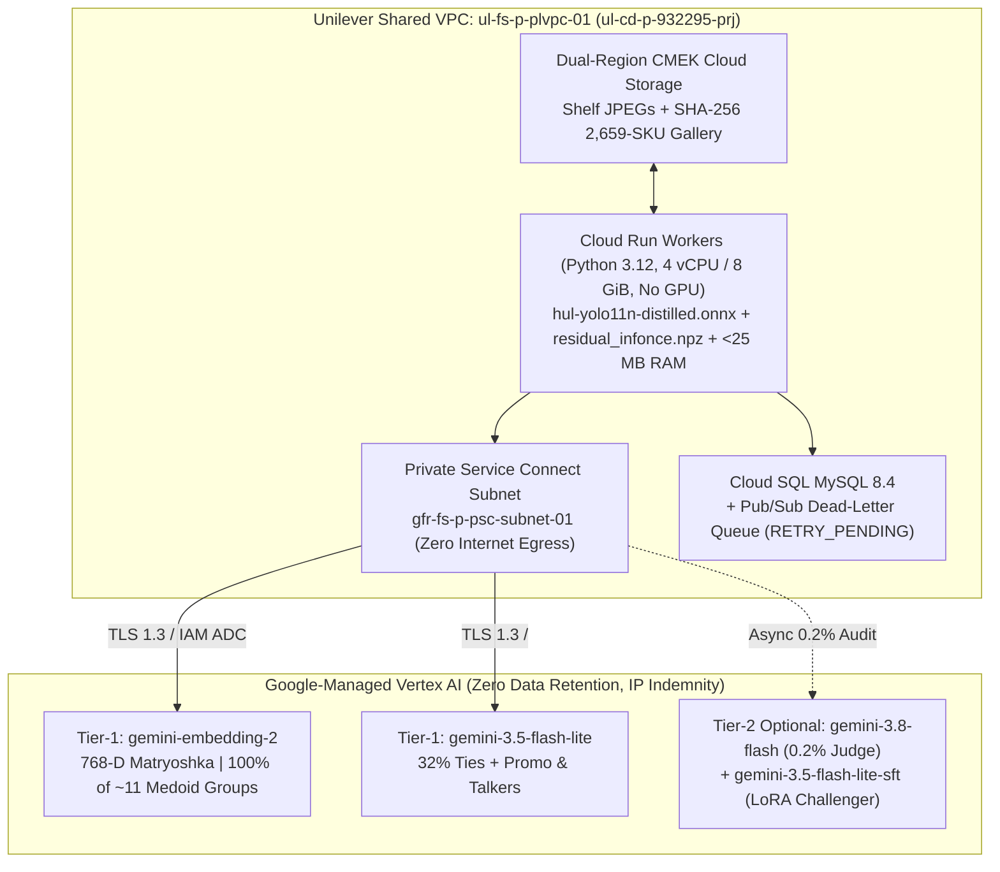

# Model Whitelisting Report

## Governance Scope

Unilever's draft `LLD001 v0.1` (`17 Aug 2026` AI Foundations note in Sections 5.5 and 10.1.2) bypassed AI Foundations whitelisting by lifting custom Keras `.h5`, ONNX, and `ViT` weights onto 11 to 14 dedicated Vertex AI Online GPU Endpoints. That setup required Security Exception `IST0001092` (Sections 2.2 and 5.3) to run End-of-Life `Python 3.8.20 / 3.9.25 / 3.10.11`, legacy `keras`, and `azure-cli` inside GCP containers at 42.32% SKU accuracy and ₹48.63 Lakhs/month.

`LLD001 v0.2` retires those custom GPU endpoints and closes `IST0001092`. Upgraded Cloud Run worker containers run patched `Python 3.12`, execute one in-process CPU ONNX detector (`onnxruntime`, MIT license), and call two first-party Google-managed Vertex AI APIs (`gemini-embedding-2` and `gemini-3.5-flash-lite`) over Private Service Connect (`gfr-fs-p-psc-subnet-01`).

## Goals and Non-Goals

### Goals
- **Minimal model footprint:** Whitelist 3 Tier-1 assets serving Market Share (`323,935/day`), Merchandising (`104,571/day`), and Toker Promo (`78,025/day`) inside Shared VPC `ul-fs-p-plvpc-01` with zero public internet egress.
- **Close `IST0001092`:** Eliminate EOL Python 3.8-3.10, `azure-cli`, and unpatched `.h5` weight deserialization from production images.
- **Data protection and IP indemnity:** Restrict cloud inference calls to Google first-party GA models covered by Google Cloud Enterprise Terms, Zero Data Retention, and Google GenAI IP Indemnity.

### Non-Goals
- **Self-hosted open-weight models:** None of the 8 open-weight R&D models (`Qwen3.5-9B`, `Qwen3-VL-8B`, `DINOv3`, `DINOv2`, `V-JEPA 2`, `MaxViT`) are requested for production whitelisting.

## Production Whitelist

Three Tier-1 assets serve all four retail workloads in `LLD001 v0.2` (Option 2):

| Asset ID / Endpoint | Provider & Hosting | Pipeline Role | License & IP Indemnity | Data Privacy Policy | AIF Action |
| :--- | :--- | :--- | :--- | :--- | :---: |
| **`gemini-embedding-2`** | Google Managed API (`locations/global`, GA via PSC) | **Stage 2A Matcher:** Embeds ~11 medoids/shelf (`768-D` Matryoshka slice via `outputDimensionality=768` from `3,072-D` native); exits 68% with `0` generative VLM tokens; indexes new SKUs in 60s. | Google Cloud Enterprise Terms; GenAI IP Indemnity. | **Zero customer training.** Zero retention outside project (`Zero Data Retention` eligible). | **APPROVE (Tier-1)** |
| **`gemini-3.5-flash-lite`** | Google Managed API (`locations/global`, GA via PSC) | **Stage 2B Zoom, Promo & Talkers:** Resolves 32% (~3.5 groups/shelf) ties via 3-band sheet (88.4% cached). | Google Cloud Enterprise Terms; GenAI IP Indemnity. | **Zero customer training.** Context cache isolated inside `ul-cd-p-932295-prj` (`TTL`-bound). | **APPROVE (Tier-1)** |
| **`hul-yolo11n-distilled-detector-onnx`** + **`residual_infonce.npz`** | Self-contained `.onnx` (`11.2 MB`) & `.npz` (`2.4 MB`) in CMEK Cloud Storage (`onnxruntime` CPU) | **Stage 1 Detector & Adapter:** 960px CPU detection of `Class 0` bays (99.0% mAP50), `Class 1` packs (96.2%), and talkers (`80 ms`, ₹0 GPU). | Runtime: `onnxruntime` (**MIT**), `numpy` (**BSD-3**). See Track A/B below. | **In-container CPU execution.** Zero external calls or telemetry egress. | **APPROVE (Track A/B)** |

### Detector License Options

Unilever Legal should select one open-source license track for the Stage-1 ONNX detector prior to Phase-3 cutover:
- **Runtime library (`onnxruntime` = MIT license):** Production Cloud Run worker containers execute pure `.onnx` weights via Microsoft `onnxruntime` (MIT) and do not import `ultralytics` Python code at runtime.
- **Training lineage (`YOLO11n` = `AGPL-3.0` vs. `Apache-2.0` alternative):**
  1. **Track A (existing enterprise license):** Reference Unilever's commercial Ultralytics Enterprise License (already applicable if Unilever trained legacy `marketshare_yolo.onnx` and `gtmerch_asset_sku_intermediary_17092026.onnx` via Ultralytics), or
  2. **Track B (`Apache-2.0` swap, 48 hours):** Export the distilled 960px dual-class ONNX graph from `RT-DETR-r18`, `LW-DETR`, or `YOLOX-s` (`Apache-2.0`) trained on our teacher labels (`[x1, y1, x2, y2, score, class_id]` requires 0 Stage-2 code changes).

## Optional Challenger Models

Three first-party Google Vertex AI models remain optional for canary drift auditing, A/B testing (`Option 3`), and embedding failover:

| Asset ID / Endpoint | Hosting & Billing | Optional Role | Governance Posture | AIF Action |
| :--- | :--- | :--- | :--- | :---: |
| **`gemini-3.8-flash`** (or **`gemini-3.5-flash`**) | Google Managed API (`locations/global`, GA) | **Async 0.2% Canary Judge** (`1,013` shelves/day, `₹11,400/mo`) + micro-text tiebreaker (`85.34%` 3-Attr, `0.40%` False HUL). | Same Google Cloud Enterprise Terms, Zero Data Retention, and IP Indemnity. | **APPROVE (Tier-2 Audit)** |
| **`gemini-3.5-flash-lite-sft`** (`endpoints/8037166116251893760`) | Tenant-Isolated LoRA (`rank-4`) on managed base | **Option 3 Challenger** (`85.0% Val / 82.1% Test` `hul_variants`; **₹0/hr idle fee**, billed at base `Flash-Lite` token SKUs). | Adapter weights stay inside Unilever's project; shared base weights remain unmodified. | **APPROVE (Tier-2 A/B)** |
| **`multimodalembedding@001`** | Google Managed API (`locations/global`, 512-D, GA) | **Embedding Failover** if `gemini-embedding-2` regional quota saturates (`USD 0.0001/img`, SKU `276A-E20A-4D82`). | Google First-Party GA model under identical Vertex AI enterprise data protection terms. | **APPROVE (Tier-2 Backup)** |

## Excluded R&D Models

Eight open-weight vision backbones and VLMs benchmarked in `ul-fs-s-sandbx-16-prj` are excluded from production:

| Evaluated R&D Model | Source & License | Sandbox Result | Reason for Exclusion |
| :--- | :--- | :--- | :--- |
| **`MaxViT-Tiny-224`** (`timm`) | HuggingFace (`Apache-2.0`) | `86.77%` closed-set `hul_variants` | Covers 1,922 classes (misses 737 SKUs), scores **0.0% on Day-0 launches**, and needs full retraining on pack updates. |
| **`V-JEPA 2`** (`vitl16` / `vitg16`) | Meta (`MIT` / `Apache-2.0`) | `84.50%` `hul_golden` (`1K`) | Requires dedicated GPU serving (**83% idle** off-peak) and head retraining when new SKUs launch. |
| **`DINOv3`** (`vitb14` / `vitl16`) | Meta **DINOv3 License** | `79.79%` `hul_variants` (`27.9%` on 1-2 crop SKUs) | **Restrictive custom Meta license** requires separate legal review; drops to 27.9% on rare tail SKUs. |
| **`DINOv2`** (`vits14` / `vitb14`) | Meta (`Apache-2.0`) | `71.8%-76.4%` `hul_golden` (`0.0%` on 1,121 unseen) | Trails Option 2 (`83.5%-84.0%`) on `50g` vs. `100g` identical bottle shapes and requires GPU serving. |
| **`Qwen3.5-9B` & `Qwen3.5-27B`** | Qwen / Apache-2.0 (`vLLM` L4) | Competitive crop accuracy | **5.1x higher TCO (₹0.614/shelf, ₹93.3L/mo):** 24x L4 GPUs sit **83% idle** 20 hrs/day, plus third-party weight governance. |
| **`Qwen3-VL-8B` (Fine-Tuned)** | Alibaba Qwen License | Surpassed by `gemini-embedding-2` (`₹0.047/shelf`) | Requires self-hosted GPU containers and CVE patching vs. zero-idle managed `gemini-embedding-2`. |
| **`hul-yolov12s-sku110k-detector-onnx`** | Sandbox Teacher Model | Offline distillation teacher only | Used offline during dataset generation; excluded from production container images. |

## Legacy Decommission

Unilever's Project Plan listed 13 logical models, while `LLD001 v0.1` and Cloud Storage held 14 weight files (including `2.31 GB` across 9 Market Share `.h5` binaries totaling `3,053` softmax classes). All 14 artifacts retire at Phase-3 cutover:

| Project Plan Row (`13` Logical Models) | Deployed GCS / Legacy Endpoint Artifact (`14` Files) | Reconciliation Note | `LLD001 v0.2` Replacement |
| :--- | :--- | :--- | :--- |
| **1. SKU Detection (`1` YOLOv8)** | `1.` `marketshare_yolo.onnx` (1-class 640px) | 1:1 match (`MT/GT Market Share`). | `hul-yolo11n-distilled.onnx` (960px 2-class CPU). |
| **2. Brand ID (`2` XceptionNet: HUL & Non-HUL)** | `2.` `marketshare_brand.h5` (`274.10 MB`, `941` cls) | Plan counted `2` models; GCS merged into `1` `.h5` (`-1`). | `gemini-embedding-2` + 2,659-SKU RAM index (`96.1%` Brand). |
| **3. Variant Heads (`6` Category InceptionNets)** | `3-9.` `wash` (`173`), `skin` (`438`), `p5` (`291`), `gen` (`145`), `oral` (`57`), `nonhul_gen` (`595`), `nonhul_p6` (`367` cls; `1.78 GB`) | Plan counted `6` heads; GCS split Non-HUL into `2` files (`+1`, `2,066` classes). | Stage 2A + `Gemini 3.5 Flash-Lite` 3-band zoom (`82.3%-84.0%` SKU). |
| **4. Pack Classification (`1` Custom CNN)** | `10.` `marketshare_packtype.h5` (`253.93 MB`, `46` cls) | 1:1 match (`54.86%` acc; `29.60%` Stage-4 loss). | 7-step catalog container hierarchy (`91.7%-93.3%` Pack). |
| **5. Asset + SKU Detection (`1` YOLOv8)** | `11.` `gtmerch_asset_sku_intermediary_17092026.onnx` | 1:1 match (`GT/MT Merchandising`). | Shared 960px CPU ONNX (`99.0%` Bay mAP50) + Stage 1.5 Gate. |
| **6. Promo Classification (`1` `ViT-240`)** | `12.` `ViT-B-16-plus-240` (240 closed classes) | 1:1 match (`Toker Promo Packs`). | Dual-Band Promo Verifier (`5-min` onboarding). |
| **7. Merch Classification (`1` InceptionNet)** | `13.` `17Sep26-moc10-model-gtmerch-pr-0050-0.9480.h5` | 1:1 match (`209` classes, `[0, 255]` input). | Shared 2,659-SKU spine (`97.2%-98.8%` in-bay SKU). |
| **8. Toker Talker Detector (Pilot Asset)** | `14.` Legacy `toker_dataset` talker detector | Pilot weight (`+1` = `14` total physical files). | Store-disjoint 960px 3-class Talker CPU ONNX (`90.02%` Zone F2). |

## Security Controls

| Governance Pillar | Enforced Control in `ul-cd-p-932295-prj` (`LLD001 v0.2`) | Verification Reference |
| :--- | :--- | :--- |
| **1. Closes `IST0001092`** | Upgrades Cloud Run workers to `python:3.12-slim` + `onnxruntime` + `google-genai`; `0` EOL Python, `0` `azure-cli`, `0` `.h5` files. | `LLD001 v0.2` Sec 2.2 & 5.3; Cloud Build scan |
| **2. Private Service Connect & IAM** | Routes `gfr-fs-p-cloudrun-01` -> PSC `gfr-fs-p-psc-subnet-01`; Workload Identity + Secret Manager (`0` static JSON keys). | `LLD001` network & IAM spec |
| **3. Prompt-Injection Isolation** | Wraps shelf OCR inside `<untrusted_pack_text>` XML tags with `enum`-constrained JSON schema decoding (`1..K` or `0`). | Stage-2B, Promo, and Talker verifiers |
| **4. Open-Set Competitor Guard** | Two-tier cosine veto (`0.045` lead guard + `s1 >= 0.45` floor) blocks forced Unilever tags on unknown rivals (**1.00% False HUL**). | Automated QC & competitor guardrail |
| **5. Fail-Open Payout Quarantine** | `180s` SLA timeouts or `429`/`5xx` errors route to Pub/Sub DLQ (`RETRY_PENDING`, `earning_override = null`; **0 false `Earning = '0'`**). | SLA & Locust fault-injection |
| **6. Immutable Catalog & Billing Log** | Logs `catalog_sha256` (`b2dc368a0bf972a6`), Cloud Trace `trace_id`, token counts, and live Cloud Billing SKU cost to BigQuery. | Cloud Trace & billing export |
