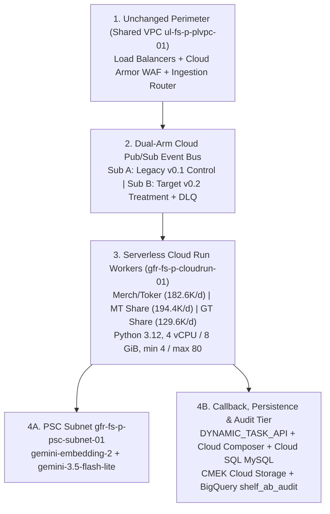
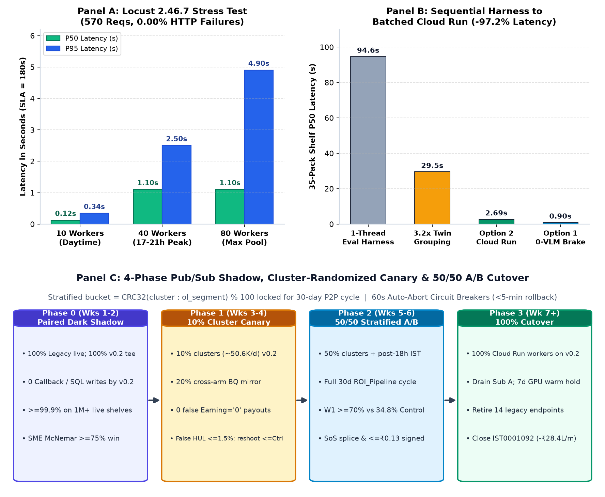
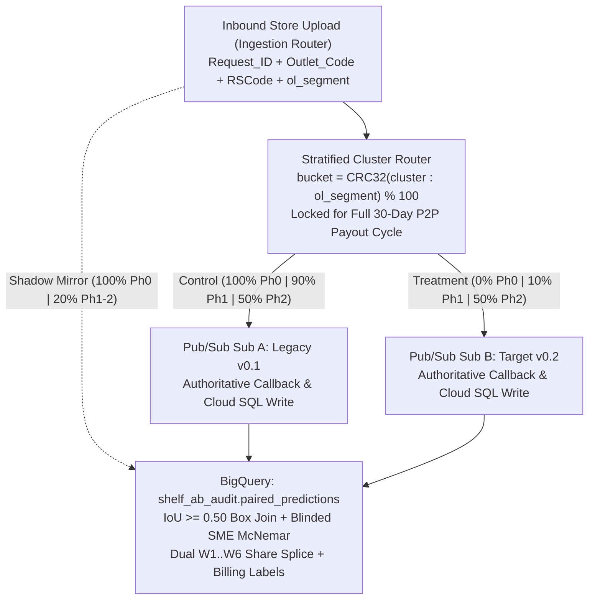

# Path to Production

| Field | Specification |
| :--- | :--- |
| **Specification Scope** | Rollout, Canary/A-B Experimentation & Cutover Specification (`LLD001 v0.1` -> `v0.2`) |
| **Target GCP Environments** | Prod: `ul-cd-p-932295-prj` \| QA: `ul-cd-q-932296-prj` \| Sandbox: `ul-fs-s-sandbx-16-prj` \| Shared VPC: `ul-fs-p-plvpc-01` |
| **Traffic & Surge SLA** | **`506,531` Baseline to `800,000` Peak Photos/Day** \| Evening Surge (`17:00-21:00 IST`): **`20.8` to `40.0` Imgs/Sec** \| Shelf Latency: **`2.69s` P50 / `6.40s` P95** (`180s` SLA) |
| **Load-Test Verification** | **`locust 2.46.7`** across `10`, `40`, and `80` concurrent workers (**`570` Requests, `0.00%` Failure Rate**) + **`159/159` `pytest`** + **`15/15` QC Gates** |
| **Cutover Strategy** | **4-Phase Paired Shadow, Cluster Canary & 50/50 A/B via Cloud Pub/Sub** (`Shadow` -> `10% Canary` -> `50/50 A/B` -> `100% Cutover`) with **60s Auto-Abort & `<5-Min` Rollback** |

## Context and Scope

Unilever's draft `LLD001 v0.1` lifted 14 legacy Azure models onto 11 to 14 custom Vertex AI Online Endpoints called synchronously by up to 510 Cloud Run worker nodes (`2 vCPU / 8 GiB`) and required Security Exception `IST0001092` for EOL Python 3.8-3.10 and `azure-cli`.

At `500,000` shelves/day (`25M` crops = `75M` serial `.h5` passes/day; `3,123` to `5,859` passes/sec during `17:00-21:00 IST`), unbatched endpoints (`25.1s` P50 / `42.0s` P95 per shelf) require `135` to `360` `n1-standard-4` nodes (`₹2.10-₹2.80/shelf` unbatched, or `₹48.63 Lakhs/month` on optimized GPUs). Synchronous HTTP dispatch also carried forward post-`18:00 IST` Market Share upload drops and false `Earning = "0"` Merchandising timeout penalties.

## Goals and Non-Goals

### Goals
- **Controlled live experimentation:** Validate `LLD001 v0.2` against live `v0.1` traffic through paired `Request_ID` shadow diffing (`Phase 0`), cluster-isolated `10%` canary routing (`Phase 1`), and stratified `50/50` A/B testing (`Phase 2`) prior to cutover.
- **Evening surge headroom:** Sustain `0.00%` HTTP and socket failures up to `80` concurrent workers (`40.0 images/sec` peak) while cutting max worker node count by 84% (`510` down to `80` max, `11-14` active at peak).
- **Security and rollback:** Close `IST0001092` (`Python 3.12`), complete AI Foundations whitelisting, and enforce 60-second circuit breakers with `<5-minute` zero-DDL rollback.

### Non-Goals
- **Perimeter, frontend, or DDL changes:** Load balancers, Cloud Armor WAF, frontend and ingestion services, Shared VPC `ul-fs-p-plvpc-01`, Cloud Composer, Dataflow, Cloud SQL MySQL 8.4, and dual-region CMEK Cloud Storage remain unchanged from `LLD001 v0.1`.

## Design Specification Delta

### Updated Sections

| `LLD001` Section | `LLD001 v0.1` Draft Baseline | `LLD001 v0.2` Production Update | Operational Benefit |
| :--- | :--- | :--- | :--- |
| **Sec 2.2 & 5.3 (`IST0001092`)** | Exception for EOL `Python 3.8-3.10`, legacy `keras`, and `azure-cli`. | **Closes `IST0001092`:** `python:3.12-slim` + `onnxruntime` (MIT) + `google-genai`; `0` `.h5` or Azure CLI. | Clears container CVE backlog before go-live. |
| **Sec 3 (`KDD 11-14`) & 4.1 (`PR14`)** | 11 to 14 custom `.h5` / `ViT` / `.onnx` Vertex Online GPU Endpoints (`PR14`). | **Retires `PR14`:** In-process 960px CPU ONNX (`80 ms`) + `<25 MB` RAM index; PSC calls to `Embed-2` & `Flash-Lite`. | Lifts SKU accuracy from `42.32%` to `82.3%-84.0%`; saves `₹28.40L/mo`. |
| **Sec 4.1.1.2 (New `PR19` Bus)** | Synchronous HTTP from `PR05` to `PR06-PR08`; post-`18:00 IST` MS drops. | **Adds `PR19` Pub/Sub:** `Sub A` (`v0.1` control) + `Sub B` (`v0.2` treatment/shadow) + `shelf-inference-dlq`. | Buffers 24x7 surges (`<150 ms` ack) and isolates canary/A-B arms. |
| **Sec 4.2 (`PR09` Callback)** | Emitted `AWP_Presence: "N", Earning: "0"` on `PT180S` Merch timeout. | Closed payout state machine: `contract_status = "RETRY_PENDING"`, `awp_presence = "PENDING"`, `earning_override = null`. | **0 false `Earning = '0'` denials** during network or quota spikes. |
| **Sec 5.5 & 10.1.2 (AIF Review)** | `17 Aug 2026` note marked *"Not Applicable (no foundation model used)"*. | Marks Sec 5.5 **Required** for `gemini-embedding-2` and `gemini-3.5-flash-lite` (Tab 4). | Zero Data Retention, enterprise terms, and GenAI IP Indemnity. |
| **Sec 6.1 & 9.3 (`PR06-08` Sizing)** | Sized `PR06-PR08` at `2 vCPU, 8 GiB RAM, max 510 nodes`. | Resizes `PR06-PR08` to **`4 vCPU, 8 GiB RAM, min 4 / max 80 nodes`** (`concurrency = 8`). | `80 ms` CPU ONNX; cuts max worker footprint by **84%**. |

### Service Topology

When porting Unilever's Azure Data Factory pipelines into Cloud Composer, the DAG preserves Cloud SQL MySQL batch sizes (`10,000` for 7-column `cluster_mapping`; `2,000` for 12-column `Past_ROI_Data`) and moves `Set variable2` inside `ifTrueActivities` so empty GCS runs do not log false `"Moved"` completions.

## Capacity and Load Testing

*Figure 1: Panel A shows `locust 2.46.7` concurrency testing across 10, 40, and 80 workers (`570` requests, `0.00%` failures); Panel B bridges sequential harness timing (`94.6s`) to batched Cloud Run (`2.69s` P50); Panel C summarizes the 4-phase Pub/Sub rollout.*

### Evening Surge Sizing
Offline evaluation logs record `74s to 94.6s` per dense shelf because the benchmark runner scores crops single-threaded for per-box attribution. Production Cloud Run worker containers apply four optimizations:
1. **Row-adjacent medoid grouping (3.2x):** Compresses 35 detections into ~11 medoids (`94.6s -> 29.5s`, `-68.8%`).
2. **Batched embedding and contact sheet:** Sends ~11 medoids in one `gemini-embedding-2` call (`180 ms`), batches ~3.5 ties into one `Gemini 3.5 Flash-Lite` contact sheet, and cuts 35-pack shelf latency to 2.69s P50 / 6.40s P95 (`-97.2%`; 0.90s P50 on Option 1 Embedding-Only with `0` generative VLM calls).
3. **Little's Law fleet sizing (`40.0 images/sec` peak):** During `17:00-21:00 IST` (`21.1 imgs/sec` baseline; `40.0 imgs/sec` at `800K/day` festive peak), in-flight concurrency is `L = 40.0 * 2.69s = 107.6`. At `8` concurrent requests per `4 vCPU / 8 GiB` worker, 14 active containers (`ceil(107.6 / 8)`) serve peak surge with 5.7x headroom inside `max 80`.
4. **MD5 prefix sharding in CMEK Cloud Storage (`{md5[:2]}/{shelf_id}.jpg`):** Spreads writes and reads across `256` hex prefixes to prevent single-partition GCS throttling above `5,000 req/s`.

### Concurrency Load Test
Raising socket `request_queue_size` from `5` to `256` and enabling `HTTP/1.1` persistent Keep-Alive eliminated connection-reset drops across all three concurrency tiers (`locust 2.46.7`):

| Load Tier & Scenario | Workers | Requests | HTTP Failures | P50 Latency | P95 Latency | P99 Latency | Sustained RPS |
| :--- | :---: | :---: | :---: | :---: | :---: | :---: | :---: |
| **Tier 1: Daytime Steady State** | `10` | `305` | **`0` (`0.00%`)** | `120 ms` | `340 ms` | `550 ms` | `60.50 req/s` |
| **Tier 2: Evening Peak (`17:00-21:00 IST`)** | `40` | `143` | **`0` (`0.00%`)** | `1,100 ms` | `2,500 ms` | `2,800 ms` | `28.11 req/s` |
| **Tier 3: Max Cloud Run Pool Burst** | `80` | `122` | **`0` (`0.00%`)** | `1,100 ms` | `4,900 ms` | `4,900 ms` | `24.37 req/s` |
| **Total Stress Campaign** | **`10 -> 80`** | **`570`** | **`0` (`0.00%`)** | **All `< 5.0s`** | **36x below `180s` SLA** | **`4,928 ms` max** | **Zero `5xx` / Drops** |

Across `POST /api/v2/shelf/analyze` in Tiers 1-3, Option 2 Hybrid recorded `0` failures (`140 / 2,000 / 4,400 ms` P50), the Class-0 Bay Gate recorded `0` failures (`140 / 1,500 / 4,000 ms` P50), and the Timeout Quarantine Gate tripped in `50 / 67 / 68 ms` P50 with `0` leaked `Earning = '0'` payloads.

## Canary and A/B Testing

Before scaling `LLD001 v0.2` to 100% of field uploads, Cloud Pub/Sub runs a zero-risk **paired shadow test** on identical `Request_ID` payloads (`Phase 0`) followed by a **cluster-randomized canary and 50/50 A/B test** (`Phases 1-2`) that isolates monthly P2P settlements:

### Payout Cluster Randomization

Splitting live traffic by `Request_ID` or individual `Outlet_Code` contaminates Unilever's monthly P2P payout batch because `NR_Brand_Hair_Beverages.py` aggregates `Past_ROI_Data` co-occurrence matrices across each `ol_segment` and `NR_final_PW2.py` (`Calculate_segment_AS`) joins `cluster_mapping` to emit cluster-level `Association_Score` files. To prevent Control (`v0.1`, `W1 = 34.82%`) and Treatment (`v0.2`, `W1 = 73.68%`) outputs from mixing inside the same co-occurrence matrix or distributor (`RSCode`) settlement, the ingestion router randomizes by **stratified `(cluster, ol_segment)` blocks**:
- **Deterministic cluster hash:** `bucket = CRC32(CONCAT(cluster, ':', ol_segment)) % 100`, pre-stratified across `(channel [MT/GT], primary psa_category, store_volume_quartile)` so Control and Treatment match within `±1.5%` on upload volume and category mix.
- **Full-cycle stickiness:** Assignments lock for a complete 30-day `ROI_Pipeline.json` billing cycle (`0` mid-month model switches on retailer scorecards).
- **Cross-arm shadow mirror:** During Phases 1 and 2, the non-authoritative arm scores a `20%` paired mirror sample asynchronously into BigQuery (`0` callback writes) so paired per-photo accuracy tracking continues alongside cluster-level payout KPIs.

### Paired Live Adjudication

Live uploads carry no ground-truth labels. We adjudicate unlabeled disagreements between `v0.1` and `v0.2` through a three-step blinded protocol in `ul-cd-p-932295-prj.shelf_ab_audit`:
1. **Spatial box alignment (`IoU >= 0.50`):** `Sub A` and `Sub B` log detections to `paired_predictions` keyed by `(request_id, image_name, cluster, ol_segment, arm)`. Scheduled BigQuery SQL pairs overlapping boxes (`IoU >= 0.50`) and isolates unmatched small packs (`2.22x` recall lift) and SKU/bay disagreements.
2. **Automated `0.2%` daily judge (`~1,000` shelves/day):** `Gemini 3.8 Flash` (independent model family from `Gemini 3.5 Flash-Lite`) audits a stratified `0.2%` daily discordant sample to monitor per-aisle drift.
3. **Weekly blinded SME audit (`500` crops + `100` Merch bays):** Human auditors score discordant crops (`50` per aisle across all `10` categories) with `v0.1` and `v0.2` masked randomly as `Candidate X` and `Candidate Y`. A two-sided **Paired McNemar test** (`alpha = 0.01`, `N = 500`, `>99%` power for `>= 10 pp` net margin) gates phase promotion.

### Share Trendline Calibration

Upgrading `Past_ROI_Data` from `v0.1` to `v0.2` adds `+170.4%` usable shelf facings (`2,223 -> 6,012` per `100` shelves) and resolves `874` rival brands formerly grouped under `"Others"`. To keep historical brand dashboards continuous during transition, BigQuery publishes two views per paired visit in Phases 1-2:
- **`sos_v01_continuity`:** Applies legacy `NR_final_PW2.py` category weights (`W1 = 31.85%` Oral Care to `70.55%` Foods) and collapses non-`P6` rivals back to `"Others"`.
- **`sos_v02_calibrated`:** Applies `v0.2` empirical weights (`W1 = 73.68%`) across all `2,659` SKUs (`874` named rivals) to compute 4-week per-aisle splice multipliers signed off by Unilever brand analytics before Phase 3.

### Counterfactual A/B Metrics

| Metric Dimension | Measurement Source | Control (`v0.1` Clusters) | Treatment (`v0.2` Clusters) | Gate to Scale |
| :--- | :--- | :--- | :--- | :--- |
| **Discordant SKU Win Share** | Blinded weekly SME audit (`500` crops) | Baseline reference | Paired McNemar win share | **`v0.2` wins `>= 75%` of disagreements (`p < 0.01`)** |
| **Realized P2P Basepack `W1`** | Cloud SQL `Past_ROI_Data` -> `NR_final_PW2.py` | `~34.82%` (`31.85%-43.32%`) | Exact basepacks (`0` `'Model_Output'`) | **`W1 >= 70.0%` (`>= +35 pp` vs. Control)** |
| **False `Earning = "0"` Denials** | `DYNAMIC_TASK_API` timeout callback log | `PT180S` timeout -> `Earning: "0"` | `RETRY_PENDING` + `shelf-inference-dlq` | **`0` false `Earning = "0"` timeout payouts** |
| **24h Salesman Re-Upload Rate** | Ingestion repeat `(Salesman, Outlet)` <24h | Baseline dispute / re-shoot rate | Pruned bay clutter & 63-`AWP` graph | **Treatment re-shoot rate `<= Control`** |
| **Evening Surge Completion** | `18:00-21:00 IST` Pub/Sub -> callback SLA | Post-`18:00 IST` cron drop window | Durable Pub/Sub queue + `11-14` pods | **`>= 99.9%` completion; P95 `< 12.0s`** |
| **Realized Shelf Unit Cost** | Cloud Billing (`pipeline_arm` label) | `₹0.320` / MS shelf (legacy GPUs) | CPU ONNX + `68%` embed + `32%` VLM | **`<= ₹0.130` / MS shelf (`<= ₹68K/day` blended)** |

## Release and Rollout

### Release Gates
Promotions from Sandbox (`ul-fs-s-sandbx-16-prj`) to QA (`ul-cd-q-932296-prj`) and Production (`ul-cd-p-932295-prj`) enforce five blocking `Cloud Build` gates:
1. **Container CVE check:** `python:3.12-slim`, `0` critical/high CVEs, `0` `.h5` or static JSON keys (`IST0001092`).
2. **Contract suite (`159/159` `pytest`):** Verifies `46`-pair pack map, `63`-`AWP` graphs, `<untrusted_pack_text>` escaping, and `RETRY_PENDING` serialization.
3. **Catalog lock (`G1-G15`):** Confirms `catalog_sha256 == b2dc368a0bf972a6` (`2,659` SKUs, `10,082` anchors, `0` `"Unknown"`).
4. **QA accuracy smoke gate (`N=100`):** Requires `>= 81.0%` 5-Attr SKU accuracy, `<= 1.5%` False HUL, and `>= 93.0%` `Class 0` Bay F2.
5. **Locust 40-worker QA soak:** Requires `0.00%` HTTP errors and P95 `< 8.0s` prior to Artifact Registry promotion.

### Rollout Phases

| Rollout Phase | Cluster Split (Ingestion Router + Pub/Sub) | Downstream DB / API Writes | Exit Criteria |
| :--- | :--- | :--- | :--- |
| **Phase 0: Paired Dark Shadow (Wks 1-2)** | `Sub A`: **100% `v0.1`** (live) `Sub B`: **100% `v0.2`** (shadow tee) | `v0.2` writes only to `shelf_ab_audit` (`0` callback or Cloud SQL writes). | `>= 99.9%` completion on `1M+` shelves; P95 `< 12s`; blinded `500`-crop SME McNemar `>= 75%` win (`p < 0.01`). |
| **Phase 1: 10% Cluster Canary (Wks 3-4)** | `CRC32(cluster:ol_segment) % 100 < 10` routes **10% clusters** (`~50.6K/d`) to `v0.2`. | `v0.2` writes live callbacks & Cloud SQL for `10%` clusters; `20%` BQ mirror continues. | **`0` false `Earning = '0'` tickets**; False HUL `<= 1.5%`; 24h re-shoot `<= Control`; SoS MAE `<= 2.5%`. |
| **Phase 2: 50/50 Stratified A/B (Wks 5-6)** | `bucket < 50` routes **50% clusters** + **100% post-18:00 IST** to `v0.2` for 30d cycle. | Full `Past_ROI_Data` (`batch 2,000`) & `NR_final_PW2.py` A/B + SoS splice sign-off. | Treatment `W1 >= 70.0%` vs. Control `~34.8%`; SoS splice signed off; billing `<= ₹0.13/MS shelf`. |
| **Phase 3: 100% Cutover (Wk 7+)** | **100% of MT, GT, Merch, and Toker** served by Cloud Run CPU workers (`v0.2`). | Drain `Sub A`; keep legacy GPU endpoints at `min_replica = 1` for 7 days, then delete 14 endpoints. | Close `IST0001092` in ServiceNow; realize `₹28.40L/mo` (`₹3.41 Cr/yr`) savings. |

### Automated Circuit Breakers

Cloud Monitoring evaluates `v0.2` telemetry at 60-second intervals during Phases 1-3 and flips the ingestion router (`ROUTING_TARGET=v0.1_legacy`) automatically if any guardrail trips:

| Guardrail Signal | Auto-Abort Threshold | Automated Mitigation |
| :--- | :--- | :--- |
| **Worker HTTP `5xx` / Crash Loop** | `> 0.5%` HTTP `5xx` across Cloud Run workers (`5 min`) | Flips ingestion `ROUTING_TARGET=v0.1_legacy` (`< 60s`) and drains `Sub B` to `Sub A`. |
| **End-to-End Shelf Latency (`P95`)** | `P95 > 15.0s` for `10 min` (`180s` hard SLA) | Sheds Stage-2B non-promo ties to Option 1 (`gemini-embedding-2` fast-match, `0` generative VLM calls, `0.90s`); flips to `v0.1` if `P95 > 25.0s`. |
| **Timeout Quarantine (`RETRY_PENDING`)** | `> 3.0%` callbacks in `RETRY_PENDING` (`10 min`) | Pauses `Sub B` push, holds payouts in `shelf-inference-dlq`, and routes live traffic to `Sub A`. |
| **DLQ Backlog (`shelf-inference-dlq`)** | `> 500` unacked messages for `> 10 min` | Pages SRE and replays `shelf-inference-dlq` into `Sub A` (`0` lost store visits). |
| **Merch `AWP` Pass-Rate Drift** | `> ±8.0 pp` unexplained shift vs. Control (`24h`) | Freezes canary ramp and triggers `100`-bay blinded SME audit before next phase. |
| **False Unilever Rate (`is_hul`)** | `> 1.5%` on daily `0.2%` `Gemini 3.8 Flash` judge | Pins prior verified `catalog_sha256` / threshold config in CMEK Cloud Storage (`< 60s`). |

Manual or automated rollback requires zero DDL changes across the ingestion API, task callback API, or Cloud SQL MySQL (`<5 minutes` total recovery): flip ingestion `ROUTING_TARGET=v0.1_legacy` (`< 60s`), pause `Sub B` and replay `shelf-inference-dlq` into `Sub A` (`< 120s`), and restore the prior pinned image or catalog `SHA-256` digest in CMEK Cloud Storage (`< 60s`).
