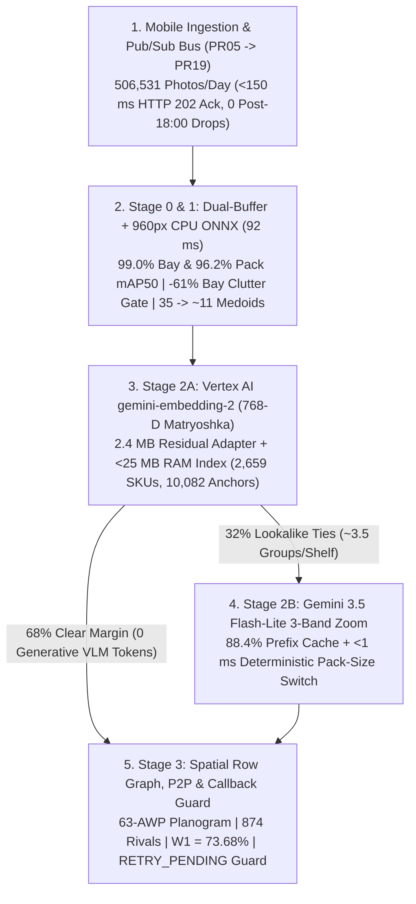

# Technical Design Document: Unilever Retail Shelf Understanding (`LLD001 v0.2`)

| Field | Specification |
| :--- | :--- |
| **Document ID & Scope** | Unified Technical Design Document (`LLD001 v0.1` -> `v0.2` across Market Share, Merchandising, Promo & Talkers) |
| **Target GCP Environments** | Prod: `ul-cd-p-932295-prj` \| QA: `ul-cd-q-932296-prj` \| Sandbox: `ul-fs-s-sandbx-16-prj` \| Shared VPC: `ul-fs-p-plvpc-01` |
| **Daily Portfolio Volume** | **`506,531` Baseline to `800,000` Peak Photos/Day** (`323,935` Market Share + `104,571` Merchandising + `78,025` Promo & Talkers) |
| **Production Architecture** | **Option 2 Hybrid (`960px` CPU ONNX + `<25 MB` RAM Catalog + `gemini-embedding-2` `768-D` + `Gemini 3.5 Flash-Lite` 3-Band Zoom)** |
| **Verified Impact** | **`82.3%` (`N=5K`) / `84.0%` Test SKU** (vs. `42.32%` Legacy) \| **`73.68%` P2P `W1`** (`2.12x` vs. `34.82%`) \| **`0` False `Earning = '0'`** \| **₹20.23L/mo (`USD 21.1K`)** (**Saves ₹28.40L/mo = ₹3.41 Cr/yr**) |
| **Verification Status** | **`159/159` `pytest` Passed** \| **`15/15` Automated QC Gates Passed** \| **`570` `locust 2.46.7` Requests (`0.00%` Failures up to `80` Workers)** |

## 1. Context and Problem

Field representatives upload 506,531 store shelf photos per day (`15.20M/month`, `800,000/day` festive peak) from `Sales EDGE` across Modern Trade supermarkets and `Shikhar` across General Trade Kirana shops. Over 60% of daily traffic arrives during a four-hour evening window between `17:00` and `21:00 IST`. Those photos drive corporate and brand Share-of-Shelf (SoS) reporting (`323,935` photos/day) alongside monthly retailer Pay-for-Performance (P2P) trade incentive payouts (`182,596` Merchandising and Promotional Compliance photos/day).

Unilever's legacy Azure Kubernetes Service (AKS) stack and draft `LLD001 v0.1` lift-and-shift design split those workflows across 14 separate model weights hosted on dedicated GPU endpoints. Auditing the raw Cloud Storage buckets (`5.14M` objects), legacy `.h5` and `.onnx` binaries (Cloud Run Job `shelf-bench-legacy-audit-n2xn2`), and Azure Logic App workflows exposed five production bottlenecks:

1. **Serial model chaining caps SKU accuracy at 42.32%:** Market Share chained one 640px detector into nine Keras InceptionV3 `.h5` crop classifiers (`2.31 GB`, `3,053` softmax classes). Serial errors across brand (`12.94%` loss), category (`5.04%`), variant (`10.10%`), and 299x299 square-distorted packaging (`29.60%` loss on `1,480` of `5,000` crops) depressed blind `N=5,000` 5-attribute SKU accuracy to `42.32%` (`52.00%` ceiling even with 100% Oracle Brand) and held P2P basepack reliability (`W1`) at `34.82%`.
2. **Zero Day-0 launch recall and rival blind spots:** Newly launched Unilever basepacks and 4-week festive promo packs (`B1G1`, `Rs 10 Off`, `20% Extra`) scored `0.0%` (`0/18`) for 3 to 4 weeks until field teams collected and retrained store crops. Meanwhile, `874` regional competitor brands collapsed into coarse `"Others"` buckets (`-21.92 pp` rival variant gap).
3. **Kirana bay suppression and flat planograms:** Cross-class greedy NMS in the 640px Merchandising detector let large `Class 0` display-bay boxes suppress interior `Class 1` product packs (`51.1%` Bay F2), while the flat 209-class `.h5` classifier (`0.10%` wild-shelf SKU accuracy) ignored row sequence, brand blocking, and Out-of-Stock (OOS) empty gaps.
4. **Evening upload drops and false zero-payout penalties:** Market Share Logic Apps checked `07:30 <= IST <= 18:00`, returned `HTTP 200` to mobile apps, and dropped uploads after `18:00 IST` (while `dayOfWeek == 10` booted clusters on Sundays). Merchandising `PT180S` timeouts emitted `AWP_Presence: "N", Earning: "0"` to `DYNAMIC_TASK_API` and zeroed retailer payouts.
5. **GPU idle cost and EOL security debt:** Hosting 11 to 14 dedicated GPU endpoints across a 4-hour evening peak cost `₹0.320` per Market Share shelf (`₹48.63 Lakhs/month` = `USD 50.7K/mo` across all 4 workloads) and required Security Exception `IST0001092` for End-of-Life `Python 3.8-3.10`, legacy `keras`, and `azure-cli`.

*Figure 1: Comparison of the 14-model GPU chain (`42.32%` SKU accuracy, `₹48.63L/mo`) against the unified 4-stage serverless architecture (`82.3%-84.0%` SKU accuracy, `₹20.23L/mo`).*

## 2. Goals and Non-Goals

### Goals
- **SKU and payout accuracy:** Exceed `80%` blind 5-attribute SKU accuracy on `N=5,000` crops (achieved `82.30%` strict / `83.20%` canonical remap on `test_5k`, `83.50%` Val / `84.00%` Test on `EXP-58`), hold visit SoS MAE `<= 2.0%` (`1.25%` single-shelf, `2.00%` multi-shot visit), and lift P2P basepack `W1` from `34.82%` to `73.68%` (`2.12x`).
- **Sub-minute Day-0 onboarding:** Onboard new basepacks in `<60 seconds` from `1` studio packshot and `1` catalog row at `94.4%` (`17/18`) Day-0 accuracy (`5 minutes` for festive promo packs at `84%-96%`).
- **Surge durability and payout safety:** Buffer `17:00-21:00 IST` surges (`40.0 imgs/sec` peak) via Cloud Pub/Sub (`<150 ms` `HTTP 202` ack) and route `>180s` timeouts or `5xx` errors to `RETRY_PENDING` (`0` false `Earning = "0"` denials).
- **FinOps and security closure:** Cut portfolio spend by `58.4%` (`₹20.23L/mo` vs. `₹48.63L/mo`, saving `₹3.41 Cr/yr`) and close Security Exception `IST0001092` on `Python 3.12`.

### Non-Goals
- **Mobile client or DDL changes:** `Sales EDGE` and `Shikhar` keep their existing JSON request payloads, and Shared VPC `ul-fs-p-plvpc-01`, Cloud Armor WAF, Cloud Composer, and Cloud SQL MySQL 8.4 schemas (`cluster_mapping`, `Past_ROI_Data`) stay unchanged.
- **Self-hosted open-weight GPUs:** All 8 benchmarked open-weight R&D models (`MaxViT`, `V-JEPA 2`, `DINOv3`, `DINOv2`, `Qwen3.5/CLEF`, `CLM-8B`) remain excluded from production.

## 3. System Architecture

`LLD001 v0.2` replaces all 14 legacy model endpoints (`PR14`) with a unified 4-stage visual decision funnel inside stateless Python 3.12 Cloud Run CPU workers (`PR06-PR08`, `4 vCPU, 8 GiB RAM, min 4 / max 80`) behind a Cloud Pub/Sub event bus (`PR19`). Workers run spatial detection and catalog indexing in container CPU/RAM (`₹0` GPU and `₹0` Vector DB cost) and call two Google-managed Vertex AI GA APIs (`gemini-embedding-2` and `gemini-3.5-flash-lite`) over Private Service Connect (`gfr-fs-p-psc-subnet-01`).

*Figure 2: Shared VPC topology connecting mobile ingestion, Pub/Sub surge buffering, Cloud Run CPU spatial workers, Private Service Connect Vertex AI APIs, and Cloud SQL / BigQuery persistence.*

### LLD Component Mapping

| Functional Tier | `LLD001` ID | `LLD001 v0.1` Draft | `LLD001 v0.2` Production State |
| :--- | :---: | :--- | :--- |
| **Perimeter & Router** | `PR01-PR05` | Load Balancers, Cloud Armor WAF, sync HTTP dispatch | **Unchanged perimeter**; `PR05` publishes async events + `(cluster, ol_segment)` hash (`<150 ms` `HTTP 202`). |
| **Async Event Bus & DLQ** | `PR19` *(New)* | Absent (post-`18:00 IST` MS drops; sync `180s` timeouts) | **Added:** Cloud Pub/Sub (`Sub A` control, `Sub B` treatment, + `shelf-inference-dlq`). |
| **Inference Workers** | `PR06-PR08` | `2 vCPU / 8 GiB, max 510` nodes calling GPUs (`IST0001092`) | **Upgraded:** `Python 3.12, 4 vCPU / 8 GiB, min 4 / max 80` (`-84%` max nodes; `IST0001092` closed). |
| **GPU Model Endpoints** | `PR14` | 11 to 14 custom Vertex Online GPU Endpoints (`₹48.63L/mo`) | **Retired** after Phase-3 cutover; replaced by PSC calls to `gemini-embedding-2` & `gemini-3.5-flash-lite`. |
| **Callback, ETL & SQL** | `PR09, PR11, PR15-17` | Callback API (`Earning: "0"` on timeout), Composer, MySQL 8.4 | **Unchanged DDL**; adds `RETRY_PENDING` guard on `PR09` and moves `Set variable2` inside `ifTrueActivities` in `PR11`. |
| **Dual-Region Storage** | `PR18` | Dual-region CMEK Cloud Storage buckets | **Unchanged**; adds 256-way MD5 prefix sharding (`{md5[:2]}/`) and `SHA-256`-locked `2,659`-SKU gallery. |

## 4. Data Forensics and Catalog Unification

Raw client storage held `1,002,209` isolated crops and `67,062` store shelf annotations across four unlinked buckets (`brand_data` lacked variants/packs; `70.7%` of `variant_*` lacked pack suffixes; `54.2%` of `pack_data` lacked SKU names). Evaluating directly on raw folders introduced `399,769` byte duplicates, `20,421` filename collisions (`21.4%` false-match rate), `8,398` synthetic `copy*`/`DA_TBC_*` copies, burned-in red/green QA boxes on `100%` of legacy `mt/` shelves, and `4.95%` (`49` pairs) train-to-test store leakage.

*Figure 3: Deterministic catalog builder linking four disconnected raw buckets via cryptographic MD5 joins into a locked 2,659-SKU catalog and 11 store-disjoint Golden benchmarks.*

### Legacy Error Waterfall and Catalog Proof

Partitioning blind `hul_golden` runs (`test_5k` `#1016-093317`, `1K` `#1015-092627`, and `1K` Oracle Brand `#1015-115810`) into mutually exclusive stages shows why serial `.h5` chaining hits a `52.00%` ceiling even with perfect brand labels:

| Failure / Evaluation Stage | Real `test_5k` (`N=5,000`) | Real `1K` (`N=1,000`) | Oracle Brand `1K` (`N=1,000`) | Structural Cause |
| :--- | :---: | :---: | :---: | :--- |
| **Stage 1: Brand Loss** | `647` (`12.94%`) | `115` (`11.50%`) | `0` (`0.00%`) | `brand.h5` trained without variant or container context. |
| **Stage 2: Category Loss** | `252` (`5.04%`) | `45` (`4.50%`) | `3` (`0.30%`) | Misrouted category invokes the wrong downstream `.h5` head. |
| **Stage 3: Variant Loss** | `505` (`10.10%`) | `104` (`10.40%`) | `130` (`13.00%`) | Pooling `874` rivals into 2 heads creates a `-21.92 pp` rival gap. |
| **Stage 4: Pack Loss (`packtype.h5`)** | **`1,480` (`29.60%`)** | **`291` (`29.10%`)** | **`347` (`34.70%`)** | `299x299` distortion crushes `Sachet` (`21.8%`) & `Wrapper` (`15.4%`). |
| **Chained 5-Attr Pass (Baseline)** | **`2,116` (`42.32%`)** | **`445` (`44.50%`)** | **`520` (`52.00%`)** | `[41.0%, 43.7%]` 95% Wilson CI on `test_5k`. |
| **Enriched Catalog Lookup (Bypass `packtype.h5`)** | **`3,596` (`71.92%`)** | `736` (`73.60%`) | **`867` (`86.70%`)** | **`+29.60 pp` lift (`-33%` compute)** from catalog linkage alone. |

### Master Catalog and 15 Quality Gates

Our builder links `188,376` brand-to-variant and `73,131` pack crop pairs by cryptographic `MD5` digest and a 7-step container resolver while keeping **100% of real camera blur (`35.5%`), sub-64px tiny cutouts (`66.1%`), and foil glare (`5%-8%`)** in `val`, `test`, and `test_5k`:

- **5-level `2,659`-SKU catalog (`SHA-256: b2dc368a0bf972a6`):** Unifies `1,048` Unilever variants, `874` rival variants (`1,922` in `hul_variants`), and `737` brand lines (`10,082` leak-free gallery anchors; `25,071` `gallery + train` SFT union covering all `2,659` classes including `356` rare tail SKUs).
- **Zero dropped container classes:** Separates `10` store categories from `18` physical container forms (`14` raw shapes + `Roll_On`, `Spray`, `Stick`, `Pack`) with a lossless bi-directional map onto all `46` legacy `<Category>__<PackType>` pairs (`97.5%` primary / `100.0%` dual-accept parity; `0` invalid pairs down from `645`).
- **11 Golden suites and `15/15` automated QC gates (`cli qc --verify-all`):** Verifies `132,844` boxes across `7,217` clean shelves (`356` MT stores, `532` Talker stores, `2,479` disjoint store visits) for catalog parity (`G1`), `0` `"Unknown"`/`"Others"` crop leaks (`G2`, `G5`), `0` burned-in debug overlays (`G2`/`G5`), `0` `outlet_code`/MD5 split overlap (`G3`, `G13`), dual-buffer RGB isolation (`G14`), and `0` mock fallbacks or official HTTP errors (`G15`).

*Figure 4: Packaging accuracy across Modes 1-4 and exact `1,002,209`-to-`602,440` unique MD5 crop reconciliation.*

## 5. Market Share Pipeline

Market Share (`323,935` shelves/day: `194,361` MT + `129,574` GT) executes all four funnel stages inside the Python 3.12 Cloud Run CPU worker:

1. **Stage 0 Photometry (`12 ms` CPU, Gate `G14`):** Minkowski Shades-of-Gray white balance (`p = 6`) splits each photo into **Buffer A** (unsharpened linear RGB for Stage-2A embeddings, avoiding the `-6.0 pp` CLAHE hue-shift drop on `Pond's` blue vs. violet tubs) and **Buffer B** (`L* CLAHE` contrast for Stage-1 edges and Stage-2B micro-text).
2. **Stage 1 Spatial Detection & Medoid Grouping (`80 ms` CPU, `₹0` GPU):** Distilled `960px` dual-class CPU ONNX (`hul-yolo11n-distilled.onnx`) with Gaussian Soft-NMS (`sigma = 0.55`), `2x2` high-density tiling (`>65` boxes, up to `189` packs/photo), and horizontal shelf-plank support (`y_max` alignment) reaches `96.2%` `Class 1` Pack mAP50 and `99.0%` `Class 0` Bay mAP50. Row-adjacent twin grouping (`histogram >= 0.94`) compresses `35` facings into `~11` medoid groups (`3.2x`).
3. **Stage 2A Multimodal Embedding Fast-Exit (`68%` of groups):** Batch-encodes the `~11` Buffer-A medoids via Vertex AI `gemini-embedding-2` using its **`768-D` Matryoshka slice (`outputDimensionality=768` from `3,072-D` native)**, applies a `2.4 MB` residual InfoNCE adapter (`norm(q + 0.35 * W2 * GELU(W1 * q))`), and scores CSLS cosine similarity + Lidstone container-shape priors (`epsilon = 0.01`) against `10,082` float16 gallery anchors in `<1 ms` inside `<25 MB` RAM (`₹0` Vector DB). High-margin matches (`P1 - P2 >= 0.14`, `Z >= 1.65`, `68%` of groups) exit immediately with `0` generative VLM tokens. Standalone Stage 2A (Option 1 Embedding-Only) scores `80.9%` exact SKU in `0.90s` P50 at `₹0.045/shelf`.
4. **Stage 2B 3-Band Zoom & Layer-5 Size Switch (`32%` ties):** Batches the `~3.5` ambiguous lookalike groups per shelf (`50g` vs. `100g` stamps, curved tubes) into a single `Gemini 3.5 Flash-Lite` composite sheet (`[Full Crop | 2x Bottom-30% Weight Band | 2.5x Reference-Variance Saliency Band Var_k(R_k) | Top-22% Cap Crown]`, plus `1.15x` cylindrical tube unwarping that lifts tubes from `77.0%` to `89.0%`). Invariant system rubrics sit first (`88.4%` context-cache hit rate at `90%` token discount). Pre-choice evidence decoding (`pack_size_read`, `distinctive_cue`, `brand_read` before `choice`, `+8.9 pp`) feeds Bayesian PoE logprob fusion (`0.62` VLM + `0.38` Stage-2A) and a `<1 ms` deterministic `g`/`ml` sister-SKU switch (`83.50%` Val / `84.00%` Test on `EXP-58`, Paired McNemar `p = 0.006`, `0.045` cosine veto, `1.00%` False HUL Rate).
5. **Stage 3 Row Smoothing, Panorama Dedup & P2P Export:** Plank-row smoothing (`+2.5 pp`) and multi-photo overlap deduplication (`NCC >= 0.86`, `<0.5%` visit error) hold single-shelf SoS MAE at `1.25%` (`2.00%` visit MAE). Exporting exact basepacks (`0` `'Model_Output'` drops) into 12-column `Past_ROI_Data` lifts usable facings per `100` shelves on `ms_json_golden` from `2,223` to `6,012` (`+170.4%`, resolving `991` `"Others"` boxes into `874` named rivals) and raises P2P basepack `W1` from `34.82%` to `73.68%` (`2.12x`).

*Figure 5: Uploading 1 studio packshot and 1 catalog row updates the `<25 MB` RAM gallery in `<60 seconds` at `94.4%` (`17/18`) blind Day-0 accuracy.*

## 6. Merchandising, Planogram, and Promo Pipeline

Merchandising and Promo Compliance (`182,596` shelves/day: `104,571` Display-Bay + `78,025` Promo & Talkers) share the exact same Python 3.12 container, `960px` CPU ONNX detector, and `2,659`-SKU RAM catalog, adding four deterministic modules plus memory-cached OAuth tokens (`55-min` TTL, saving `300-600 ms` per upload):

1. **Stage 1.5 Pre-Embedding Class-0 Bay Gate (`-61%` clutter, `-80%` cost):** In Kirana photos (`gtmerch_golden`), `92.1%` of visible shelf items sit outside Unilever's paid display bay. Filtering `Class 1` packs by geometric containment (`containment >= 0.55`) inside `Class 0` bays (`WIN`, `CTU`, `MB2`, `MB3`, with vertical strip-column fallback for frameless `HAN` sachet hangers) lifts Bay F2 from `51.1%` to `94.7%` (`99.0%` mAP50), prunes `61%` of counter clutter before cloud calls, cuts shelf cost from `₹2.27` unscoped to `₹0.180`, and achieves `98.81%` Val / `97.19%` Test in-bay exact SKU accuracy (`97.2%-100%` bay purity).
2. **Stage 3A 2D Spatial-Graph Planogram & OOS Engine (`63` `AWP_Code` templates):** Projects pack bottom edges (`y_max`) onto 1D density + 2D Hough plank lines (`±12°` tilt tolerance) across `132` required rows, scoring `AWP_Presence`, `AWP_Sim_Score`, `95.1%` brand-block purity, and `94.6%` horizontal Out-of-Stock void recall (`delta_x > 1.25 * w_row`).
3. **Stage 3B Dual-Band Promo & 3-Class Talker Verifiers:** Composes `[Full Crop | 2x Top-28% | 2x Bottom-28% | Studio Reference]` on `240` promo SKUs (`5-minute` campaign onboarding, `84.0%-96.0%` promo accuracy, `₹0.066/crop`). On `532` store-disjoint `hul_talkers_golden` outlets, our 3-class `960px` CPU ONNX detector + batched `Flash-Lite` OCR reaches `90.02%` Zone F2 (`84.87%` raw F2 vs. `49.2%` leaked baseline) in `3.05s` (`93%-100%` printed and handwritten rupee OCR).
4. **Closed Payout Quarantine Contract (`0` false `Earning = "0"`):** Replaces legacy `Earning: "0"` timeout callbacks on `DYNAMIC_TASK_API` with `contract_status = "RETRY_PENDING"`, `awp_presence = "PENDING"`, `earning_override = null`, and dead-letter replay via `shelf-inference-dlq`.

*Figure 6: Dual-class separation isolating paid Unilever display bays (cyan, `Class 0`) and in-bay packs (green, `27.8%`) from background counter stock (orange, `72.2%`).*

## 7. AI Governance and Model Whitelisting

`LLD001 v0.2` updates Section 5.5 from *"Not Applicable"* to **Required**, closes Security Exception `IST0001092` (`python:3.12-slim` + MIT `onnxruntime` + `google-genai`, `0` `.h5` files, `0` `azure-cli`, `0` static JSON keys), and isolates shelf OCR inside `<untrusted_pack_text>` XML tags with `enum`-constrained JSON schema decoding (`1..K` or `0`):

| Tier & Asset ID | Hosting & Dimensionality | Pipeline Role | Governance & License Posture |
| :--- | :--- | :--- | :--- |
| **Tier-1: `gemini-embedding-2`** | Google Managed GA API (`locations/global` via PSC, `outputDimensionality=768` Matryoshka) | Stage-2A matcher (`100%` of `~11` medoids; exits `68%` with `0` generative VLM tokens; `<60s` onboarding). | Google Cloud Enterprise Terms, **Zero Data Retention**, GenAI IP Indemnity. |
| **Tier-1: `gemini-3.5-flash-lite`** | Google Managed GA API (`locations/global` via PSC, `88.4%` prefix cache) | Stage-2B 3-band zoom (`32%` ties), Dual-Band Promo, and Talker OCR. | Google Cloud Enterprise Terms, **Zero Data Retention**, project-scoped cache TTL. |
| **Tier-1: `hul-yolo11n-distilled.onnx` + `residual_infonce.npz`** | In-container CPU weights (`11.2 MB` `.onnx` + `2.4 MB` `.npz`) in CMEK GCS | Stage-1 `960px` CPU detector (`80 ms`, `₹0` GPU) + Stage-2A residual adapter. | Runtime `onnxruntime` (**MIT**). Legal selects **Track A** (existing Ultralytics Enterprise license) or **Track B** (48h `Apache-2.0` `RT-DETR`/`YOLOX` swap). |
| **Tier-2 Optional Challengers** | `gemini-3.8-flash` (`0.2%` async judge), `flash-lite-sft` (LoRA, `₹0/hr` idle), `multimodalembedding@001` (`512-D` backup) | Drift auditing (`1,013` shelves/day), Phase-2 MT A/B challenger, and regional quota failover. | First-party Google GA APIs under identical Zero Data Retention & IP Indemnity terms. |

### Rejected R&D Alternatives

| Evaluated Alternative | Sandbox Result | Falsified Engineering / Governance Constraint |
| :--- | :--- | :--- |
| **Closed-Set `MaxViT-Tiny` / `V-JEPA 2`** | `86.77%` (`hul_variants`) / `84.50%` (`1K`) | `MaxViT` misses `737` SKUs (`56.9%` tail collapse); **both score `0.0%` (`0/18`) on Day-0 launches**; GPUs sit `83%` idle. |
| **Meta `DINOv3` / `DINOv2`** | `79.79%` / `76.4%` (`27.9%` rare tail) | Restrictive custom Meta `DINOv3` license; `0.0%` on `1,121` train-absent tail SKUs without gallery union. |
| **Self-Hosted `Qwen3.5/CLEF` (`24x L4` GPUs)** | Competitive crop accuracy (`EXP-26`) | **`5.1x` higher TCO (`₹0.614/shelf`, `₹98.40L/mo`)**: evening-sized GPU pools sit `83%` idle 20 hours/day. |
| **Single-Call Full-Shelf VLM** | `45.6%-51.2%` E2E F2 (`15.4s`) | Coordinate drift across `35-120` small packs cuts F2 below `52%` at **`11.7x` higher cost (`₹1.41-₹2.15/shelf`)**. |
| **Option 1: Embedding-Only (`gemini-embedding-2`)** | `80.9%` 5-Attr (`0.90s` P50, `₹0.045/shelf`) | Trails Option 2 by `-2.7 pp` on identical-artwork `50g` vs. `100g` stamps; retained as `>85%` quota brake (`0` generative VLM calls). |

## 8. FinOps Receipt and Accuracy Slices

All costs bind directly to live `cloudbilling.googleapis.com` SKU IDs (`1 USD = ₹95.98875`): Vertex AI `gemini-embedding-2` (`330D-7FB0-87C5` `USD 0.45/1M` img tok, `EBBD-6991-B1BB` `USD 0.20/1M` text tok), `Gemini 3.5 Flash-Lite` Priority (`A2BB-5D97-C5A2` `USD 0.54/1M` input, `A909-DA58-491D` `USD 0.054/1M` cached input, `9331-9BC3-A888` `USD 4.50/1M` output; Standard `1.0x` `₹0.095/shelf`; Flex `0.5x` `₹0.080/shelf`), Cloud Run CPU/RAM (`257B-2A84-3396` / `8A79-9F45-5F32`), and GCS (`4DBF-185F-A415` / `7870-010B-2763`).

*Figure 7: Monthly 4-workload cloud spend at `506,531` photos/day (`15.20M/month`) alongside matched `N=5,000` accuracy across legacy `.h5` silos and container shapes.*

### Per-Shelf Receipt and 4-Workload Portfolio Budget

On a 35-pack Market Share shelf, GCS + Pub/Sub + SQL (`₹0.001`), Cloud Run CPU ONNX (`₹0.003`), Stage-2A `gemini-embedding-2` across `~11` medoids (`₹0.047` / `USD 0.00055`, `39.2%`), and Stage-2B `Flash-Lite` Priority on `32%` ties (`₹0.069` / `USD 0.00080`, `57.5%`) total **`₹0.120` (`USD 0.00139`) per shelf** (`0` GPU, `0` Vector DB; even under a `100%` promo-week VLM tie spike, worst-case shelf cost caps at `USD 0.00309` / `₹0.297`, still below `₹0.320` legacy):

| Application Workload | Daily Photos (`Share`) | Unit Cost (`Priority`) | Monthly (`30 Days`) | Legacy `v0.1` GPU Baseline | Net Monthly Savings |
| :--- | :---: | :---: | :---: | :---: | :---: |
| **1. Modern Trade Market Share** | `194,361` (`38.4%`) | `₹0.120` / shelf | **₹7.00 Lakhs** | ₹18.66 Lakhs | **-₹11.66 Lakhs (-62.5%)** |
| **2. General Trade Market Share** | `129,574` (`25.6%`) | `₹0.120` / shelf | **₹4.66 Lakhs** | ₹12.44 Lakhs | **-₹7.78 Lakhs (-62.5%)** |
| **3. Merchandising & Planograms** | `104,571` (`20.6%`) | `₹0.180` / shelf (`-61%` gate) | **₹5.65 Lakhs** | ₹10.04 Lakhs | **-₹4.39 Lakhs (-43.7%)** |
| **4. Promo & Shelf Talkers** | `78,025` (`15.4%`) | `₹0.120` / shelf (`₹0.066/crop`) | **₹2.81 Lakhs** | ₹7.49 Lakhs | **-₹4.68 Lakhs (-62.5%)** |
| **5. Async `3.8 Flash` Judge (`0.2%`)** | `1,013` (sampled) | `₹0.375` / audit | **₹0.11 Lakhs** | ₹0.00 (no audit) | Continuous drift guard |
| **Baseline Total (`506,531 / day`)** | **`15,195,930 / mo`** | **`₹0.133` blended** | **₹20.23L (`USD 21.1K`)** | **₹48.63L (`USD 50.7K`)** | **-₹28.40L/mo (-58.4%, ₹3.41 Cr/yr / `USD 355K/yr`)** |
| **Festive Peak (`800,000 / day`)** | **`24,000,000 / mo`** | **`₹0.110` w/ `>85%` brake** | **₹26.40L (`USD 27.5K`)** | **₹76.80L (`USD 80.0K`)** | **-₹50.40L/mo (-65.6%, ₹6.05 Cr/yr / `USD 630K/yr`)** |

### Category `W1..W6` and Cohort Slices (`N=5,000`)

In Unilever's downstream P2P scorer (`NR_final_PW2.py`), each category blends six empirical model-reliability weights: **`W1 = Basepack [W4 * W5 / 100]`**, **`W2 = SubCategory`**, **`W3 = Brand`**, **`W4 = Variant`**, **`W5 = Size`**, and **`W6 = PackType`**:

| Store Category | N (`5K`) | Live `NR_final_PW2.py` `W1` (`W6` Pack) | Legacy 9-Model SKU (Strict / Canon) | Option 2 SKU (`5K`) | Option 2 Brand (`W3`) | Option 2 Cat | Net SKU Lift |
| :--- | :---: | :---: | :---: | :---: | :---: | :---: | :---: |
| **Foods** | 630 | `70.55%` (`78.00%`) | `48.3%` (`52.22%`) | **90.0%** | 97.1% | 99.7% | **+41.7 pts** |
| **Skin** | 772 | `54.58%` (`65.00%`) | `39.9%` (`38.60%`) | **85.9%** | 96.9% | 93.8% | **+46.0 pts** |
| **Hair_Care** | 385 | `56.51%` (`84.00%`) | `42.3%` (`45.97%`) | **85.7%** (`89.9%` 1K) | 99.0% | 99.2% | **+43.4 pts** |
| **Beverages** | 569 | `54.00%` (`75.00%`) | `38.7%` (`41.48%`) | **80.5%** | 95.4% | 98.6% | **+41.8 pts** |
| **HHC (Household Care)** | 513 | `62.90%` (`84.00%`) | `33.7%` (`30.21%`) | **80.5%** | 96.9% | 93.0% | **+46.8 pts** |
| **PW (Personal Wash)** | 441 | `38.03%` (`81.00%`) | `56.7%` (`50.57%`) | **80.3%** (`87.5%` 1K) | 95.2% | 93.7% | **+23.6 pts** |
| **HFD (Health Food Drinks)** | 651 | `43.32%` (`91.00%`) | `36.3%` (`37.17%`) | **80.0%** | 98.0% | 98.5% | **+43.7 pts** |
| **Oral_Care** | 421 | `31.85%` (`80.00%`) | `37.1%` (`32.78%`) | **80.0%** | 94.3% | 97.4% | **+42.9 pts** |
| **Laundry** | 527 | `35.59%` (`84.00%`) | `52.0%` (`54.65%`) | **78.4%** | 93.7% | 97.0% | **+26.4 pts** |
| **DMT (Deodorants)** | 91 | `58.13%` (`84.00%`) | `35.2%` (`29.67%`) | **63.7%** | 83.5% | 83.5% | **+28.5 pts** |

Across difficult container geometries on `test_5k`, Option 2 lifts `Sachet` from `19.8%` to `94.3%` (`+74.5 pts`), `Wrapper` from `14.5%` to `86.4%` (`+71.9 pts`), `Pump` from `0.0%` to `95.1%`, `Tub` from `23.6%` to `80.6%` (`+57.0 pts`), Unilever SKUs from `48.51%` to `88.8%`, Competitor SKUs from `36.01%` to `75.7%`, and 1-to-2 crop rare tail SKUs (`356` classes) from `27.9%` to `79.1%` (`+51.2 pts`).

## 9. Production Rollout and Load Verification

At `40.0 images/sec` festive surge and `2.69s` P50 shelf latency (`6.40s` P95), Little's Law (`L = 40.0 * 2.69s = 107.6` in-flight shelves at `concurrency = 8`) requires only **`14` active `4 vCPU / 8 GiB` containers** inside `max 80` (`5.7x` surge headroom). Raising socket `request_queue_size` to `256` with `HTTP/1.1` Keep-Alive verified **`0.00%` failures across `570` `locust 2.46.7` requests**:

*Figure 8: Concurrency stress test (`0.00%` failures across `10 -> 80` workers), batched Cloud Run latency bridge (`2.69s` P50), and 4-phase stratified Pub/Sub rollout.*

| Load Tier / Rollout Phase | Concurrency / Traffic Split | Key Telemetry & Downstream Scope | Verified Result / Promotion Gate |
| :--- | :--- | :--- | :--- |
| **Locust Tier 1 -> Tier 3** | `10` -> `40` -> `80` workers (`570` reqs) | `POST /api/v2/shelf/analyze` + `PT180S` fault injection (`50-68 ms` trip) | **`0` (`0.00%`) HTTP failures**; P95 `0.34s -> 2.50s -> 4.90s` (`36x` under `180s` SLA). |
| **Phase 0: Paired Dark Shadow (Wks 1-2)** | `Sub A`: `100%` `v0.1` \| `Sub B`: `100%` `v0.2` tee | `v0.2` writes only to BigQuery `shelf_ab_audit` (`0` DB/callback writes). | `>= 99.9%` completion on `1M+` shelves; `500`-crop blinded SME McNemar `>= 75%` win (`p < 0.01`). |
| **Phase 1: 10% Cluster Canary (Wks 3-4)** | `CRC32(cluster:ol_segment) % 100 < 10` (`~50.6K/d`) | Locked 30-day P2P settlement clusters so `NR_final_PW2.py` matrices stay pure; `20%` BQ mirror. | **`0` false `Earning = '0'` tickets**; False HUL `<= 1.5%`; 24h re-shoot rate `<= Control`. |
| **Phase 2: 50/50 Stratified A/B (Wks 5-6)** | `50%` clusters + `100%` post-`18:00 IST` uploads | Publishes `sos_v01_continuity` and `sos_v02_calibrated` BigQuery splice views. | Realized `W1 >= 70.0%` vs. `~34.8%` Control; unit cost `<= ₹0.130/MS shelf`. |
| **Phase 3: 100% Cutover (Wk 7+)** | `100%` `v0.2` across MT, GT, Merch & Promo | Holds `14` legacy GPU endpoints at `min_replica = 1` for 7 days, then deletes `PR14`. | Closes `IST0001092`; realizes **`₹28.40L/mo` (`₹3.41 Cr/yr`)** net savings. |

Five blocking `Cloud Build` release gates (`0` critical/high CVEs on `python:3.12-slim`, **`159/159` `pytest`**, `15/15` `G1-G15` catalog lock `b2dc368a0bf972a6`, `N=100` QA accuracy smoke test, and 40-worker Locust soak) guard Artifact Registry promotion. In production, 60-second Cloud Monitoring circuit breakers auto-shed Stage-2B ties to Option 1 (`gemini-embedding-2` fast-match, `0.90s`) above `15s` P95 and flip `ROUTING_TARGET=v0.1_legacy` with `shelf-inference-dlq` replay in **`<5 minutes` (`0` DDL changes, `0` lost visits)**.

## 10. Stakeholder Sign-Offs and Companion References

1. **Unilever Data Engineering ([Data_Integration_and_Enrichment_Guide.md](Data_Integration_and_Enrichment_Guide.md)):** Approve the `2,659`-SKU catalog rules (`Horlicks` `Bottle`/`Jar` boundary, `497` twin-folder merges, `69` promo rollups, and raw pre-overlay `mt/` shelf exports).
2. **AI Foundations & Legal ([Model_Whitelisting_Report_AI_Foundations.md](Model_Whitelisting_Report_AI_Foundations.md)):** Approve Tier-1 whitelisting (`gemini-embedding-2` and `gemini-3.5-flash-lite`) under Section 5.5 and select Stage-1 ONNX Detector `Track A` or `Track B`.
3. **Cloud Infra & Security ([Marketshare_Pipeline_Design_Changes.md](Marketshare_Pipeline_Design_Changes.md), [Merchandising_Pipeline_Design_Changes.md](Merchandising_Pipeline_Design_Changes.md), [Path_to_Production_and_Rollout_Plan.md](Path_to_Production_and_Rollout_Plan.md)):** Approve `PR19` Cloud Pub/Sub + DLQ, `RETRY_PENDING` callback handling, and `Python 3.12` `4 vCPU / 8 GiB` worker sizing (`IST0001092` closure).
4. **Brand Analytics & Commercial Ops ([Cost_Breakdown_and_Deep_Dive_Report.md](Cost_Breakdown_and_Deep_Dive_Report.md)):** Approve Option 2 Priority PayGo (`₹20.23L/mo` = `USD 21.1K/mo`) and the 30-day `(cluster, ol_segment)` A/B & SoS continuity splice protocol.
