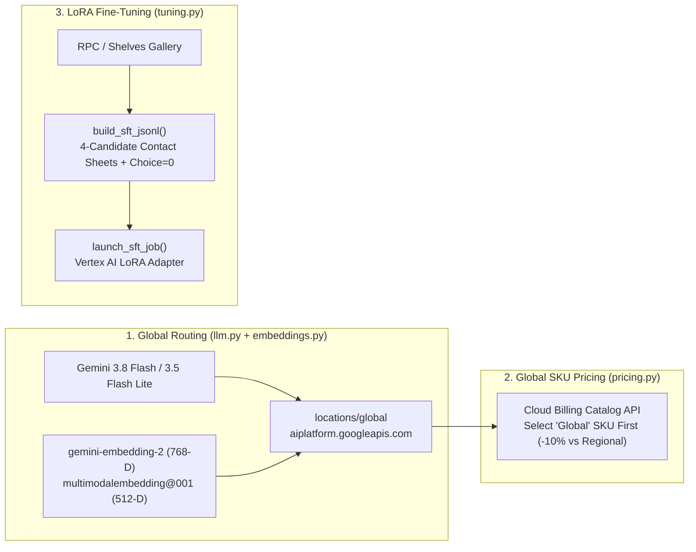
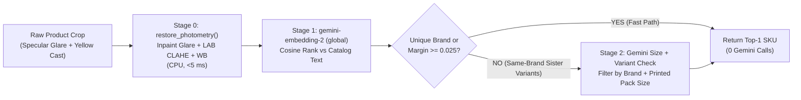
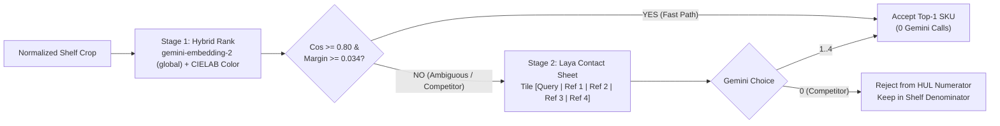
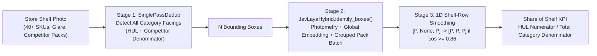
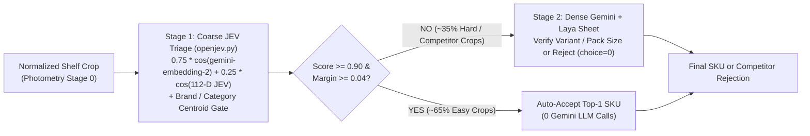
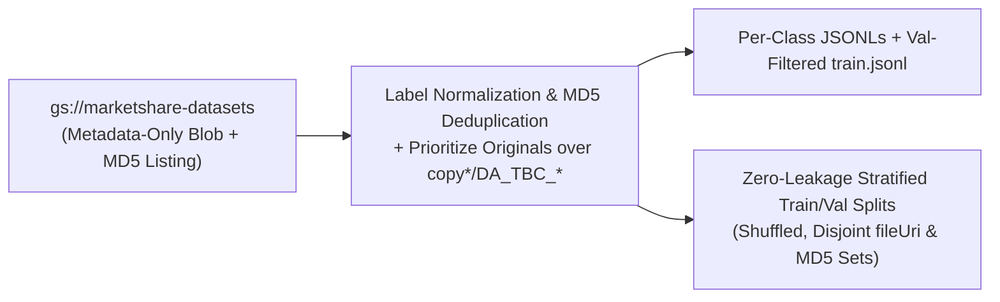

# Shelf Benchmark: reference

Details behind the [README](../README.md): onboarding cookbook for new approaches, how cost is
computed, the Priority and Flex tiers, how to back retrieval with a vector database, and what telemetry
records.

## Onboarding cookbook: 4 patterns for adding & benchmarking an approach

Every approach lives under `src/approaches/<use_case>/<task>/` and is auto-discovered by
[`approaches/base.py`](../src/approaches/base.py). Pick the pattern that matches your model:

| Pattern | Where to put it | What to implement | Copy from |
|---------|-----------------|-------------------|-----------|
| **1. Standalone detector / classifier / retriever** | `market_share/{detection,classification,retrieval}/` | `@register` subclass with `detect(image, ctx)` or `identify(image, ctx, allowed_ids=None)` | [`single_pass_dedup.py`](../src/approaches/market_share/detection/single_pass_dedup.py), [`hierarchy_classify.py`](../src/approaches/market_share/classification/hierarchy_classify.py), [`embedding_retrieval.py`](../src/approaches/market_share/retrieval/embedding_retrieval.py) |
| **2. Multi-step composition** (`detect -> retrieve`, `detect -> classify`, or `detect -> classify -> retrieve`) | `market_share/end_to_end/` | `compose("my_e2e", DetectorCls, *IdentifierClasses, dataset="shelves")`: intermediate classifiers filter the catalog via `narrow(image, catalog, ctx) -> set[int]` | [`detect_identify.py`](../src/approaches/market_share/end_to_end/detect_identify.py) |
| **3. Single-invocation detect + classify** (e.g. fine-tuned Gemini or Agent Platform endpoint returning boxes + `sku_id`s in 1 call) | `market_share/end_to_end/` | `@register` subclass with `task = "end_to_end"` and `detect_and_identify(image, ctx) -> (boxes, sku_ids)` | [`_single_call_end_to_end_template.py`](../src/approaches/market_share/end_to_end/_single_call_end_to_end_template.py) |
| **4. Custom / non-Gemini model** (e.g. YOLO, DiffusionGemma, Vertex endpoint) | Any task folder | Set `models = ["my-model-id"]` (and `also_calls = [...]` if hybrid), initialize your client/weights in `setup(config, ctx)`, and optionally bill non-Gemini SKUs with `ctx.bill(unit, amount)` | [`embedding_retrieval.py`](../src/approaches/market_share/retrieval/embedding_retrieval.py) |

**4-step verification & benchmark checklist:**
1. **Check registration:** `.venv/bin/shelf-bench list` (confirms use case, task, dataset, and accepted models).
2. **Smoke test on `val`:** `make run A=my_approach M=gemini-3.5-flash-lite ARGS="--split val --limit 5"` and inspect in `make ui`.
3. **Add an offline unit test:** Add a test in the matching file under [`tests/`](../tests/) (`test_detection.py`, `test_classification.py`, `test_retrieval.py`, or `test_end_to_end.py`) and run `make lint && make test`.
4. **Run official Cloud Run benchmark:** `make cloud A=my_approach M=gemini-3.5-flash-lite` (builds the container, runs on Cloud Run, prices every SKU from the Cloud Billing Catalog API, pulls `results/<run_id>/`, and ranks it on the leaderboard).

## How cost per image is calculated

Every number comes from GCP itself; no prices are hard-coded ([pricing.py](../src/utils/pricing.py)).

| Part | Quantity (measured) | Price (source) |
|------|---------------------|----------------|
| Gemini | Every response's `usage_metadata`: tokens split by **traffic type Vertex actually served** (standard / priority / flex), modality (text / image), cached vs uncached, and output + thinking | The matching SKU in the **Cloud Billing Catalog API**, fetched at the start of each run (e.g. `Gemini 3.8 Flash Global Image Input Priority - Predictions`) |
| Promotional credit | Gemini list cost | `promotions` in `config.yaml` (Gemini 3.x Flash: 50% credit back until 2026-12-31). Promotions are paid back as billing credits, so they are not in the catalog |
| Other APIs (embeddings) | What the approach bills with `ctx.bill(unit, amount)` | The Billing Catalog SKUs the approach lists in `skus` |
| Cloud Run | Task start → completion from the **Cloud Run Admin API**, rounded up to 100 ms, × vCPU and GiB | `Jobs CPU in <region>` / `Jobs Memory in <region>` catalog SKUs |
| Cloud Storage | 1 read per image + the annotations file, 2 result writes | `Regional Standard Class A/B Operations` SKUs (paid rate) |
| ₹ |: | The USD→INR rate GCP billing uses (catalog `currencyConversionRate`) |

A Cloud Run task can't know its own billed duration, so it stores a provisional compute figure;
`shelf-bench pull` (run automatically after `cloud-run`) replaces it with the real task
duration and writes the final summary back to GCS. Each run's summary stores the full price
sheet (SKU ids, prices, fetch time), so any cost can be audited.

An approach that bills a unit it didn't list in `skus` fails loudly rather than under-reporting.
What `setup()` bills (e.g. embedding the reference gallery once) is the run's setup cost, shown on
the run page and not in cost/img.

Not included: Cloud Build (one image build per `cloud-run` call, not per image), monthly free
tiers, taxes, negotiated discounts, and instance-hour services such as AlloyDB (a fixed monthly
cost, not per image). The exact invoiced amount is only in the Cloud Billing BigQuery export.
Local runs (`shelf-bench run`) price Gemini and other APIs only and are for development.

## Priority and Flex PayGo

All 16 Gemini approaches run on the [Priority PayGo](https://cloud.google.com/vertex-ai/generative-ai/docs/priority-paygo)
tier by default (`tier: [priority]` in `config.yaml`), and any run can also target Standard
(`-t standard`) or [Flex PayGo](https://cloud.google.com/vertex-ai/generative-ai/docs/flex-paygo)
(`-t flex`). Priority costs **1.8x** Standard PayGo per token across all token buckets (`text_input`,
`image_input`, `cached_text_input`, `cached_image_input`, and `output` + `thinking_tokens`) and aims
for lower, steadier latency; Flex costs **0.5x** per token in exchange for longer, less predictable
latency and more throttling, which suits batch shelf processing (nobody waits on a market-share
report per photo). No setup is needed beyond the request headers (`X-Vertex-AI-LLM-Request-Type: shared`,
`X-Vertex-AI-LLM-Shared-Request-Type: priority`), which `llm.py` sends automatically by default.
Both work on the global endpoint only.

```bash
shelf-bench cloud-run -a shelf_detect_retrieve shelf_detect_tiered -m gemini-3.5-flash-lite \
                      -t priority flex              # 4 runs; priority is default (-t priority)
```

Vertex can downgrade a priority or flex request to standard when capacity is short. Each call's
`trafficType` is recorded, and downgraded calls (`ON_DEMAND`) are billed at 1.0x standard rates.
When a dedicated Priority SKU is absent from the Cloud Billing Catalog (or for custom/tuned
endpoints), `pricing.py` derives `priority/<kind>` at `1.8x` the `standard/<kind>` rate
(`PRIORITY_MULTIPLIER = 1.8`). The run summary's `priority_served` / `flex_served` field is the
share of calls actually served at that tier.

## Retrieval with a vector database (AlloyDB)

[embedding_retrieval.py](../src/approaches/market_share/retrieval/embedding_retrieval.py) keeps RPC's 800 reference
vectors in memory (built in `setup`; a Python loop is enough at that size).
[_detect_retrieve_template.py](../src/approaches/market_share/end_to_end/_detect_retrieve_template.py) is the same pipeline
with the vectors in AlloyDB, which a real catalog of thousands of products needs (the leading `_`
keeps it off the CLI until a database exists):

```python
class DetectRetrieveAlloyDB(EmbeddingRetrieval):
    task, also_calls = "end_to_end", [MODEL]
    skus = embeddings.SKUS                        # extra Billing Catalog SKUs priced at run start

    def setup(self, config, ctx):                 # once per run, before any image
        self.emb = embeddings.VertexEmbeddings(config, model=MODEL)
        self.db = AlloyDB(**config["alloydb"])

    def detect(self, image, ctx):
        return gemini_detect(image, ctx)          # boxes; the runner crops each one

    def identify(self, crop, ctx):
        v = pgvector(self.emb.image(crop, ctx))
        rows = self.db.query(VECTOR_SQL, (v, v))  # your SQL: vector, hybrid, anything
        return int(rows[0][0]) if rows else None
```

The approach owns everything that changes between experiments (embedder, where the vectors live,
the search); nothing outside `approaches/` needs to change. A hybrid (vector + full-text,
reciprocal-rank fusion) query is in the template's comments.
[utils/alloydb.py](../src/utils/alloydb.py) runs SQL through the
[AlloyDB Python Connector](https://cloud.google.com/alloydb/docs/connect-language-connectors) (IAM
auth, encrypted, no passwords); `pgvector(vec)` formats a vector parameter.

**To turn it on once an AlloyDB instance exists:**
1. Run the setup SQL in the docstring of [alloydb.py](../src/utils/alloydb.py): the `vector`
   extension, a `products (id, embedding vector(512), ...)` table, and a ScaNN index.
2. Grant the Cloud Run job's service account `roles/alloydb.client` and
   `roles/serviceusage.serviceUsageConsumer`, and create an IAM database user for it.
3. Load the RPC reference-photo embeddings made with the **same** embedder as the approach
   (512-d), with `id` = the RPC product id.
4. Fill the `alloydb:` section of `config.yaml`. For a private-IP instance also set
   `cloud_run.network` / `cloud_run.subnet` (Direct VPC egress).
5. Copy the template to `src/approaches/market_share/end_to_end/detect_retrieve_alloydb.py` (no `_`) and run it like any other approach.

## Telemetry (Cloud Trace + Cloud Logging)

Every run, local or Cloud Run, is **one OpenTelemetry trace** in Cloud Trace
([telemetry.py](../src/utils/telemetry.py)). Each span also writes one Cloud Logging entry
(log `shelf-bench`) with the same fields, linked to its span:

| Span | What it records |
|------|-----------------|
| `run <run_id>` | approach, model, tier, split / limit / seed, owner, Cloud Run execution + task; at the end F2, recall, precision, p50/p95/p99, cost/img, total tokens, traffic served |
| `image <image_id>` | gt / pred / tp / fp / fn, F2, latency, cost (net + list + other APIs), tokens, error (span status = ERROR); each `ctx.trace.step` is a span event |
| `gemini <model>` | `gen_ai.usage.input_tokens` / `output_tokens`, thinking tokens, image vs text vs cached input tokens, traffic type Vertex actually served, tier requested, attempts + one `retry` event per 429/5xx, finish reason, response id / model version, temperature / max tokens / thinking level, image size and JPEG bytes, model latency, cost. Its log entry also has the **prompt and response text** |
| `embedding <model>` | one per crop / text embedded while scoring an image: model, image or text, dimension, latency, attempts, billed units (`shelf_bench.billed.*`). Reference-photo embeddings in setup are billed but not traced |

Links are stored with the results and shown on the run page:

* `summary.json["telemetry"]`: `trace_id`, `trace_url` (Cloud Trace), `logs_url` (every
  entry of the run) and, on Cloud Run, `task_logs_url` (the task's full stdout/stderr).
* each row of `images.jsonl` has `telemetry` with that image's span (`span_id`, `trace_url`,
  `logs_url`).
* each call recorded on a step in `images.jsonl` carries its `span_id`, so the run page's
  **Load Cloud Trace + Logging into the steps** ([audit.py](../src/utils/audit.py)) puts every
  span and log entry on the exact step it belongs to (older runs: matched by timestamp).

Handy Logs Explorer queries: `logName="projects/unilever-shelf-understanding/logs/shelf-bench"
jsonPayload.event="gemini_call" jsonPayload."shelf_bench.attempts">1` (retried calls),
`jsonPayload."shelf_bench.truncated"=true` (output hit the token limit), `severity>=ERROR`.

Approaches get all of this for free through `ctx.ask` and `ctx.trace.step`. Writing needs
`roles/cloudtrace.agent` + `roles/logging.logWriter`, and viewing needs `roles/cloudtrace.user` +
`roles/logging.viewer`. Logs take up to a minute to show up. To turn it off, set
`telemetry.enabled: false` in `config.yaml` or `SHELF_BENCH_TELEMETRY=0`. Tests never export.

## Global Vertex AI Endpoints, Global Billing & LoRA SFT



### 1. Global Endpoint Routing ([`src/utils/llm.py`](../src/utils/llm.py), [`src/utils/embeddings.py`](../src/utils/embeddings.py))
* **Rule:** Route all model calls to the `global` Vertex AI endpoint (`https://aiplatform.googleapis.com/v1/projects/{project}/locations/global/...`) by default.
* **Reason 1 (Latency & Quota):** The `global` endpoint routes traffic across available regions and avoids single-region quota exhaustion.
* **Reason 2 (Model Availability):** GA `gemini-embedding-2` requires the `global` endpoint (`us-central1` returns `404 Not Found`). Both `gemini-embedding-2` (`768-dim`) and `multimodalembedding@001` (`512-dim`) run on `locations/global`.
* **Reason 3 (Lower Cost):** Global region SKUs in the Cloud Billing Catalog cost **10% less** than Regional SKUs (for example, `$0.30 / 1M` vs. `$0.33 / 1M` image input tokens on `gemini-3.5-flash-lite`).

### 2. Global Region SKU Pricing ([`src/utils/pricing.py`](../src/utils/pricing.py))
* **Rule:** `price_sheet()` queries `sku_description(base_model, "global", tier, kind)` first in the Cloud Billing Catalog API.
* **Fallback:** The lookup falls back to a regional SKU only if a global SKU does not exist for that model.

### 3. Parameter-Efficient LoRA SFT Pipeline ([`src/utils/tuning.py`](../src/utils/tuning.py))
* **Step 1 (`build_sft_jsonl`):** Build Laya 4-candidate visual contact sheets from the reference gallery, including `20%` negative examples (`{"choice": 0}`) for open-world competitor rejection, and upload `train.jsonl` and `val.jsonl` to GCS.
* **Step 2 (`launch_sft_job`):** Submit a parameter-efficient LoRA supervised fine-tuning job on Vertex AI (`adapter_size` in `{1, 4, 8, 16}`).
* **Step 3 (`resolve_model`):** Route `-sft` model aliases in `config.yaml` to the tuned endpoint while billing tokens at the base model's `Global` SKU rate.

## Stage 0 Photometry & `djev_classify` Hierarchy Classifier



### 1. Why Photometry Runs at Stage 0 ([`src/utils/photometry.py`](../src/utils/photometry.py))
* **Problem:** Store lights create white specular glare on glossy packs and warm yellow color casts.
* **Effect on Models:** Glare hides printed pack sizes (`10g` vs. `60g`) and shifts package colors away from studio catalog photos.
* **Action (`restore_photometry`):** Detect saturated low-chroma glare regions (`L >= 242`), inpaint localized glare from surrounding package pixels, and normalize contrast on the CPU in under `5 ms`.

### 2. How `djev_classify` Identifies Brand, Variant, and SKU ([`src/approaches/market_share/classification/djev_classify.py`](../src/approaches/market_share/classification/djev_classify.py))
* **Step 1 (Global Embedding Shortlist):** Embed the restored crop with `gemini-embedding-2` (`global` endpoint) and rank all catalog items by cosine similarity.
* **Step 2 (Fast-Path Gate):** Accept the top-1 SKU immediately (with **zero Gemini calls**) when the brand has only one product in the catalog, when rank-1 and rank-2 belong to different brands, or when the cosine margin is `>= 0.025`.
* **Step 3 (Sister-Variant Verification):** When rank-1 and rank-2 belong to the same brand within `< 0.025` margin, filter the catalog to that brand, read the printed pack size (`10g`, `130ml`, `1kg`) with Gemini, and select the exact SKU.

## `jev_laya_hybrid` Visual Retrieval & Contact-Sheet Verifier



### 1. How `jev_laya_hybrid` Differs from Public OpenJEV & Laya ([`src/approaches/market_share/retrieval/jev_laya_hybrid.py`](../src/approaches/market_share/retrieval/jev_laya_hybrid.py))
* **Public Baseline Limitation:** Public OpenJEV returns the top-1 cosine neighbor for every crop, and public Laya calls Gemini on every crop.
* **Our Hybrid Step 1 (Embedding + CIELAB Margin Gate):** Rank the reference gallery with `gemini-embedding-2` (`global`) plus CIELAB chromatic histograms. Accept the top-1 SKU immediately when `cos >= 0.80` and `margin >= 0.034` (or `cos >= 0.90` and `margin >= 0.020`).
* **Our Hybrid Step 2 (Laya `K=4` Contact Sheet):** For ambiguous crops, tile the query crop next to its top-4 gallery photos (`[1]..[4]`) in one composite image (up to `8` crops batched per Gemini call).
* **Our Hybrid Step 3 (`choice = 0` Competitor Rejection):** If the crop is a non-HUL competitor product, Gemini returns `{"choice": 0}` and rejects the false match.

## End-to-End Share-of-Shelf Composition (`detect_jev_laya` & `shelf_jev_laya`)



### 1. End-to-End Operation ([`src/approaches/market_share/end_to_end/detect_identify.py`](../src/approaches/market_share/end_to_end/detect_identify.py))
* **Stage 1 (Category-Agnostic Detection):** `SinglePassDedup` detects every visible bottle, box, or pouch on the shelf (`HUL` and competitor packs) so the **Total Category Denominator** is complete.
* **Stage 2 (Batched Identification):** `JevLayaHybrid.identify_boxes()` normalizes each crop, resolves high-margin crops via `gemini-embedding-2` (`global`), groups adjacent identical uncertain crops (`cos >= 0.92`), and verifies one sharpest representative crop per group in batched `4-row` Laya contact sheets.
* **Stage 3 (Competitor Middle Bottle Rule):** When a middle bottle is a non-HUL competitor product, Gemini returns `0` (`None`). The facing remains in the total shelf denominator and is excluded from the HUL numerator.
* **Stage 4 (Visually Gated Row Smoothing):** Fill an abstained interior facing `[P, None, P] -> [P, P, P]` only when its embedding cosine with both flanking neighbors is `>= 0.86`.

## Two-Stage Coarse JEV Triage + Dense Gemini (`coarse_jev_gemini`, `coarse_jev_laya`, `detect_coarse_jev_gemini`)



### 1. Why Split Coarse Triage and Dense Verification ([`src/utils/openjev.py`](../src/utils/openjev.py))
* **Problem on 40-SKU Shelves:** Calling a generative LLM on all 40 shelf crops takes over `25 seconds` per image, while pure embedding search confuses sister sizes (`10g` vs. `60g`) and competitor bottles.
* **Stage 1 (`coarse_jev_triage`):** Combine the `768-dim` `gemini-embedding-2` vector (`global` endpoint) with our `112-dim` JEV visual descriptor (`64-dim` `8x8` spatial Gram matrix + `48-dim` RGB/LAB color histogram and edge sharpness) and narrow the catalog by brand/category centroid similarity.
* **Fast-Path Gate:** When top-1 combined similarity is `>= 0.90` and the margin over rank-2 is `>= 0.04`, assign the SKU immediately with **zero Gemini calls** (`~65%` of shelf crops).
* **Stage 2 (Dense Gemini Escalation):** Send only the remaining `~35%` ambiguous, occluded, sister-size, or competitor crops to `gemini-3.5-flash-lite` (`coarse_jev_gemini`, `coarse_jev_laya`, `detect_coarse_jev_gemini`).
* **Benchmark Result (`ul-fs-s-sandbx-16-prj`):** `detect_coarse_jev_gemini` reaches **`0.871` End-to-End F2** at **`5.3s` p95 latency** (`₹0.215/img`), and `coarse_jev_laya` reaches **`0.900` Retrieval F2** at **`3.0s` p95 latency**.

## `gs://marketshare-datasets` Supervised Fine-Tuning (SFT) JSONL Methodology ([`src/utils/tuning.py`](../src/utils/tuning.py))

All three hierarchical classification datasets in `gs://marketshare-datasets` (`pack_data`, `brand_data`, and `input_data`) are prepared using **GCS object metadata only** (`list_gcs_image_blobs()` / `list_gcs_image_uris()`: never downloading or modifying image bytes) and formatted in Vertex AI Gemini Supervised Fine-Tuning `GenerateContent` JSONL schema:



### 1. Pack Classification (`pack_data/pack/train/` → `pack_data/pack/jsonl/`)
* **Source Structure:** 46 `<Category>__<PackType>` directories (`98,488` raw images across 10 categories and 14 pack types).
* **Copy / Synthetic Filtering (`is_copy_or_synthetic`, `_prioritize_originals`):** Prioritizes original crops ahead of `copy*.jpg`, Windows Explorer copies (`- Copy.jpg`, `(copy).jpg`, `0 (2).jpg`), and synthetic color-jittered `DA_TBC_*.jpg` crops so synthetic/duplicate files never leak into `val_stratified.jsonl`.
* **Target JSON:** `{"category": "<Category>", "pack_type": "<PackType>"}` (`PACK_PROMPT`).
* **Outputs (`build_marketshare_pack_jsonl`):**
  * 46 per-folder `<Category>__<PackType>.jsonl` files + val-filtered, MD5-deduplicated `train.jsonl` (`90,042` examples, excluding all `val_stratified` URIs and MD5s).
  * `val_stratified.jsonl` (`445` examples: 10% of originals per class bounded to `5-10` examples) and `train_stratified.jsonl` (`5,239` examples: up to `120` non-overlapping examples per class), both shuffled with `seed=42`.

### 2. Brand Classification (`brand_data/brand/brand_data/` → `brand_data/brand/jsonl/`)
* **Source Structure:** 941 raw directories (`522,102` raw images, ~555 images/folder with `copy*.jpg` and `- Copy.jpg` augmentations).
* **Label Cleaning (`clean_brand_name`):** Strips artificial leading `A` / `A_` alphabetical sort prefixes on 222 folders (`ADove` → `Dove`, `A_3_roses` → `3_roses`), merging 7 duplicate folder pairs (`ADr_Wash`/`Dr_Wash`, `AGenteel`/`Genteel`, `AMr_Muscle`/`Mr_Muscle`, `AMysore_Sandal`/`Mysore_Sandal`, `ARevive`/`Revive`, `ASafe_Wash`/`Safe_Wash`, `AVanish`/`Vanish`) into **934 canonical brand classes**.
* **Original-First & MD5 Deduplication (`_prioritize_originals`):** Deduplicates on GCS `b.md5_hash` metadata and partitions each brand's URIs so non-copy originals are sampled ahead of `copy*` / `- Copy` duplicates.
* **Target JSON:** `{"brand": "<Brand>"}` (`BRAND_PROMPT`).
* **Outputs (`build_marketshare_brand_jsonl`):**
  * 934 per-brand `<Brand>.jsonl` files + val-filtered, MD5-deduplicated `train.jsonl` (`425,133` examples).
  * `val_stratified.jsonl` (`1,844` examples: up to `2` unique-MD5 originals per brand) and `train_stratified.jsonl` (`7,317` examples: up to `10` unique-MD5 examples per brand), zero URI/MD5 overlap, shuffled with `seed=42`.

### 3. Category / Brand / Variant Classification (`input_data/variant_[category]/train/` → `input_data/jsonl/`)
* **Source Structure:** 5 category trees (`variant_gen`, `variant_oral`, `variant_p5`, `variant_skin`, `variant_wash`) containing `1,104` raw `<Brand>__<Variant>` folders (`381,619` raw images across 5 categories and 57 brands).
* **Label Cleaning & Promo Suffix Stripping (`clean_variant_name`, `parse_variant_folder`):** Normalizes stray spaces (`_ ` → `_`) and repeated underscores (`__` → `_`), and strips price/promo/artwork suffixes (`_Rs_10`, `_Rs_5`, `_B3G1`, `_PO3`, `_Pack_Of_2`, `_New`, `_Old`, `_1Old_pack`) into **`1,068` canonical `(category, brand, base_variant)` classes**.
* **Multi-Task Stratified Outputs (`build_marketshare_variant_jsonl`):**
  * 1,068 per-class `<category>__<Brand>__<Variant>.jsonl` files + val-filtered, MD5-deduplicated `train.jsonl` (`331,734` examples).
  * **Joint All-3 (`--task all3`):** `train_stratified.jsonl` (`8,115` lines, up to `8`/class) & `val_stratified.jsonl` (`2,128` lines, up to `2`/class) → `{"category": "...", "brand": "...", "variant": "..."}`.
  * **Category-Only (`--task category`):** `train_category_stratified.jsonl` (up to `5`/class) & `val_category_stratified.jsonl` (up to `1`/class) → `{"category": "..."}`.
  * **Brand-Only (`--task brand`):** `train_brand_stratified.jsonl` (up to `100`/brand) & `val_brand_stratified.jsonl` (up to `10`/brand) → `{"brand": "..."}`.
  * **Brand + Variant (`--task variant`):** `train_variant_stratified.jsonl` (`8,115` lines, up to `8`/class) & `val_variant_stratified.jsonl` (`2,128` lines, up to `2`/class) → `{"brand": "...", "variant": "..."}` (autoregressively predicts `"brand"` before `"variant"`).

### 4. Rebuilding via CLI
```bash
# Build local + upload GCS SFT JSONLs for pack, brand, or variant datasets:
shelf-bench tune --dataset pack --build-only
shelf-bench tune --dataset brand --build-only
shelf-bench tune --dataset variant --task all3 --build-only
```
